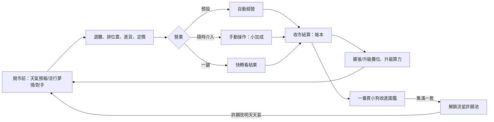

# 線條小狗模擬城市 — 手機遊戲企劃 v0.3

> 名稱說明：「線條小狗」是他人的角色名稱，「模擬城市」是 SimCity 的中文商標名稱。目前只給自己和朋友私下玩，日後若公開發布，需要改名。

> 給 Kai 和朋友玩的益智／策略小遊戲。第一版做免費 PWA，之後交給 Koda 實作。

## 1. 一句話概念

白色垂耳小狗老闆帶著調皮的咖啡色搭檔，在一條奇幻夜市裡賣夢境冰淇淋、天氣罐頭、心情充電。玩家要看天氣和人潮決定開什麼攤、進多少貨、賣多少錢，經營一番賞和 AI 算命攤，跟隔壁的 AI 對手搶客人，把一個小攤做成整條夜市。

> **版權說明**：兩隻小狗都是**我們自己設計的原創角色**（線條手繪風），**不是**「線條小狗」本尊，也不使用它的名字、造型或周邊圖案。

## 2. 核心循環（一天怎麼玩）

1. **開市前**：看明天天氣／節日預報和「今日流行夢境」，也看得到隔壁對手攤昨天的品項和價格 → 選攤、排攤位位置、進貨、定價（一番賞攤選箱子和一抽價格）。
2. **營業**（約 60–90 秒）：**預設自動跑**，客人依人潮與價格上門。玩家**隨時可以介入手動操作**，有小加成；也可以**一鍵快轉**直接看結果。
3. **收市結算**：帳本顯示每攤營收、成本、報廢／庫存、一番賞剩籤、充電站帶來的加成，以及跟對手攤的客人比例；小狗收進圖鑑；用錢擴張或升級。

### 營業階段：自動＋手動

| 手動操作 | 效果（可調） | 限制 |
|---|---|---|
| 加快出餐（點攤位） | 該攤服務速度 +20%，持續 10 秒 | 冷卻 15 秒 |
| 臨時降價 | 當場改價，立刻影響來客 | 每攤每天 1 次 |
| 招攬客人（點路過的客人） | 該客人上門機率 +15% | 每次點擊限一位 |

- 手動加成控制在**全天營收約 +5–15%**，不操作也玩得下去，想多賺可以動手。
- **一鍵快轉** = 只用自動經營跑完剩下的時間，馬上進結算。
- 不管自動還是手動，結果都由同一套模擬邏輯算出來（見第 5 節）。

## 3. 系統規則

> 以下數字都是**可調整的初始參數**，統一放在 `config.json`，試玩後再微調。每個攤位都寫成一份設定（進價、售價、係數、特殊規則），**Kai 之後可能再提出新攤位**，新增時只要加一份設定和對應的規則函式。

### 3.0 共通規則

- **來客數** = 基礎人潮 × 天氣係數 × 節日係數 × 攤位專屬係數 × 價格係數。
- **價格係數**：比建議價貴，客人就少（例：`(建議價 / 定價)^1.5`）。
- **擴張**：夜市有 6–8 個攤位格，用賺的錢買新格子或升級攤位。攤位**位置有意義**（見心情充電站）。
- **時段**：一晚分成前段、中段、後段，各占 1/3（星星烤串會用到，其他攤位暫不分時段）。

### 3.1 MVP 要放幾種攤位？

**建議：MVP 放 5 種**，就是 3 種奇幻攤位＋AI 算命攤＋一番賞攤。時光扭蛋機和星星烤串放到 v1.1，當第一批新攤位。

| | 攤位 | 版本 | 主要考驗 |
|---|---|---|---|
| 1 | 夢境冰淇淋 | MVP | 進貨量、會融化報廢 |
| 2 | 天氣罐頭攤 | MVP | 反著看天氣、賭預報 |
| 3 | 心情充電站 | MVP | 攤位擺放、帶動其他攤 |
| 4 | AI 算命攤 | MVP | 算力（產能）與成本 |
| 5 | 一番賞攤 | MVP | 換箱時機、定價 |
| 6 | 時光扭蛋機 | v1.1 | 收集 |
| 7 | 星星烤串 | v1.1 | 時段定價 |

**理由**
- MVP 這 5 種**每一種考驗的決策都不一樣**，策略面已經夠完整。
- **時光扭蛋機跟一番賞重疊**：兩個都是抽獎＋收集，第一版同時放會分散焦點，也要多畫一套回憶照片。
- **星星烤串需要「時段」系統**（後段才開賣、越晚越貴），是新的一層機制。等核心玩法穩定再加比較好調。
- 攤位少，美術和調參數的工作量也少，Koda 可以更快做出能玩的版本。

### 3.2 各攤位機制

**① 夢境冰淇淋（MVP）**：口味是客人昨晚做的夢，例如飛起來味、考試遲到味、被狗狗包圍味、掉牙味。
- 進價 20／球，建議售價 45–65。
- 每天早上公布 1–2 個「**今日流行夢境**」：該口味需求 ×1.5，其他口味 ×0.8。每天最多上架 3 種口味（第一版共 6 種口味）。
- 客人吃到自己夢到的口味，會多給 30% 小費（隨機，約 20% 的客人）。
- 冰淇淋會融化，**當天沒賣完全部報廢**。
- 天氣：熱 ×1.4、晴 ×1.1、冷 ×0.6、雨 ×0.7。

**② 天氣罐頭攤（MVP）**：賣罐裝的晴天、微風、暖陽、雨滴。**大家想買的是跟今天相反的天氣。**
- 進價 15／罐，建議售價 35–55。
- 對應關係：雨天 → 晴天罐最好賣；熱天 → 微風罐；冷天 → 暖陽罐；晴天 → 雨滴罐（但需求整體比較低）。
- 對應罐 ×1.8，其他罐 ×0.5。
- 天氣看的是**實際天氣**，預報只有約 80% 準，所以要決定押單一種罐子，還是多種分散。
- 罐頭**不會報廢**，但倉庫上限 40 罐，囤太多會佔位、卡資金。

**③ 心情充電站（MVP）**：客人把尾巴插上去充電，充過電的客人心情變好，到別的攤位會花更多錢。
- 不用進貨，每次充電成本 3（電費），建議售價 15–35。
- 一次可以充 4 位客人，每位 15 秒（遊戲內時間）。
- **帶動加成**：充過電的客人到**左右相鄰**的攤位消費 +20%，到其他攤位 +5%，效果維持到收市。
- 策略點：充電站本身賺得不多，但放在冰淇淋、算命攤中間能拉高整條街的營收，也可以考慮低價衝人數。
- 天氣：雨 ×1.3（下雨心情差）、其他 ×1.0。

**④ AI 算命攤（MVP，原設計保留）**：機器人小狗用「AI」幫客人算命，順便畫一張 Q 版畫像。很吸客，但要花錢升級「算力」，算力不夠，客人排太久就會走掉。

| 參數（可調） | Lv1 | Lv2 | Lv3 |
|---|---|---|---|
| 升級費用 | 開攤 1,200 | 1,500 | 4,000 |
| 服務速度（客人／分鐘，遊戲內時間） | 6 | 10 | 15 |
| 每日電費（固定成本） | 50 | 100 | 180 |

- **售價**：建議 60–100／次（參考值 80），每次變動成本 5。
- **人潮**：基礎人潮 ×1.6（全夜市最吸客）；雨天 ×1.2（躲雨順便算命）。
- **排隊流失**：每位客人的耐心是 20 秒（遊戲內時間），等超過就離開；隊伍最多排 12 人，滿了新客人直接不排。
- **策略點**：算力太低 → 人多但大量流失；升太高 → 電費吃掉利潤。要看人潮（週末、節日）決定升到哪一級。
- **內容（第一版不接付費 API）**：算命用預寫的文字模板隨機組合，例如「今日運勢（大吉／中吉…）＋幸運攤位＋一句建議」，先準備約 30 句。Q 版畫像用預先畫好的部件（臉型、髮型、配件）隨機拼出來。

**⑤ 一番賞攤（MVP，原設計保留）**：見 3.3。

**⑥ 時光扭蛋機（v1.1）**：扭出小狗的回憶照片（例：第一次擺攤、下雨天一起躲雨），可以收進圖鑑的「回憶相簿」。
- 每顆進價 8，建議售價 30–50。
- 跟一番賞不一樣：**沒有箱子、扭不完**，每張照片機率相同，總共 12 張。玩家主要在決定定價，以及要不要自己扭來收集。
- 相簿集滿 12 張，解鎖一張夜市裝飾（例：照片牆）。
- 天氣：雨 ×0.8，其他 ×1.0；節日 ×1.3。

**⑦ 星星烤串（v1.1）**：用夜空摘下來的星星烤成串，**只在後段開賣**，越晚越亮也越貴。
- 進價 25／串，基礎售價 50–70。
- 後段再細分成 3 小段，售價自動 ×1.0 → ×1.3 → ×1.6，需求 ×1.0 → ×0.9 → ×0.8（越晚越貴，但人也越少）。
- 晴 ×1.3、熱 ×1.0、冷 ×1.1、雨 ×0.4（看不到星星）。
- 當晚沒賣完的星星會散掉，全部報廢。
- 策略點：前段和中段這一格是空的，要決定值不值得留一格給它。

### 3.3 一番賞攤

老闆自己花錢向批發商進一整箱籤，箱內各賞數量固定，抽完為止。

**範例箱：「線條小狗模擬城市 第一彈」80 抽**

| 賞 | 數量 | 單件進價 | 小計 | 獎品範例 |
|---|---|---|---|---|
| A 賞 | 1 | 600 | 600 | 廟會小狗（大型） |
| B 賞 | 3 | 150 | 450 | 夢境冰淇淋小狗、星空睡帽小狗 |
| C 賞 | 8 | 50 | 400 | 睡衣小狗等吊飾 |
| D 賞（一般） | 68 | 15 | 1,020 | 貼紙、小卡 |
| 最後賞 | 1 | 200 | 200 | 抽到最後一張的人另外拿 |
| **整箱進價** | | | **2,670** | |

- **建議一抽售價**：45–70（參考值 50）。一抽 50 全部抽完營收 4,000，利潤約 1,330。
- **人潮**：A 賞還在 ×1.5；A 賞被抽走 ×1.0；A、B 都沒了 ×0.6；剩 10 抽以內，最後賞再吸一點人（×1.2）。天氣影響小（雨 ×0.9）。
- **老闆要決定**：什麼時候換箱、剩籤要不要降價出清、換哪一款箱。
- **剩籤退回**：剩下的籤可以退回批發商，拿回 30% 進價。**（已確認保留）**
- **帳本**：每一箱分開記錄進價、已抽數、營收、利潤。
- **自抽**：老闆可以花遊戲幣自己抽來收集圖鑑（也算這箱的銷售）。

### 3.4 天氣與節日

**全夜市人潮**

| 狀況 | 人潮係數 |
|---|---|
| 晴 | ×1.0 |
| 熱 | ×1.0 |
| 冷 | ×0.9 |
| 雨 | ×0.6 |
| 週末 | ×1.3 |
| 節日（中秋、元宵、跨年等） | ×1.8，可搭配限定小狗造型 |

**各攤位天氣係數**（會跟全夜市人潮相乘）

| 攤位 | 晴 | 熱 | 冷 | 雨 |
|---|---|---|---|---|
| 夢境冰淇淋 | ×1.1 | ×1.4 | ×0.6 | ×0.7 |
| 天氣罐頭攤 | 雨滴罐 ×1.8 | 微風罐 ×1.8 | 暖陽罐 ×1.8 | 晴天罐 ×1.8 |
| 心情充電站 | ×1.0 | ×1.0 | ×1.0 | ×1.3 |
| AI 算命攤 | ×1.0 | ×1.0 | ×1.0 | ×1.2 |
| 一番賞攤 | ×1.0 | ×1.0 | ×1.0 | ×0.9 |
| 時光扭蛋機（v1.1） | ×1.0 | ×1.0 | ×1.0 | ×0.8 |
| 星星烤串（v1.1） | ×1.3 | ×1.0 | ×1.1 | ×0.4 |

天氣罐頭攤沒對上天氣的罐子是 ×0.5；天氣罐頭看的是實際天氣，其他攤位的進貨要靠預報判斷。天氣預報的準確率大約 80%，保留一點運氣成分。

### 3.5 AI 對手攤（隔壁攤）

隔壁攤由電腦經營，跟玩家看同一份天氣預報和流行夢境，玩家得想辦法反制。決策規則刻意做得簡單、看得懂：

1. **選品**（只從 3 種奇幻攤位裡選）：
   - 預報熱或晴 → 夢境冰淇淋（固定上架當日流行夢境口味）。
   - 預報雨或冷 → 天氣罐頭攤，**只押預報對應的那一種罐子**。
   - 平常日開 1 攤；週末和節日多開 1 個心情充電站，放在自己攤位旁邊（只加成自己的攤）。
2. **進貨**：預估需求 × 1.1。
3. **開市定價**：建議價的中間值；如果玩家昨天同品項的價格比它便宜，就定成玩家昨天的價格 −5。最低不會低於進價 × 1.2。
4. **營業中**（只在中場調整一次）：玩家同品項賣完了 → 漲價 10%；自己剩貨超過一半 → 降價 15%。
5. **搶客**：同品項的客人依價格分給雙方（便宜的一邊分到比較多）。

**玩家可以怎麼反制**：
- 避開對手的品項。
- 預報不準時，對手只押一種罐子；玩家分散進貨，就能吃下它沒準備的需求。
- 把自己的充電站擺在主力攤旁邊。
- 用一番賞或 AI 算命攤把人潮帶過來。
- 利用對手「每天只在中場調一次價」的弱點臨時降價。

**放在 MVP 還是第二版？建議放 MVP 的簡化版**（上面 5 條規則、1 個對手）。理由：
- 遊戲主打策略，只有天氣當變數，玩幾天就會找到固定解，對手能讓每一天的決策都不一樣。
- 對手只是一段純邏輯函式，美術只需要 1 個對手角色和攤位，工作量小。
- 進階版本（對手有個性、會擴張、會開一番賞或 v1.1 攤位）留到第二版。

### 3.6 收集圖鑑與解鎖攤位

- 一番賞的小狗造型分系列（例：奇幻夜市、廟會、睡衣），每系列 5–8 款，A 賞造型最稀有。
- 時光扭蛋機的回憶照片另外收在「回憶相簿」（v1.1）。
- 重複抽到的造型可以換成少量遊戲幣，避免收集卡關。**（已確認保留）**
- **集滿第一套，解鎖特別攤位「流星許願池」**：
  - 客人投幣向流星許願，建議售價 30–60，不用進貨，成本 0。基礎人潮 ×1.2；晴 ×1.3、雨 ×0.5。
  - **老闆的願望**：每天收市後可以許 1 次願，指定明天的天氣，成功率 60%（失敗就照原本的預報走）。這讓玩家能主動配合自己的天氣罐頭或冰淇淋庫存，是收集的實質獎勵。
- 其他系列可解鎖夜市裝飾（燈籠、招牌）。

### 3.7 金流原則

- 全部用**遊戲幣**，不收真錢。
- 如果未來改成真錢購買抽獎（一番賞、時光扭蛋機），要依台灣相關規定**公開各賞的機率／數量**，到時再另外評估。

## 4. 版本範圍

| 第一版 MVP | 後續版本候選 |
|---|---|
| 5 種攤位：**夢境冰淇淋、天氣罐頭攤、心情充電站、AI 算命攤、一番賞攤** | **v1.1 新攤位：時光扭蛋機、星星烤串**（加上時段系統） |
| **AI 對手攤（簡化版，1 個對手）** | Kai 之後提出的新攤位 |
| 營業：自動＋手動介入＋一鍵快轉 | AI 對手進階版：有個性、會擴張、也開一番賞 |
| 天氣＋週末＋2–3 個節日＋今日流行夢境 | 客人性格：學生（怕貴）、情侶（愛時光扭蛋）、收藏家（專為一番賞來） |
| 一番賞攤 1–2 款箱子、帳本 | 朋友互逛夜市、抽對方的一番賞 |
| 1 套圖鑑（約 8 款小狗）＋解鎖「流星許願池」 | 每週排行榜 |
| 擴張攤位格（位置會影響充電加成） | 離線收益 |
| 本地存檔＋匯出／匯入 | 雲端存檔（朋友功能需要） |

## 5. 技術選型（定案）

- **React + TypeScript + Vite 為主**：選單、進貨定價、帳本、圖鑑這些 UI 用 React 寫最快、最好改。
- **營業畫面：MVP 不嵌 Phaser**，用一個 React 元件包住 **HTML Canvas 2D**（或 CSS 動畫的精靈圖）來畫小狗、客人、排隊，手動操作就是點攤位或點客人。理由：
  - 營業畫面同時只有大約 20–30 個角色，加上點擊和簡單動畫，Canvas 2D 就夠用。
  - 少一套引擎，打包比較小，React 和 Phaser 之間的狀態也不用同步，Koda 比較好維護。
  - **之後只有在這些情況才換 Phaser**：要做拖拉擺攤、大量粒子特效、或同時超過約 100 個角色。因為模擬邏輯是獨立的，到時只要換掉畫面那層。
- **模擬邏輯和畫面分開**：營業模擬寫成純函式，以固定 tick 推進（例如 1 tick = 遊戲內 1 秒）。手動操作 = 在某個 tick 送進一個指令；**一鍵快轉 = 不畫畫面，直接把剩下的 tick 跑完**。一番賞抽籤、AI 對手決策也都是純函式，方便寫單元測試和調參數。
- **攤位做成可插拔**：每個攤位 = 一份 `config.json` 設定＋一個規則模組（例如：融化報廢、反天氣需求、相鄰加成、時段定價），方便之後加 Kai 想到的新攤位。
- **PWA**：用 `vite-plugin-pwa` 加 manifest 和 service worker，可以加到主畫面、離線玩。
- **部署**：GitHub Pages。
- **存檔**：localStorage 或 IndexedDB，加上「匯出／匯入存檔」按鈕。
- **畫面**：手機直向，以 390×844 為基準設計。

## 6. 美術需求

**風格**：黑色手繪線條、白底，只在重點處少量上色（奇幻元素可以多一點柔和的顏色，例如夢境的粉紫、星星的金黃）。全部**由我們用 AI 生成**，兩隻角色都是原創。

**主角**
- **老闆**：白色垂耳小狗，表情溫和，常做雙手合十／拜託的動作。
- **搭檔**：咖啡色垂耳小狗，體型比較小、表情調皮（會眨眼、吐舌頭）。

**已有的概念圖**（存在 `/home/box/agent-data/agents/3994915a-a430-478b-8fda-2ca6889b87cd/assets/`）
- `4c0ac56e8f334d996440bd265747998c22cc10b9a994d2e7756711da233729c5.jpg`：搭檔概念圖，雙狗在攤位前的 4 格：老闆搭檔、臭豆腐小狗、一番賞小狗（搭檔捧籤盒）、射氣球小狗。角色造型和攤棚可以沿用；臭豆腐、射氣球是舊攤位，之後改畫成奇幻攤位，或轉作一番賞造型。
- `a3bd264dfcd4aeba3d42fa4dd90c75e849e0712b05372df7034c42f0e4cc9cd3.jpg`：白狗造型概念圖，4 款：雞排小狗（綁頭巾）、珍奶小狗、廟會小狗（神明帽＋令旗）、睡衣小狗（睡帽＋抱娃娃）。可以直接當一番賞造型。

**還要做的（MVP）**
- 老闆和搭檔的表情／動作：待機、開心、慌張、數錢，各 4 種。
- 一番賞造型補到約 8 款：現有 4 款，再加奇幻款，例如夢境冰淇淋小狗、天氣罐頭小狗、充電尾巴小狗、星空睡帽小狗。A 賞款要明顯比較精緻。
- 攤位外觀（各 1–2 個升級階段）：
  - **夢境冰淇淋**：雲朵造型的冰淇淋車，另外要 6 種口味圖示。
  - **天氣罐頭攤**：罐頭貨架，另外要 4 種罐頭（晴天、微風、暖陽、雨滴）。
  - **心情充電站**：插座樁，客人尾巴插著電線，還有一個「充飽電」的發光效果。
  - **AI 算命攤**。
  - **一番賞攤**。
- **流星許願池**（解鎖攤位）和流星特效。
- **機器人小狗**（AI 算命攤的店員），算力 Lv1–3 外觀可以有點不同。
- **AI 對手角色**和它的攤位（也要是原創角色，例如別種狗或貓）。
- Q 版畫像部件：臉型、髮型、配件各約 5 種。
- 客人：3–4 種簡單路人，外加「充電後心情變好」的表情。
- 背景：奇幻夜市街道（晴／雨／熱／冷）、燈籠串、夜空。
- UI：遊戲幣、天氣圖示、流行夢境標籤、籤紙、帳本、圖鑑格子、按鈕。
- App icon：192×192、512×512。
- （選配）音效：叫賣聲、翻籤、中大賞、充電音效、流星音效、夜市環境音。

**v1.1 再做**：時光扭蛋機（機台＋12 張回憶照片）、星星烤串（攤位，加上 3 段亮度的烤串）。

## 7. 待 Kai 決定的問題

1. ~~兩隻小狗的名字~~：已決定，進遊戲時由玩家選角色並自己取名（見文末補充決定）。
2. ~~朋友功能的時程~~：已決定，第一版單人、之後再加連線（見文末）。
3. ~~兩條待確認規則~~：已決定，剩籤退回 30% 進價、重複造型換遊戲幣都保留（見文末）。

## 補充決定（Kai，2026-10-10）
- **開場選角與取名**：第一次進遊戲時，玩家先從白色老闆、咖啡色搭檔中選一隻當自己的主角，再自己替兩隻小狗取名字（之後可在設定裡改名）。名字存在瀏覽器本地，遊戲中的對話與帳本都用玩家取的名字。
- **單人優先**：第一版只做單人遊玩、純前端，不架後端；朋友互逛、抽對方一番賞、排行榜等連線功能放到之後的版本。
- **兩條規則保留**：剩籤可退回批發商拿回 30% 進價；重複小狗造型可換遊戲幣。
