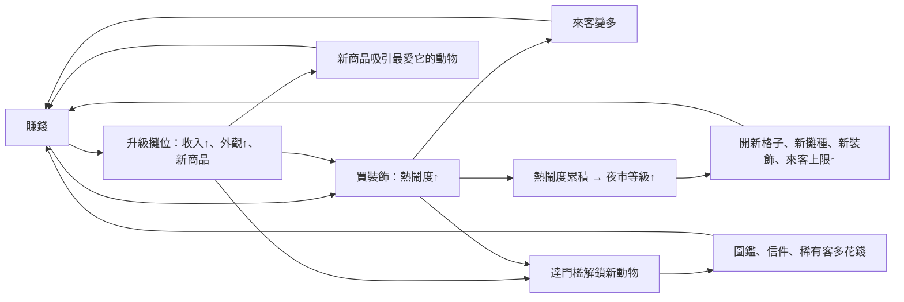

# 動物夜市 — 企劃 v0.5

> Repo：`vup830707/line-dog-city`（舊名「線條小狗模擬城市」）。網址維持 `vup830707.github.io/line-dog-city`。私人遊戲，只給自己和朋友玩。
>
> **版權說明**（沿用 v0.4）：兩隻小狗是我們自己設計的原創角色，不是「線條小狗」本尊，也不用它的名字、造型或周邊圖案。氣氛參考《線條小狗：動物溫泉》那種放鬆的放置經營，主題是我們自己的奇幻夜市。改名「動物夜市」之後，名稱上的顧慮也一起解決。
>
> 基準程式：`main` `b8f6430`（2026-10-10 22:35 台北）。實作照第 11 節拆成小 PR，**每個 PR merge 前都先問 Kai**（merge 等於上線）。
>
> **2026-10-10 Kai 核定 §13。** Q1–Q14 與 Q16 採用 ★ 選項。Q15 沒有建議星號，也還沒有小吃主題的內容，先採用 B：先不做第二款箱子，等 Kai 給內容再做。

---

## 0. 變更紀錄（v0.4 → v0.5）

| # | 改了什麼 | 為什麼 | 對應章節 |
|---|---|---|---|
| 1 | **改名「動物夜市」**。App 名稱、`<title>`、PWA manifest 一起改。 | Kai 決定（j）。 | §1、§9 |
| 2 | **成長循環重做**：賺錢 → 升級 → 賺更多。攤位升級會提高收入、外觀變豪華、**解鎖新商品**（冰淇淋 Lv1 香草、Lv2 草莓／巧克力、Lv3 聖代）。動物有最愛商品。 | Kai 今晚 #1。現在升級不加收入，數字成長是斷的。 | §2、§5.1 |
| 3 | **「氣氛」改叫「熱鬧度」**，重寫來客公式：裝飾和攤位外觀真的會帶來更多客人。熱鬧度累積成**夜市等級**，升級開放更多格子、新攤種、新裝飾，來客上限也跟著提高。 | Kai #1。現在來客永遠頂在上限，裝飾沒有用。 | §5.5、§5.6 |
| 4 | **新動物靠門檻解鎖**（升級、裝飾、夜市等級）。稀有動物花比較多錢。 | Kai #1（c）。 | §5.3 |
| 5 | **經濟 bug 列為必修**：一番賞無限錢、來客永遠滿、升級不加收入、「收箱」名不副實、刺蝟的信拿不到，以及幾個連帶問題。 | 交接文件 §7。 | §6 |
| 6 | **自然移動**：2–3 張 walk frame、沿石板路曲線走、停頓左顧右盼、在攤前停下、影子對齊腳底。 | Kai #2。 | §8 |
| 7 | **新建造流程**：在手機裡點「建造」→ 底部卡片列（有價格）→ 可蓋的空格發光 → 點格子蓋、有動畫；買不起的卡片變灰並顯示差多少。 | Kai #3。現在只有拖放圖示，沒有價格。 | §3.3 |
| 8 | **畫面 bug**：攤位小面板太擠、按鈕超出白框；攤位底部白邊；黃色格框對不上攤位。 | Kai #4（截圖）。 | §3.5 |
| 9 | **新開場畫面**：拿掉表單和取名。全螢幕手繪黃昏廣場、兩隻小狗、手寫「動物夜市」、一顆「開始營業」／「繼續營業」按鈕，按下去燈籠亮起直接進遊戲。 | Kai #5。推翻 v0.4「開場選角與取名」。 | §3.1 |
| 10 | **遊戲內手機選單**（參考 Dave the Diver）：頂部按鈕拿掉，右下小狗吊飾打開手機，app：建造、員工、圖鑑、信件、設定、夜市等級。只留左上金幣。 | Kai #6，已核准概念圖。 | §3.2 |
| 11 | **AI playtest 流程**：每次 release 前，AI 用真的瀏覽器玩 10–15 分鐘、寫報告，修完再給 Kai 看。 | Kai #7。 | §10 |
| 12 | 畫面描述從「側視橫向街道」改成**現有的 2.5D 夜市廣場**（16 格、石板環道）。「拖曳捲動長街道」拿掉。 | 程式已經是廣場，企劃跟上現況。 | §3、§5.6 |
| 13 | 設定從員工面板拆出來，成為手機裡的「設定」app。 | 現在改名／匯出／新遊戲塞在員工面板。 | §3.2 |
| 14 | 存檔升到 **schema v4**，**Kai 現有的 v3 存檔要遷移，不能丟**。 | 新增夜市等級、熱鬧度累積、商品等欄位。 | §9.2 |
| 15 | v0.4 寫了但還沒做的約 35 項，逐項分到「v0.5 哪個 PR」「之後」或「不做」。 | 交接文件 §9.2。 | §12 |

不變的：沒有對手、沒有失敗、淨收入永遠不為負；離線收益上限 8 小時；單人、純前端、本地存檔；電腦全視窗先做，手機版之後用同一套模擬。

---

## 1. 一句話概念

白色垂耳小狗和調皮的咖啡色搭檔在奇幻夜市廣場擺攤、掛燈。小動物自己走進來，挑喜歡的攤、買最愛的那一口。賺到的錢拿去升級攤位（賣更多花樣、更豪華）和佈置廣場；越熱鬧，來的客人越多、越稀有，夜市等級也會升，廣場一路變大。沒有對手，不會倒閉。

## 2. 核心循環



三種成長同時存在：

- **數字成長**：每筆收入變大（商品更貴、稀有客多花錢）、每時段客人變多（熱鬧度）、上限變高（夜市等級）。
- **收集**：一番賞造型、動物圖鑑、商品圖鑑、信件。
- **佈置**：裝飾和攤位外觀直接長在廣場上，越玩越漂亮。

**設計不變式**（沿用）：任何一段時間的淨收入都不為負。缺貨、下雨、員工休息只是慢一點。廣場再空也有基本來客。沒有失敗畫面。

**節奏目標**（試玩時檢查，數字可調）：開局 1 分鐘內買得起第一件裝飾；5 分鐘內第一次升級攤位；10–15 分鐘內夜市升到 Lv.2、看到第一隻解鎖的新動物。玩家每 1–2 分鐘至少有一件買得起、想買的東西。

### 2.1 離線收益（沿用 v0.4）

- 關掉分頁時用同一支 tick 快轉，上限 `offlineCapHours` = 8 小時。
- 回來先看到開場畫面，按「繼續營業」後顯示摘要：賺了多少、來過哪些動物、新信件、有沒有升級。
- 修正：摘要把秒寫成「分鐘」（`offline.ts:20`）；分頁回到前景時（`visibilitychange`）補算背景被節流的時間。

## 3. 畫面與操作（電腦全視窗）

先以 1920×1080 和 1280×720 好看為準。全部用滑鼠；之後的手機版只換版面和操作，模擬同一套。

畫面上平常只有三樣東西：**廣場**（全螢幕 canvas）、**左上金幣 pill**、**右下小狗吊飾**。其他都收在手機裡。

### 3.1 開場畫面

取代現在的選角＋取名表單。

- 全螢幕手繪圖：黃昏的夜市廣場，兩隻小狗站在一個攤位前，大大的手寫「動物夜市」標題。燈籠一開始是暗的。
- 只有一顆按鈕：
  - 沒有存檔：「**開始營業**」。
  - 有存檔：「**繼續營業**」。
- 按下去：燈籠由近到遠依序亮起（約 1.2 秒，`titleLightMs`，可點一下跳過），天色轉成夜晚，淡入遊戲。有離線收益就接著顯示摘要。
- **不再取名**。兩隻狗用預設名字（待 Kai 決定，§13）。存檔格式照舊存名字，所以不用為了這件事升 schema。
- 角色選擇是否也拿掉：**待 Kai 確認**（§13 Q1）。建議拿掉，`playerDog` 預設 `white`，兩隻狗平等，都是老闆。
- 程式：`App.tsx` 改成永遠先顯示開場畫面（現在有存檔就直接進街道）。「新遊戲」移到設定 app，需要確認兩次。

### 3.2 遊戲內手機選單

參考概念圖 `phone-menu-concept.jpg`（Kai 已核准）。

- **右下小狗吊飾**：白色小狗，平常輕輕晃。有新信件、可升級、夜市升級時，吊飾上出現小紅點。
- 點吊飾 → 直立手機從右下滑上來（高度約視窗的 60%，`phoneHeightRatio`），桌布是夜市燈籠。最上排顯示時段、天氣圖示。
- **2×3 app 格**：

| App | 圖示 | 內容 |
|---|---|---|
| 建造 | 工具箱 | 關掉手機、進入建造模式（§3.3）。 |
| 員工 | 小狗臉 | 指派補貨／掃地／招呼、訓練、雇用（現在的 `StaffPanel` 搬進來，拿掉設定部分）。 |
| 圖鑑 | 書 | 三個分頁：造型（一番賞）、動物（見過的動物、已發現的最愛商品、解鎖條件提示）、商品（賣過的商品）。都要有圖。 |
| 信件 | 信封 | 收到的信，有未讀數字。點開是信紙。 |
| 設定 | 齒輪 | 改名（若保留）、匯出／匯入存檔、減少動態效果、新遊戲（二次確認）。 |
| 夜市 | 星星卡 | 夜市等級、熱鬧度、到下一級的進度條、下一級會解鎖什麼；第幾天、天氣、節日、明晚預報小提示。 |

- 關閉：點手機外面、按 Esc、或再點吊飾。
- 手機開著時遊戲**不暫停**（待 Kai 確認，§13）。
- 拿掉：頂部 `header.hud` 和四顆 tab。`data-testid="money"` 保留給 e2e。

### 3.3 建造流程

1. 手機裡點「建造」→ 手機收起，畫面底部出現**卡片列**，分「攤位」「裝飾」兩個分頁。
2. 每張卡片：縮圖、名稱、價格、一行效果（例：「熱鬧度 +8」「賣香草冰淇淋」）。
   - **買不起**：卡片變灰，價格下面寫「還差 120 幣」。錢夠了自動變亮。
   - **還沒解鎖**：鎖頭＋條件（例：「夜市 Lv.3 解鎖」「集滿 8 款造型」）。
3. 點一張卡 → 所有**可以蓋的空格發光**（在 canvas 上畫、隨畫面縮放的橢圓，慢慢呼吸）。不能蓋的格子不亮。
4. 點發光的格子 → 扣錢，播建造動畫（灰塵一圈、物件從小彈到原尺寸、星星閃一下，約 0.5 秒，`buildAnimMs`），飄出「熱鬧度 +8」。
5. 蓋完裝飾留在建造模式，方便連續佈置；蓋完攤位自動退出。按 ✕、Esc 或右鍵取消。
6. 拖放保留當進階操作，跟點選共用同一個 `canPlace()` 檢查。

### 3.4 點攤位、點動物

- **攤位小面板**（重做，見 §3.5）：名稱與等級、現在賣什麼（商品小圖）、庫存、誰在補貨；「升級 600 幣」主按鈕，下面一行寫升級後多什麼（「+草莓、巧克力，熱鬧度 +3」）。最高級時按鈕換成「已是最高級」。
- 一番賞的「收起這箱」和許願池的天氣按鈕放進面板的第二排，不跟升級擠在一起。
- **點動物**：名字、最愛商品（還沒發現時顯示「？」）、這次滿不滿意、寫過的信。
- **點員工**（之後再做）：直接換工作。

### 3.5 畫面 bug 修正（Kai 截圖）

| 問題 | 原因 | 修法 |
|---|---|---|
| 攤位小面板太擠，「一番賞 Lv.3 升級 收箱」按鈕超出白框 | 面板借用 `.offline-note` 的定位，跟離線摘要、通知疊在同一位置；按鈕沒有 flex／寬度設定。 | 新元件 `StallCard`：固定寬度（約 280 px × UI 縮放），用 grid 排三列（標題／商品／按鈕），按鈕可換行且永遠在框內。位置貼在攤位上方（用攤位在畫面上的座標），碰到視窗邊緣就翻到另一側。通知改成上方置中的 toast，離線摘要改成置中卡片，三者不再共用位置。 |
| 攤位底部有白邊 | 去背只去掉「跟圖片外框相連」的白色，輪子之間、底板下方被線條圍住的白色留下來了。 | 重新處理 6 張攤位圖：底部 20% 區域加 flood fill 起點、白邊收縮加寬到 3–4 px。加一支檢查腳本：數 alpha 邊緣上幾乎全白的不透明像素，超過門檻就報錯。必要時用 `--only stalls/<name>` 重生。 |
| 黃色格框跟攤位對不上 | 格子是固定 92×56 px 的 CSS 按鈕，不隨畫面縮放，也不對應攤位圖大小。 | 格框和選取效果改在 canvas 上畫，用攤位的腳底橢圓和縮放後的圖片範圍。點擊判定改用同一組範圍。動物的點擊判定改用畫面上實際的位置（`layoutScene` 的輸出），不再用 `pathPoint`。 |

另外順手修：每幀重設 canvas 尺寸（只在 resize 時設）；rAF 迴圈不要隨每次 state 改變重掛。

## 4. 這一版拿掉或維持拿掉的東西

- 對手、比價、手動定價進貨、每日結算、失敗狀態：維持拿掉（v0.4）。
- **開場取名表單**：拿掉。
- **頂部 HUD 和 tab 按鈕**：拿掉，換成手機。
- **橫向長街道、拖曳捲動**：不做，畫面是一張廣場。
- 一番賞面板裡的「收箱」按鈕：改名「收起這箱」並加確認（§6）。

## 5. 系統

所有數字都是**初始值**，放在 `config.json`，試玩後只改設定。已存在的鍵名沿用；新鍵在 §9.3。

### 5.1 攤位、等級、商品

每座攤位 3 級。升級做三件事：

1. **收入變多**：解鎖更貴的商品。
2. **外觀更豪華**：Lv2 加彩旗和串燈，Lv3 加金邊招牌和更亮的燈（建議用疊加件，不整張重畫，§13 Q8）。攤上看得到現在賣的商品小圖。
3. **商品更多樣**：吸引最愛那樣商品的動物。

升級費沿用 `upgradeCost`（ice 600／1500、can 500／1200、charge 800／1800、fortune 1000／2200、ichiban 600／1200、wish 800／1600）。擺放費沿用 `placeCost`。

**商品表**（新鍵 `products`，價格是售價；淨收入 = 售價 − 售價 × `restockCostRatio` 0.4）

| 攤 | Lv1 | Lv2 新增 | Lv3 新增 |
|---|---|---|---|
| 夢境冰淇淋 `ice` | 香草 40 | 草莓 55、巧克力 55 | 聖代 90 |
| 天氣罐頭 `can` | 晴天罐 30 | 微風罐 40、暖陽罐 40 | 雨滴罐 65 |
| 心情充電站 `charge` | 快充 20 | 星光充 30 | 夢境充 50 |
| AI 算命攤 `fortune` | 一句籤 60 | 籤＋小畫像 85 | 完整命盤 130 |
| 流星許願池 `wish` | 小願 30 | 星願 45 | 流星大願 75 |
| 一番賞 `ichiban` | 一抽 50（`prices.ichiban`） | 補箱變快（`ichibanRestockTicks` 40 → 30） | 解鎖第二款箱子（內容待 Kai，§13） |

- 客人點什麼：最愛商品有賣就買它；沒有的話，有 `topProductChance` 0.6 的機率買最高級的商品，否則在已解鎖商品中隨機挑。所以升級後平均客單價一定上升。
- 冰淇淋的「今夜流行夢」（v0.4）改成：每晚隨機 1 種商品是「今夜限定」，買到的動物滿意度 +0.1。用現在算了沒用的 `trending`。
- 庫存先維持每攤一個數字（`stock[uid]`），不細分到商品。
- 舊鍵 `prices` 保留當作 Lv1 價格和沒有商品表時的後備。
- 同一種攤仍只能蓋一座（v0.4 規則）。是否開放第二座：之後再說。

### 5.2 一番賞

沿用 v0.4 的箱子內容、重複換幣（`duplicateValue` A 180／B 45／C 15）、客人抽、圖鑑。

**修正（必修）**：現在開箱免費、收箱卻退 30% 進價，開箱馬上收就白拿 801 幣，每 40 秒一次。建議做法（§13 Q3 可改）：

- 攤位**自動補的箱子免費，收起來不退錢**。
- 老闆可以按「**立刻開新箱**」，付整箱進價 `wholesale` 2,670，不用等補箱。**只有這種付費箱**收起來時退剩籤的 30%（`refundRate`）。箱子資料加 `paid: boolean`。
- 這樣 v0.4「剩籤退 30%」和「攤位自動補箱」兩條決定都保留，漏洞消失。
- 按鈕改名「**收起這箱**」，按下去跳確認：「收起後這箱剩下 N 抽會清掉，退回 X 幣（免費箱不退）。」
- 補充：遊戲裡沒有「收營收」的動作，錢在客人付錢時直接入帳，畫面上飄「+24」。是否改成點攤位收錢：§13 Q4。

老闆自己抽、迷你夜市箱、最後賞燈籠變成可擺的裝飾：放到 PR D 之後（§12）。

### 5.3 動物客人

8 種，每種有：最愛的攤、**最愛商品**、喜歡的裝飾、喜歡的天氣／時段、稀有度、解鎖條件。

| 動物 | 稀有度 | 最愛的攤 | 最愛商品 | 喜歡的裝飾 | 解鎖條件 | 信件條件（修正後） |
|---|---|---|---|---|---|---|
| 三花貓 | 常客 | 算命 | 籤＋小畫像 | 燈籠 | 開局就有 | 在燈籠旁算命 |
| 月兔 | 常客 | 冰淇淋 | 草莓 | 花車 | 開局就有 | 在花車旁吃到最愛口味 |
| 倉鼠 | 常客 | 罐頭 | 晴天罐 | 招牌 | 開局就有 | 招牌旁買到最愛罐頭 |
| 夜麻雀 | 常客 | 冰淇淋 | 香草 | 燈籠 | 開局就有 | 燈籠旁買到香草 |
| 水獺 | 少見 | 充電站 | 星光充 | 長椅 | 長椅 ≥ 2 張 | 充完電坐長椅 |
| 刺蝟 | 少見 | 算命 | 完整命盤 | 長椅 | 任一攤升到 Lv3 | **深夜**在長椅旁的算命攤消費（取代拿不到的「攤位 ≤ 4」） |
| 小狐狸 | 稀有 | 一番賞 | 一抽 | 招牌 | 一番賞攤在場 ＋ 裝飾 ≥ 8 件 | 抽到 C 賞以上 |
| 雲朵熊 | 稀有 | 許願池 | 流星大願 | 星星 | 許願池在場 ＋ 熱鬧度 ≥ 80 | 許願那一夜 |

- **稀有客多花錢**：`spendMultiplier` 常客 1.0、少見 1.3、稀有 1.8，乘在淨收入上。買到最愛商品再乘 `favoriteBonus` 1.2。
- **新動物第一次來**：toast「新客人：水獺！」、圖鑑點亮、吊飾紅點。
- 小狐狸改成「解鎖後平常也會來」，節日且箱裡還有 A／B 時權重 ×2（原本只有節日才來，太少見）。
- 天氣、時段權重表（現在寫死在 `animals.ts`）和充電加成 1.2 搬進 `config.json`。
- 滿意度公式沿用（`satisfaction`），新增：買到最愛商品 +0.15、今夜限定 +0.1。滿意度開始影響收入：≥ `letterAt` 時小費 +10%（`tipRate`）。
- 現有美術：麻雀用鴨子圖、小狐狸用小貓熊圖、雲朵熊用浣熊圖。改名配合圖、或補新圖：§13 Q6。

### 5.4 員工

沿用 v0.4：兩隻狗＋最多 2 名雇員（文鳥、雪貂），工作是補貨、掃地、招呼，`levelCost`、`hireCost`、`maxStaffLevel` 不變。修正：

- **補貨**優先補「庫存比例最低」的攤，不再永遠補第一格。
- **掃地**的 `cleanGain` 改成每時段加一次（現在每 tick 加，清潔度永遠 100）。
- 員工在畫面上**走到真正工作的位置**（補貨的攤、髒的地方），見 §8。
- 招呼仍是全域效果；「只影響附近」之後再做。

### 5.5 熱鬧度（原「氣氛」）與來客

畫面和文案一律叫「熱鬧度」，程式鍵名沿用 `ambience*`。

```
熱鬧度   = Σ decorScore + Σ lookByLevel[攤位等級]
清潔係數 = 0.85 + 0.15 × 清潔度 / 100
來客係數 = clamp(熱鬧度 × 清潔係數 / ambienceTarget, ambienceFloor, 該夜市等級的 visitCap)
每時段來客 = baseVisitsPerPhase × 來客係數 × (節日 ? festivalBonus : 1)
```

- **清潔度不再直接加進熱鬧度**（這就是現在永遠頂到上限的原因：清潔 100 遠大於 target 40）。
- 上限跟著夜市等級提高（§5.6），所以裝飾一直有用：每級都要更熱鬧才能吃滿。
- 清潔度下降：每時段 `cleanDropPerPhase` 6 ＋ 每位客人 `cleanDropPerVisitor` 0.5。客人越多越髒，掃地員工才有意義。
- 數值：`ambienceTarget` 40、`ambienceFloor` 0.6、`decorScore` 和 `lookByLevel` 沿用。

### 5.6 夜市等級

- 每個時段結束時，把當下的熱鬧度加進 `bustleXp`（累積熱鬧度）。
- `bustleXp` 達門檻就升級：開放更多格子、新攤種、新裝飾，提高來客上限。升級時全場燈籠閃一圈、橫幅「夜市升到 Lv.2！」，手機「夜市」app 顯示新東西。

| 夜市等級 | 累積熱鬧度 | 可用格子 | 新攤 | 新裝飾 | 來客上限 `visitCap` |
|---|---|---|---|---|---|
| 1 | 0 | 8 | 冰淇淋、罐頭 | 燈籠、長椅 | 1.2 |
| 2 | 600 | 10 | 充電站 | 招牌 | 1.5 |
| 3 | 2,000 | 12 | 算命攤 | 花車 | 1.8 |
| 4 | 5,000 | 14 | 一番賞 | — | 2.1 |
| 5 | 10,000 | 16 | 新攤種（候選：星星烤串，§13 Q9） | 燈籠串 | 2.5 |
| — | 集滿 8 款造型 | — | 流星許願池 | 星星 | — |

- **擴大廣場**：v0.5 建議在現有的 16 格廣場內逐級開格（還沒開的格子畫成圍欄／草叢）。換更大、可左右拖的背景放到之後（§13 Q7）。
- **新遊戲開局**：只送 1 座冰淇淋攤、1 盞燈籠，起始金幣 `startingMoney` 800。不再一開局就送滿 5 攤＋3 顆星星（現在開局只剩 2 格能蓋）。
- **Kai 現有的存檔**：遷移時保留全部擺設，夜市等級設成「足以涵蓋已擺的東西」的最低級（例：已有一番賞 → Lv.4），已擺的星星保留。

### 5.7 天氣、時段、節日、地圖

沿用 v0.4：天氣（晴、熱、冷、雨）、時段（入夜、中夜、深夜）、節日（元宵、中秋、跨年，30 天日曆）只改變「誰來」和氣氛，不扣來客。v0.5 只加畫面：天氣改天空色調、下雨有雨滴、節日多掛燈（PR F，§12）。

地圖：v0.5 只有城鎮夜市廣場。港灣、櫻花、雪町夜市維持「之後」。

### 5.8 熟客好感與每晚小事件（Kai 決定 e，排在 PR F）

- 每次滿意消費，該物種好感 +1（`affinity`）。到門檻（`affinityLetters` 3／10／25）收到第 2、3 封信或小禮物（裝飾）。
- 每晚最多一件小事件（`eventChance` 0.3）：突然下雨（傘下的長椅變熱門）、節日前夜、神秘客人（帶一件稀有造型的商人）。只有好事，沒有懲罰。

## 6. 必修的經濟 bug

| # | bug | 現象 | 修法 | PR |
|---|---|---|---|---|
| 1 | 一番賞無限錢 | 開箱免費、收箱退 30% → 每 40 秒白拿 801 | 免費箱不退錢，付費箱才退（§5.2） | A |
| 2 | 來客永遠滿 | 清潔度 100 + 開場裝飾 ≫ target 40，裝飾、升級不加客人 | 清潔改乘數、上限跟夜市等級（§5.5） | A（公式）、D（等級） |
| 3 | 升級不加收入 | 收入只看 `prices`，跟等級無關 | PR A 先加 `levelPriceMultiplier` [1, 1.3, 1.7] 讓升級立刻有感；PR D 換成商品價格 | A → D |
| 4 | 「收箱」其實是收掉一番賞箱 | 玩家以為是收錢，按了就把箱子清掉 | 改名「收起這箱」、移到面板第二排、加確認視窗 | A |
| 5 | 刺蝟的信拿不到 | 條件要攤位 ≤ 4，開局就 5 攤又不能拆 | 改成「深夜在長椅旁的算命攤消費」 | A |

一起修的小問題：

| 問題 | 修法 | PR |
|---|---|---|
| 掃地讓清潔度永遠 100 | `cleanGain` 每時段加一次 | A |
| 最愛的攤缺貨就直接走 | 改去別的有貨攤位 | A |
| 補貨永遠補第一格 | 補庫存比例最低的 | A |
| 開場星星繞過解鎖 | 新遊戲不送星星（舊存檔保留） | D |
| `window.__puppy` 在正式站常駐 | 只在網址加 `?debug=1` 時開（playtest 用） | A |
| 許願失敗但天氣剛好一樣時顯示成功 | 訊息依擲骰結果，不看天氣 | A |
| `openBox`／`castWish` 另建 RNG | 把 tick 的 `rng` 傳進去 | D |
| 每 tick 寫 localStorage | 改成每 5 秒或玩家動作時寫，關頁前補寫 | A |

每一條都要有 Vitest 測試；bug 1 要有「開箱 → 收起 → 錢沒變多」的測試。

## 7. 美術方向

風格不變：黑色手繪線條、溫暖夜色、柔和點綴色（夢境粉、星星金、燈籠暖黃）。2.5D 廣場、所有 sprite 腳底中心為錨點。新圖走 `/workspace/ldc-assets/_tools/` 的管線（生成 → `process.py --only` → 看 contact sheet），程式只認 `plaza.ts` 的 art 表。

每 PR 需要的圖在 §11。

## 8. 自然移動

目標：客人看起來像在逛夜市，不是每秒瞬移。

**模擬和畫面分工**

- 模擬（`src/rules/`，純函式、離線同一套）只決定**什麼時候到攤、在攤前待幾 tick、什麼時候離開**。走多遠、怎麼彎由畫面負責，不影響收入，所以離線結果不變。
- 畫面在 tick 之間內插：記下上一個和這一個 tick 的狀態，用 `alpha = (now − tickAt) / tickMs` 平滑移動。

**路徑**

- 在 `plaza.ts` 定義一組沿石板環道的路點（`PLAZA_PATH`），加上入口、出口，以及每個格子前面的「站位點」。
- 客人從入口進場，沿路點用平滑曲線（Catmull-Rom）走到目標攤的站位點，買完沿環道走到出口離開。取代現在 `ovalPoint` 和 `standPoint` 之間的跳接。
- 排隊用固定隊位，不再每幀推擠，避免抖動。

**動作**

| 動作 | 做法 | 可調值 |
|---|---|---|
| 走路 | 2–3 張 walk frame 輪播，速度快慢對應幀率；前／後兩個方向，左右用鏡像 | `walkFps` 6 |
| 停頓、左顧右盼 | 走到路點時有機率停一下，左右各轉一次頭（鏡像或 look frame） | `lookAroundChance` 0.25、`lookAroundMs` 800–1500 |
| 在攤前停下 | 面向攤位站好，頭上冒出商品小圖，付錢時飄「+24」 | — |
| 上下晃動 | 只有走路時晃，跟步伐同步；站著不晃 | — |
| 影子 | 畫在腳底錨點，大小跟深度縮放，踏步時微微壓扁 | — |

- sprite 的腳底若不在圖片最底（尾巴、裙擺），在 art 表加 `footOffset` 校正，讓影子對齊腳。
- 員工走到真正的工作位置：補貨走去目標攤、掃地走去髒的區域、招呼在入口附近揮手、休息坐長椅。模擬要暴露每位員工的目標格子。
- 設定裡「減少動態效果」打開時，關掉左顧右盼和晃動。

## 9. 技術

沿用現有：React 19 + TypeScript + Vite 7 + PWA，Canvas 2D 畫廣場，規則都是 `src/rules/` 純函式加 Vitest。GitHub Pages 子路徑 `/line-dog-city/`（`VITE_BASE`）不改。

### 9.1 預算與 CI

- **GitHub Actions 預算 $0**。repo 是 public，現有的 Pages workflow 免費，照舊。
- **不新增**吃分鐘數的 workflow。e2e、截圖、AI playtest 都在 box 本機跑。
- 可以考慮（不必要）：在現有 `pages.yml` 裡加 `npm run lint` 和 `typecheck`，只多幾十秒。
- 所有工具、服務選免費的。

### 9.2 存檔 schema v4

- `SCHEMA_VERSION = 4`。新欄位：`marketLevel`、`bustleXp`、`seenSpecies`、`seenProducts`、`box.paid`；PR F 再加 `affinity`、`events`。
- `parseSave` 遇到 v3 時跑 `migrateV3toV4()` 補預設值（**不要把 v3 當舊版丟掉**，Kai 有在玩）。v1／v2 照舊當作新遊戲。
- 讀不到或壞掉的存檔：不要靜默覆蓋，先備份到 `puppy-city-save.bak` 再開新遊戲。
- PR A、B、C 不升 schema；`box.paid` 用可選欄位，缺少時視為 `false`。

### 9.3 `config.json` 新鍵（初始值，可調）

沿用的鍵：`tickMs`、`phaseMinutes`、`offlineCapHours`、`startingMoney`、`streetSlots`、`baseVisitsPerPhase`、`ambienceFloor`、`ambienceCap`（全域最大值）、`ambienceTarget`、`cleanDropPerPhase`、`restockCostRatio`、`refundRate`、`duplicateValue`、`prices`、`placeCost`、`upgradeCost`、`decorCost`、`decorScore`、`lookByLevel`、`cleanGain`（改成每時段）、`hireCost`、`levelCost`、`ichibanRestockTicks`、`letterAt`、`satisfaction`、`festivalBonus`、`species`（加欄位）。

| 新鍵 | 初始值 | 意思 | PR |
|---|---|---|---|
| `levelPriceMultiplier` | [1, 1.3, 1.7] | 商品表上線前，升級提高售價 | A |
| `cleanDropPerVisitor` | 0.5 | 每位客人讓清潔度下降 | A |
| `saveEveryTicks` | 5 | 存檔頻率 | A |
| `titleLightMs` | 1200 | 開場點燈動畫 | B |
| `phoneHeightRatio` | 0.6 | 手機高度佔視窗比例 | C |
| `buildAnimMs` | 500 | 建造動畫 | C |
| `products` | §5.1 表 | 各攤各級商品與售價 | D |
| `topProductChance` | 0.6 | 沒最愛商品時買最高級的機率 | D |
| `favoriteBonus` | 1.2 | 買到最愛商品的收入倍率 | D |
| `tipRate` | 0.1 | 滿意時的小費 | D |
| `spendMultiplier` | 常客 1.0／少見 1.3／稀有 1.8 | 稀有度收入倍率 | D |
| `marketLevels` | §5.6 表 | 門檻、格子、解鎖、`visitCap` | D |
| `species[].product`、`rarity`、`unlock` | §5.3 表 | 最愛商品、稀有度、解鎖條件 | D |
| `speciesWeights` | 現在 `animals.ts` 的 BASE／WEATHER／PHASE | 搬進 config | D |
| `chargeBonus` | 1.2 | 充電加成（現在寫死） | D |
| `walkFps` | 6 | 走路幀率 | E |
| `lookAroundChance` | 0.25 | 停頓左顧右盼機率 | E |
| `lookAroundMs` | [800, 1500] | 停頓時間 | E |
| `affinityLetters` | [3, 10, 25] | 好感門檻 | F |
| `eventChance` | 0.3 | 每晚小事件機率 | F |

## 10. AI playtest 流程

每次 release 前（PR 準備好、還沒 merge 時）都跑一次。merge 等於上線，所以先測、先修，再問 Kai。

1. **建置**：在 box 上 `VITE_BASE=/line-dog-city/ npm run build`，用 `vite preview` 開 `/line-dog-city/`。不用 GitHub Actions。
2. **玩**：AI 用真的瀏覽器（box 的桌面瀏覽器）玩 **10–15 分鐘實時**，1920×1080 和 1280×720 各看一次。分兩段：
   - 新遊戲：從開場畫面開始，照一般玩家的方式玩，不看程式。
   - 舊存檔：匯入一份 Kai 現有進度的存檔，確認遷移後還能繼續。
   - 需要看長時間結果時，用 `?debug=1` 的 `__puppy.runTicks` 快轉，並在報告註明哪些段落有快轉。
3. **報告**：存成 `docs/playtests/<日期>-<PR>.md`，附截圖。固定格式：
   - 版本（branch、commit）、視窗大小、玩了多久。
   - **卡關點**：不知道下一步做什麼、找不到按鈕、等太久沒東西可買（附時間點）。
   - **壞掉的圖**：白邊、錯位、溢出、遮擋，附截圖。
   - **移動**：瞬移、抖動、穿模、影子對不上。
   - **無聊的段落**：哪幾分鐘沒事做、為什麼。
   - **數字快照**：第 1／5／10／15 分鐘的金幣、每分鐘收入、熱鬧度、夜市等級、已解鎖動物。
   - **Top 5 要修的事**，依影響排序。
4. **修**：先修 Top 5 裡屬於這個 PR 範圍的，再跑一次簡短檢查（5 分鐘）確認。
5. **給 Kai 看**：附報告、截圖（必要時短影片），問 Kai 可不可以 merge。Kai 說可以才 merge。
6. merge 後在正式站開一次，確認 Pages 部署成功、PWA 更新正常。

每個 PR 在送給 Kai 前也要過：`npm run lint && npm run typecheck && npm test && npm run test:e2e`（本機）。

## 11. 實作順序（小 PR）

原則：一個 PR 一件事、Kai 一眼看得出差別；每個都走 §10；**不自己 merge**。

### PR A — 經濟 bug ＋ 面板／畫面修正

- §6 全部 5 個必修 bug，加上表中標 A 的小問題。
- §3.5 三個畫面 bug：新 `StallCard` 小面板、toast 和離線摘要分開、canvas 畫格框與點擊判定、動物點擊判定。
- canvas 只在 resize 時設尺寸。
- 測試：一番賞不再生錢、裝飾增加來客、升級增加收入、刺蝟可寄信、清潔度會下降、缺貨會改去別攤。
- 不升 schema。
- **美術**：重新處理 6 張攤位圖（去白邊，優先只重跑 `process.py`，不行才重生）；新增白邊檢查腳本。其他不用。

### PR B — 開場畫面

- 全螢幕開場、單一按鈕、點燈動畫、拿掉取名（和角色選擇，依 Kai 回覆）。
- `App.tsx` 永遠先顯示開場畫面；離線摘要在按下按鈕後出現。
- 改名「動物夜市」：`vite.config.ts` manifest、`index.html`、README。
- 更新 e2e 開場流程（現在依賴 `dog-white`、`白狗的名字` 等 label）。
- **美術**：
  - 黃昏夜市廣場背景 1920×1080（燈籠暗的版本），兩隻小狗站在一個攤位前（畫在背景裡）。
  - 燈籠亮的版本，或燈光光暈貼圖（用程式疊加淡入）。
  - 手寫「動物夜市」標題 PNG（透明底）。
  - 按鈕可以先用 CSS，之後再換手繪。

### PR C — 手機選單 ＋ 新建造流程

- 小狗吊飾、手機 overlay、6 個 app。員工面板搬進去，設定拆出來。「夜市」app 先顯示天數、天氣、節日、熱鬧度（等級在 PR D 補上）。
- 建造模式：底部卡片列、價格、灰卡「還差 N 幣」、發光格子、點格子建造、建造動畫；抽出 `canPlace()` 共用。
- 拿掉頂部 HUD；更新 e2e 的 `tab-*` testid。
- **美術**：
  - 手機外框（或用 CSS 做圓角框）＋夜市燈籠桌布。
  - 6 個 app 圖示：工具箱、小狗臉、書、信封、齒輪、星星卡。
  - 白色小狗吊飾（靜止 1 張，有空可加 2 張晃動）。
  - 建造用卡片縮圖（先用現有 sprite 縮小）。
  - 建造特效：灰塵圈、星星閃光（2–3 幀，或用程式畫）。
  - 信紙底圖（信件 app 用）。

### PR D — 成長循環：商品、熱鬧度、夜市等級、動物解鎖

- schema v4 ＋ v3 遷移（含 Kai 現有存檔測試）。
- 商品表、客人選商品、最愛商品、稀有度倍率、小費。拿掉 PR A 的 `levelPriceMultiplier`。
- 夜市等級、`bustleXp`、逐級開格子、解鎖攤種與裝飾、`visitCap`。
- 動物解鎖條件、新動物 toast、圖鑑三分頁（造型、動物、商品），都有圖。
- 新遊戲開局改成小廣場。物種權重表和 `chargeBonus` 搬進 config。
- 開局前先把 §5 的數字表給 Kai 確認一次。
- **美術**：
  - 商品小圖約 17 張：冰淇淋 4、罐頭 4、充電 3、算命 3、許願 3。
  - 6 座攤位的 Lv2、Lv3 疊加件（彩旗、串燈、金邊招牌），共約 12 件。
  - 未開放格子的遮擋物（圍欄、草叢）2–3 種。
  - 夜市升級橫幅、金幣飄字小圖示。
  - 圖鑑：8 款一番賞造型圖（現在只有文字；部分可從概念圖裁）。
  - Lv5 新攤種（若做星星烤串）：攤位 1 張＋疊加件。
  - 依 §13 Q6：要嘛不畫（改名配合現有圖），要嘛補麻雀、小狐狸、雲朵熊 3 張。

### PR E — 自然移動

- tick 內插、`PLAZA_PATH` 路點與曲線、入口／出口、固定隊位、停頓左顧右盼、攤前停下＋商品泡泡、影子對齊、`footOffset`、只有走路時晃。
- 員工走到工作位置（模擬暴露目標）。
- `ArtPiece` 改成多幀（`frames`、`fps`），預載全部幀。
- **美術**（量最大，可分兩批：先 4 常客＋2 狗，再補其他）：
  - 8 種動物 × 前／後 × 2–3 幀 = 16–24 組（32–48 張）。
  - 2 隻狗 × 前／後 × 3 幀 = 12 張，加補貨、掃地、招呼、休息各 1–2 張。
  - 文鳥、雪貂 × 前／後 × 2 幀 = 8 張。
  - 「左顧右盼」先用鏡像，不另外畫。影子用程式畫。

### PR F（之後）— 熟客好感、每晚小事件、天氣視覺

- §5.8 好感與事件；天氣天空色調、雨、節日燈；離線摘要列出來過的動物和新信件。
- **美術**：天空色調用程式疊色；雨滴粒子；節日燈串；1 位神秘商人。

## 12. v0.4 未完成項目的去向

| 項目 | v0.5 去向 |
|---|---|
| 可收合的側邊建造面板 | 被手機＋卡片列取代（PR C） |
| 拖曳／邊緣捲動長街道、寬螢幕看更遠 | 不做（改成廣場） |
| 拖已放好的東西換位置、拆除 | 之後（§13 Q12） |
| 點攤位看在賣什麼、誰在補貨 | PR A（`StallCard`），商品圖 PR D |
| 點動物看寫過的信 | PR D |
| 在場景中點員工改工作 | 之後 |
| 窄條模式、Document Picture-in-Picture | 之後 |
| 手機版面 | 之後，同一套模擬；手機選單本身就適合直式 |
| 冰淇淋口味與今夜流行夢 | PR D（商品表＋今夜限定） |
| 天氣罐頭四種罐頭 | PR D（商品表） |
| 充電站插座 2→3→4、充完多留一下 | 插座數之後；多留一下 PR E（停留動畫） |
| 算命畫像部件、排隊先坐座位 | 畫像 PR D 之後；坐座位 PR E 之後 |
| 一番賞升級解鎖下一款箱子 | PR D（補箱變快）；第二款箱子內容待 Kai |
| 老闆自己抽、迷你夜市箱、最後賞燈籠可擺 | PR F |
| 許願池星星提高稀有客機率 | PR D（雲朵熊條件與權重） |
| 時光扭蛋、星星烤串 | 星星烤串候選 Lv5 新攤（PR D）；扭蛋之後 |
| A 賞在時相關動物多來 | PR D（小狐狸權重） |
| 各物種細分信件條件 | PR D（§5.3 表）；好感信 PR F |
| 稀有客條件放 config | PR D |
| 滿意度影響花費 | PR D（小費） |
| 招呼只影響附近 | 之後 |
| 天氣色調、預報提示、節日燈 | 預報 PR C（夜市 app）；視覺 PR F |
| 港灣、櫻花、雪町 | 之後 |
| 離線摘要列動物和信件 | PR F |
| 安靜的流水帳 | 之後（可放夜市 app） |
| `SettingsScreen` | PR C（設定 app） |
| 機器人小狗店員、信紙、圖鑑格子、金幣與天氣 icon | 信紙、icon PR C；圖鑑圖 PR D；機器人店員之後 |
| 攤位 2–3 段升級外觀 | PR D |
| 更多動物、員工、雲端存檔、互訪、音效 | 之後 |

## 13. 已決定（2026-10-10）

Kai 在 2026-10-10 核定下面 16 題。Q1–Q14 與 Q16 用 ★ 的那一項。Q15 沒有 ★，也還沒有小吃主題的內容，所以先用 B。

| # | 問題 | 決定 |
|---|---|---|
| Q1 | 角色選擇也拿掉嗎？ | **A** 拿掉。兩隻狗都是老闆，沒有「主角」。 |
| Q2 | 預設名字？設定裡還能改名嗎？ | **A** 預設小白／可可，設定裡保留改名。 |
| Q3 | 一番賞退款怎麼修？ | **A** 免費自動補的箱不退；付 2,670「立刻開新箱」的才退 30%。 |
| Q4 | 收錢方式 | **A** 維持自動入帳。 |
| Q5 | 刺蝟的新信件條件 | **A** 深夜，在長椅旁的算命攤消費。 |
| Q6 | 三種動物的名字和圖對不上 | **A** 改名配合現有圖：夜鴨子、小貓熊、浣熊。PR D 再改名字。 |
| Q7 | 「擴大廣場」怎麼做 | **A** 在現有 16 格內逐級開格。 |
| Q8 | 攤位升級外觀 | **A** 原圖加疊加件，加上商品小圖。 |
| Q9 | 夜市 Lv5 的新攤種 | **A** 星星烤串。 |
| Q10 | 數值表 | **A** 先照本文件，第一次 playtest 後再調。 |
| Q11 | 手機開著時遊戲要暫停嗎？ | **A** 不暫停。 |
| Q12 | 要不要加「拆除／移動」？ | **A** v0.5 不做。 |
| Q13 | Kai 現在的存檔 | **A** 遷移保留。升 schema 時夜市等級自動補到對應級。 |
| Q14 | `window.__puppy` 測試掛勾 | **A** 只有網址帶 `?debug=1` 才開。 |
| Q15 | 一番賞第二款箱子的主題 | **B** 先不做第二款箱子。沒有 ★，也還沒有小吃主題的內容。 |
| Q16 | playtest 結果放哪 | **A** 報告存 `docs/playtests/`，聊天裡附摘要。 |
