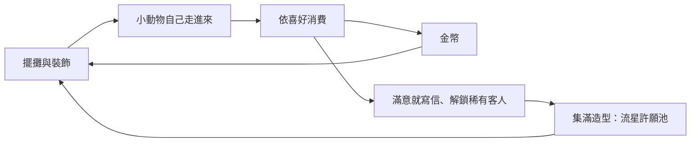

# 線條小狗模擬城市 — 電腦版企劃 v0.4

> 名稱說明：「線條小狗」是他人的角色名稱，「模擬城市」是 SimCity 的中文商標名稱。目前只給自己和朋友私下玩，日後若公開發布，需要改名。

> **版權說明**：兩隻小狗都是**我們自己設計的原創角色**（線條手繪風），**不是**「線條小狗」本尊，也不使用它的名字、造型或周邊圖案。氣氛參考 Steam 上的《線條小狗：動物溫泉》（Maltese's Fluffy Onsen，App 3404470）那種放鬆的放置經營：小動物自己走進來、喜歡什麼就多留一下、錢拿去佈置。主題仍是我們的奇幻夜市，不做成溫泉，也不沿用該作的角色。

> 這一版改方向。v0.3 是「看天氣進貨、跟對手搶客」的策略夜市；v0.4 改成**沒有競爭、沒有失敗**的放置夜市。現有程式是 v0.3 的可玩版，之後實作時依第 7 節取捨，這份文件先不改程式。

## 1. 一句話概念

白色垂耳小狗和調皮的咖啡色搭檔在一條奇幻夜市裡擺攤、掛燈、擦桌子。貓、兔子、水獺這些小動物自己走進來，喜歡的攤和裝飾會讓牠們多花錢、留下短信；錢用來把街道佈置得更漂亮，漂亮會帶來更稀有的客人。時間夠長一定賺得到，沒有對手，也不會倒閉。

## 2. 核心循環

放置迴圈，不結算成「今天成不成功」：

1. **擺**：把攤位和裝飾拖到街道上。
2. **來**：小動物依天氣、夜晚時段、氣氛和自己的喜好走進來，在喜歡的攤位消費。
3. **賺**：金幣慢慢增加。員工自動補貨、掃地、招呼，玩家不用盯庫存和價錢。
4. **佈置**：金幣拿去升級攤位、買裝飾、雇人。喜歡的搭配會送來信件和小故事，條件夠了就出現稀有客人，集滿第一套造型就開「流星許願池」。

離開網頁也會繼續賺，但有上限（見 2.1）。回來看到一句「你不在的時候」，以及這段時間的金幣、來過的動物、新信件。

**設計不變式**：任何一段時間的淨收入都不會是負的。缺貨、下雨、員工在休息，只是慢一點。街道再空，也有基本來客。沒有失敗畫面、沒有破產、沒有「今天虧了」。

### 2.1 離線收益

- 關掉分頁或電腦睡著時，用同一套純函式把時間快轉完，上限先訂 **8 小時實時**（`offlineCapHours`）。
- 超過上限的時間不計算，避免掛機一週變成天文數字。
- 回來只顯示摘要，不補播每一秒動畫。
- 視窗開著時照常慢速模擬，不另外加速。

## 3. 電腦版怎麼玩

**第一版只做電腦瀏覽器、用滑鼠、佔滿整個視窗。** 手機版以後再做。

### 3.1 全視窗（MVP）

- 橫向側視的夜市街道佔滿視窗主要區域。街道比視窗長時，用滑鼠拖曳或邊緣捲動。
- 旁邊是建造／裝飾面板：攤位、裝飾、員工、圖鑑、信件。面板可以收合，收合後街道更寬。
- 視窗放大縮小都維持這塊配置。先以大約 1280×720 看得舒服為準，更寬的螢幕只是街道看得更遠。

**滑鼠**

| 操作 | 結果 |
|---|---|
| 從面板拖到街道 | 放下攤位或裝飾。放不下就彈回，不扣錢。 |
| 拖已放好的東西 | 換位置。 |
| 點攤位 | 看等級、在賣什麼、誰在補貨，以及升級按鈕。 |
| 點動物 | 看名字、喜好、這次滿不滿意、寫過的信。 |
| 點員工 | 改工作：補貨、掃地、招呼。 |

### 3.2 之後再做的視窗形態

不進第一版。全視窗玩起來順了再加。

| 形態 | 內容 |
|---|---|
| 窄條模式 | 短而寬的視窗，大約 1280×220 到 1920×300，讓夜市貼在螢幕底部，人可以一邊工作一邊看。建造面板收成小圖示。 |
| 子母畫面 | 用 [Document Picture-in-Picture](https://developer.mozilla.org/en-US/docs/Web/API/Document_Picture-in-Picture_API) 開一個永遠在最上層的小窗，裡面放窄條街道。需要使用者點一下才開得了。桌面版 Chrome、Edge 等 Chromium 瀏覽器有這個 API；Firefox 和 Safari 目前沒有，所以不能當成大家都有的功能。 |

## 4. 這一版拿掉的東西

v0.3 裡這些不再做，程式裡對應的模組之後刪除（第 7 節）：

- **對手攤**，以及搶客、跟價、中場改價。
- **手動定價、進貨數量、臨時降價、催餐、點路人招攬。** 售價改成固定，寫在 `config.json`。升級改變的是容量、外觀和魅力，不是價格戰。
- **每日結算壓力**：沒有「收市成績單」、沒有報廢虧損、沒有跟對手的客人比例。可以有一本安靜的流水帳，只為了回看，不評成敗。
- **失敗狀態**：排隊超過耐心就離開、賣光被懲罰、天氣把人潮打到很低、冰淇淋融化導致虧本。這些都刪掉。

## 5. 系統

數字都是初始值，集中在 `config.json`，試玩後只改設定。第 9 節有一張對照表。

### 5.1 攤位

五種從一開始就買得到，第六種靠圖鑑解鎖。每一種都是「放下去就會自己轉」：員工補貨，客人自己來。升級只加容量、服務速度、外觀和能觸發的故事。

售價固定。補貨成本約是售價的四成，所以有人買就有賺。貨架空了，該攤暫停接單，動物改去別攤或坐下來；補上貨就恢復。沒有報廢。

| 攤 | 放著會發生什麼 | 升級在加什麼 |
|---|---|---|
| 夢境冰淇淋 | 口味是客人的夢（飛起來、考試遲到、被狗狗包圍、掉牙、追公車、游泳）。今夜流行 1–2 種夢，吃到的動物更容易滿意、更容易寫信。 | 可同時供應的口味 2 → 4 → 6，出餐更快，車子更像雲。 |
| 天氣罐頭 | 晴天、微風、暖陽、雨滴四種，是紀念品。喜歡今晚天氣的動物來湊熱鬧，想要另一種天氣的動物買一罐帶回去。兩種都是好事。 | 貨架種類變多、補貨更快。 |
| 心情充電站 | 尾巴插上充電。充完的動物心情好，會在街上多留一下，並再到鄰近的攤消費。 | 插座 2 → 3 → 4，燈光更暖。 |
| AI 算命攤 | 機器人小狗用預寫籤文算命，並用現成部件拼一張小畫像。人多就慢慢排，排久了會先去坐座位，不會生氣走開。 | 算力讓籤文更完整、畫像部件更多、速度更快。電費是很少的維護費，吃不掉利潤。 |
| 一番賞 | 客人自己抽。抽到的小狗造型進圖鑑。見 5.2。 | 解鎖下一款箱子，攤棚更好看。 |
| 流星許願池 | 集滿第一套 8 款造型後解鎖。動物投幣許願。老闆每天可以許一次願，指定明天的天氣氣氛，成功率 60%；沒中就照原本的天氣走。這是收集的禮物，不是翻盤手段。 | 池邊的星星裝飾，提高稀有客人出現的機會。 |

時光扭蛋機、星星烤串仍不在第一版。若以後要加，也做成「放下去就慢慢轉」的收集攤，不做時段炒價。

### 5.2 一番賞

規則沿用已確認的部分：客人（和想收集的老闆）從固定內容的箱子抽，抽完為止。

**範例箱：「奇幻夜市 第一彈」80 抽，整箱進價 2,670**

| 賞 | 數量 | 單件進價 | 獎品 |
|---|---|---|---|
| A | 1 | 600 | 廟會小狗 |
| B | 3 | 150 | 夢境冰淇淋小狗、星空睡帽小狗、天氣罐頭小狗 |
| C | 8 | 50 | 睡衣、充電尾巴、珍奶、雞排等 |
| D | 68 | 15 | 貼紙、小卡（不進造型圖鑑） |
| 最後賞 | 1 | 200 | 夜市燈籠裝飾 |

- 一抽售價固定 50，玩家不調價。
- 動物喜歡一番賞的會自己來抽。A 賞還在時，這種動物來得多一點；剩下很少時，也有動物專程來看最後賞。這是吸引力，不是要玩家算換箱時機。
- **剩籤退回 30% 進價**（已確認保留）。老闆可以隨時把箱子收起來，剩下的籤和還沒發出的最後賞，按進價合計的 30% 退回，四捨五入。
- **重複造型換成遊戲幣**（已確認保留）：A 180、B 45、C 15。重複的不加進收藏數量。D 賞本來就不是造型。
- 老闆仍可自己抽，花的遊戲幣同時算這箱的營業，淨現金為 0，造型進自己的圖鑑。客人抽到的造型也進圖鑑（這是夜市的收藏，不是只算老闆親手抽的）。
- 另一款較便宜的「迷你夜市」可以留著，讓前期就摸得到收集；數字仍放 `config.json`。

### 5.3 動物客人

第一版 8 種。前 6 種平常就會來，後 2 種要達成條件。每種有喜歡的攤、喜歡的裝飾、喜歡的天氣或時段。喜好用來決定**誰出現、滿不滿意、會不會寫信**。全街的來客期望不因天氣變少。

滿意度：這次有沒有逛到喜歡的攤、附近有沒有喜歡的裝飾、街道乾不乾淨。高於門檻就有機會留下一封短信（每種動物、每個話題只留一次）。

| 動物 | 出現 | 喜歡的攤 | 喜歡的裝飾 | 容易來的時候 | 信件 |
|---|---|---|---|---|---|
| 三花貓 | 常客 | 算命 | 燈籠 | 雨、入夜 | 在燈籠底下算過命 |
| 月兔 | 常客 | 冰淇淋 | 花車 | 晴、中夜 | 花車旁吃到今夜的流行夢 |
| 倉鼠 | 常客 | 罐頭 | 招牌 | 什麼時候都來 | 四種罐頭都買過 |
| 夜麻雀 | 常客 | 冰淇淋，許願池開了之後也去 | 燈籠串 | 入夜 | 一整排燈籠都亮著 |
| 水獺 | 少見 | 充電站 | 長椅 | 雨 | 充完電坐下來 |
| 刺蝟 | 少見 | 算命 | 離攤遠一點的座位 | 深夜、冷 | 氣氛夠、攤位卻不多，覺得很安靜 |
| 小狐狸 | 稀有 | 一番賞 | 招牌 | 節日，且箱子裡還有 A 或 B | 抽到 C 賞以上 |
| 雲朵熊 | 稀有 | 許願池 | 星星裝飾 | 許願池已開，且氣氛達標 | 許願那一夜留下的故事 |

短信是幾句繁體中文小故事，集中在一個內容檔，之後可以再加句，不用改規則。稀有客人的條件寫在 `config.json`，方便 Kai 改。

### 5.4 員工

- **兩隻狗是基本員工。** 開場仍由玩家選白狗或咖啡色狗當自己的主角，並替兩隻取名（見文末）。兩隻都能指派工作。
- **工作只有三種**：補貨、掃地、招呼。招呼讓附近動物的滿意度稍微高一點。同一隻狗同時只做一件事，可以隨時換。
- **等級**：做事變快、休息得比較好看。升級用金幣，不影響成敗。
- **可再雇用**：第一版先做 2 名額外員工（建議是小型線條小狗，造型跟主角分開）。雇來就一樣能指派那三種工作。
- 狗在休息、或人力不夠、貨架暫時是空的，街道繼續轉，只是慢。

### 5.5 裝飾與氣氛

裝飾是主要的花錢去處。

| 裝飾 | 氣氛分數（初始） | 誰會特別喜歡 |
|---|---|---|
| 燈籠 | 8 | 三花貓、夜麻雀 |
| 長椅 | 5 | 水獺、刺蝟 |
| 招牌 | 6 | 倉鼠、小狐狸 |
| 花車 | 10 | 月兔 |

- **氣氛** = 裝飾分數 + 攤位外觀等級 + 清潔度。清潔度慢慢下降，掃地的員工把它拉回來。
- 氣氛高，動物來訪更穩、更容易滿意、更容易寫信。氣氛低仍有基本來客（約基準的六成），不會變成沒人的街。
- 流星許願池的星星裝飾在解鎖池之後才買得到。

### 5.6 天氣、夜晚時段、節日

三個都是**氣氛和來客名單**，不是懲罰。

- **天氣**：晴、熱、冷、雨。改變天空、街道色調和哪些動物權重較高。全街來客期望維持同一基準；節日可以略增，作為禮物。
- **時段**：入夜、中夜、深夜，循環播放。麻雀偏入夜，刺蝟偏深夜。播完一輪就換一個天氣，不強制彈出結算。
- **節日**：日曆上的元宵、中秋、跨年。多一點燈、多一點來客、小狐狸更容易出現。沒有「錯過節日就虧」的設計。
- 預報可以留著當可愛的提示（今晚可能下雨，貓會很高興），不再用來賭進貨。

### 5.7 地圖

| 地圖 | 版本 | 差異 |
|---|---|---|
| 城鎮夜市 | MVP | 第一條街。 |
| 港灣夜市 | 之後 | 另一條街、海風裝飾、一位港灣稀有客人。 |
| 櫻花夜市 | 之後 | 花瓣、春日裝飾。 |
| 雪町夜市 | 之後 | 雪、暖燈。 |

參考作有八張主題地圖。我們第一版只有城鎮夜市；上面三張是後續候選，不在這一輪加碼。

## 6. 版本範圍

| 第一版 MVP | 之後 |
|---|---|
| 電腦瀏覽器、滑鼠、**全視窗**：街道填滿視窗，附建造／裝飾面板 | 手機版面（同一套模擬） |
| 側視橫向街道，拖放擺攤與裝飾，點動物／攤位看資訊 | **窄條模式**（約 1280×220 到 1920×300） |
| 五攤 ＋ 圖鑑解鎖流星許願池；固定售價；員工自動補貨；升級 | **Document Picture-in-Picture** 最上層小窗（僅 Chromium） |
| 8 種動物、喜好、滿意度、信件、2 種稀有條件 | 更多動物與信件 |
| 兩隻有名字的狗 ＋ 可雇員工（補貨、掃地、招呼、等級） | 更多員工種類 |
| 燈籠、長椅、招牌、花車；氣氛影響來訪 | 各地圖專用裝飾 |
| 天氣、入夜／中夜／深夜、元宵／中秋／跨年（只改氣氛和誰來） | 港灣、櫻花、雪町 |
| 一番賞：客人抽、30% 退籤、重複換幣、圖鑑 | 更多箱子；時光扭蛋、星星烤串若要做，也改成放置收集 |
| 離線收益，上限 8 小時 | 雲端存檔、朋友互訪 |
| 單人、本地存檔、匯出／匯入 | 音效、完整 AI 立繪 |

## 7. 技術

沿用現在的棧，不換引擎。

- **React + TypeScript + Vite + PWA**（`vite-plugin-pwa`）。GitHub Pages 子路徑 `/line-dog-city/` 維持不變。
- **街道用 Canvas 2D** 畫側視夜市。React 畫面板、拖放起點和資訊卡。模擬狀態仍是唯一來源，Canvas 只畫。
- **規則全部是純函式**（`src/rules/`），Vitest 單元測試。離線收益 = 用同一支 tick，把上限內的時間跑完，不碰 DOM。
- **存檔**：`localStorage`，版本號往上加；讀不到舊版戰略存檔時就開新遊戲（v0.3 的對手順、定價、格子跟新玩法對不上）。設定頁保留匯出／匯入 JSON。
- **`config.json`** 繼續當所有可調數字的來源。

### 建議留用

| 現有 | 怎麼用 |
|---|---|
| `src/rules/rng.ts` | 離線和線上共用同一套種子，保證快轉可重現。 |
| `src/rules/ichiban.ts` | 抽籤、30% 退回、重複換幣。改成客人也能抽。 |
| `src/rules/collection.ts` | 八款集滿解鎖許願池。 |
| `src/content/fortunes.ts` | 算命模板和畫像部件。 |
| `src/rules/save.ts`、`src/game/storage.ts` | 版本化存檔與匯出／匯入的形狀。內容改成街道、員工、信件。 |
| `src/assets/assetMap.ts` | 換圖只改對照表。 |
| `src/ui/TitleScreen.tsx` | 選角、兩隻取名。版面改成電腦橫向。 |
| `src/ui/SettingsScreen.tsx` | 改名、匯出、匯入。 |
| PWA、Pages workflow、`scripts/public-base.mjs` | 照舊。 |

### 建議刪掉或整支換掉

| 現有 | 原因 |
|---|---|
| `src/rules/rival.ts` 與測試 | 沒有對手。 |
| `src/rules/pricing.ts` | 不再比價。售價是常數。 |
| `src/rules/demand.ts` | 人潮公式含懲罰係數。改成喜好權重，全街基準不下降。 |
| `src/rules/business.ts` | 催餐、改價、招攬、排隊流失、賣光。改成街道 tick：走路、消費、補貨、掃地。 |
| `src/rules/ledger.ts` | 每日盈虧成績單。改成可選的流水摘要。 |
| `src/game/day.ts` 裡的開市檢查、報廢、對手記憶 | 改成連續的夜晚循環。 |
| `src/canvas/drawBusiness.ts` | 改成側視街道。 |
| `src/ui/CityScreen.tsx`、`BusinessScreen.tsx`、`LedgerScreen.tsx` | 直向「準備／營業／結算」三階段。改成全視窗街道＋面板。 |
| `config.json` 裡的對手、價格係數、催餐、人潮懲罰、報廢 | 換成第 9 節的鍵。 |

`src/rules/weather.ts` 的日期和節日名稱可以留，係數改成「誰會來」的權重。

## 8. 美術

風格不變：黑色手繪線條、白底，奇幻處用一點柔和顏色（夢境粉、星星金、燈籠暖黃）。角色原創，圖之後可以換，路徑走 `assetMap`。

**已有概念圖**（倉庫裡的 `docs/`）

- `docs/concept-duo.jpg`：雙狗攤位、臭豆腐、一番賞搭檔、氣球狗。攤棚和雙狗可以沿用。臭豆腐、氣球狗不做成對手；氣球狗若要留，就改成裝飾或一番賞造型。
- `docs/concept-white-dog.jpg`：雞排、珍奶、廟會、睡衣。繼續當一番賞造型。

**第一版要的**

- 側視街道：地面、夜空、可橫向延伸的攤棚骨架。晴、熱、冷、雨四種天空。
- 兩隻狗的側視走路、補貨、掃地、招呼、休息。
- 8 種動物的側視走路與停留，每種一種主色就夠，先用簡單形體佔位。
- 六種攤的側視（含許願池），每種 2–3 段升級外觀可以先換顏色。
- 裝飾：燈籠、長椅、招牌、花車、星星。
- 機器人小狗（算命攤店員）。
- 信件用紙、圖鑑格子、金幣與天氣小圖示、拖放用的面板縮圖。
- 一番賞不足的奇幻造型：夢境冰淇淋、星空睡帽、天氣罐頭、充電尾巴（概念圖裡還沒有的用佔位）。
- App icon 沿用現有 192 與 512。

音效、窄條專用排版、各地圖背景都放到後面。

## 9. `config.json` 初始可調數字

實作時改鍵名可以，關係要在。下面是起點，不是最終平衡。

| 鍵 | 初始值 | 意思 |
|---|---|---|
| `tickMs` | 1000 | 視窗開著時，1 個遊戲分鐘＝1 秒。 |
| `phaseMinutes` | 20 | 入夜、中夜、深夜各 20 遊戲分鐘。 |
| `offlineCapHours` | 8 | 離線最多結算 8 小時實時。 |
| `startingMoney` | 800 | 夠放一個攤和一兩件裝飾。 |
| `streetSlots` | 16 | 城鎮夜市可放置格。 |
| `baseVisitsPerPhase` | 8 | 基準氣氛下，一個時段約 8 位動物。 |
| `ambienceFloor` | 0.6 | 街道再空，來客也不低於基準的六成。 |
| `ambienceTarget` | 40 | 氣氛達到這個值就有基準來客，再高會多一點，上限約 1.5 倍。 |
| `cleanDropPerPhase` | 8 | 每時段清潔度下降。 |
| `letterSatisfaction` | 0.8 | 高過這個滿意度才可能寫信。 |
| `wishSuccessRate` | 0.6 | 許願改天氣的成功率。 |
| `refundRate` | 0.3 | 剩籤退回比例。 |
| `duplicateValue` | A 180／B 45／C 15 | 重複造型換幣。 |
| `restockCostRatio` | 0.4 | 補貨成本相對固定售價。 |
| `staffHireCost` | 500 | 第 1 名額外員工；第 2 名 900。 |
| `staffLevelCost` | 300、700 | 升到 2 級、3 級。 |

固定售價：冰淇淋 40、罐頭 30、充電 20、算命 60、一番賞 50、許願 30。

攤位升級費用（解鎖／2 級／3 級）：冰淇淋 200／600／1500，罐頭 200／500／1200，充電 300／800／1800，算命 400／1000／2200。一番賞第一箱仍是整箱 2,670，不是一格一格的升級費。

裝飾價格：燈籠 80、長椅 60、招牌 70、花車 120。

## 10. 待 Kai 決定

實作前若沒有另外交代，就先照上面的初始值做，並把數字留在 `config.json`。

1. 八種動物的名字和外形，要先定稿，還是第一版用佔位形體？
2. 一番賞要維持「老闆買一整箱」，還是改成攤位自動慢慢補箱、老闆只負責解鎖？
3. 離線上限 8 小時實時，這個長度合不合？
4. 兩隻狗是都可以指派三種工作，還是主角固定招呼、搭檔固定補貨？
5. 額外員工要做成更多線條小狗，還是其他小動物？
6. 城鎮夜市第一版 16 格，會不會太長或太短？
7. 參考作還有蘑菇森林。我們之後的地圖是否就停在港灣、櫻花、雪町？
8. 節日要固定在 30 天日曆（元宵、中秋、跨年），還是偶爾悄悄出現就好？
9. 手機版是否確定只換操作和版面，模擬規則不分叉？

## 補充決定（Kai，2026-10-10）

這些在 v0.4 仍然有效：

- **開場選角與取名**：第一次進遊戲時，玩家先從白色老闆、咖啡色搭檔中選一隻當自己的主角，再自己替兩隻小狗取名字（之後可在設定裡改名）。名字存在瀏覽器本地，遊戲中的對話、信件與街道都用玩家取的名字。
- **單人優先**：第一版只做單人遊玩、純前端，不架後端；朋友互訪、排行榜等連線功能放到之後的版本。
- **兩條規則保留**：一番賞剩籤可退回，拿回 30% 進價；重複小狗造型可換遊戲幣。

另外，v0.4 的玩法方向也已決定：保留奇幻夜市主題，改成《動物溫泉》那種放置經營；**電腦全視窗先做**，窄條模式和子母畫面放到第一版之後；拿掉對手、手動定價進貨、每日結算壓力和失敗狀態。
