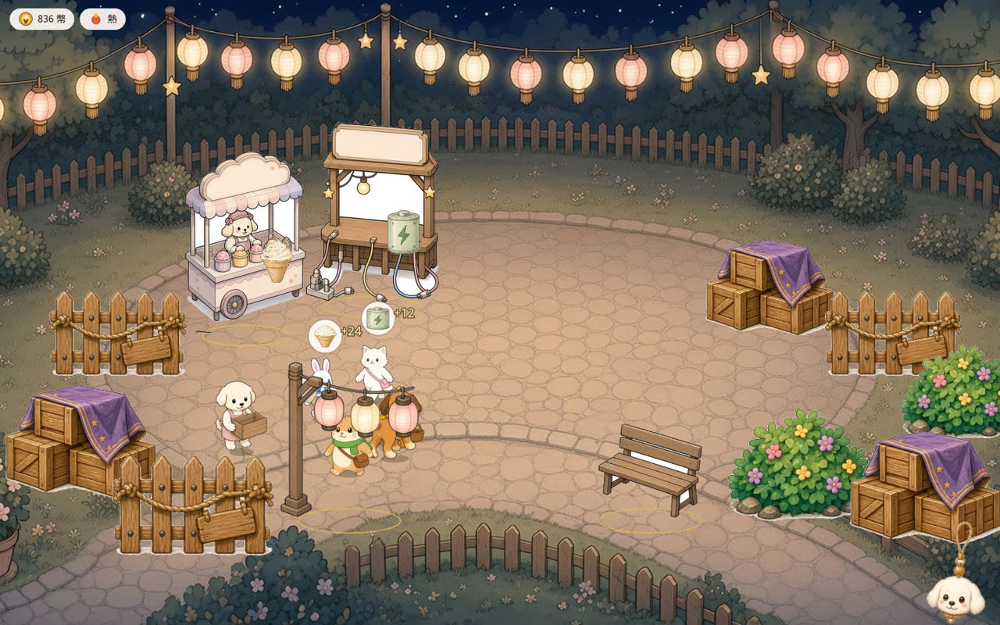
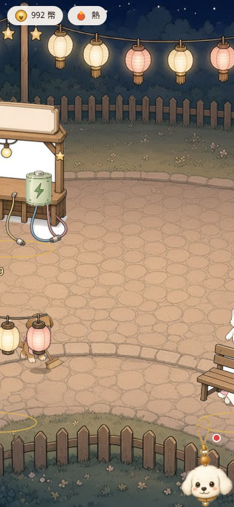
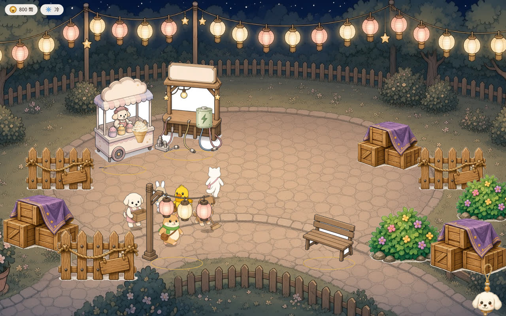

# QA：PR #10 顧客沿石板路移動

HEAD 核對過：`origin/cursor/pr-e-movement-abec` 是 `ce781d4ffc358839eeb02db6bc7bc34f0d21515d`。parent 是 `70dcb51`（走路圖），base 是 `origin/main` `887c07560381d047cddae3cf2aa4a8e5c22c997d`。

## 結論：需修改

品質門檻、試合併、經濟模擬、存檔都過。顧客的正面／背面、1-2-3-2、站著不上下晃、排隊點、腳沒踏進攤位，也都對。

要改的是員工。開場前幾秒，兩隻狗往畫面上方走（plaza `y` 在減少，離開鏡頭）時，播的是正面走路圖，而且 `mirror` 是 true。面向用的是路徑切線，不是這一幀實際的位移。

## 重現

1. 開 `?debug=1` 的新局，視窗 1440×900。
2. 點「開始營業」，看前 2 秒。兩隻狗從入口往攤位走。
3. 白狗一幀的位移大約是 `dx = 0.7`、`dy = -4.9`，圖卻是 `white-puppy-front-1.png`，`mirror` 為 true。棕狗同一時段是 `brown-puppy-front-1.png`，`dy` 約 -1.6。
4. `walkFacing` 的規則是 `dy < 0` 要播背面。顧客大多符合：390×844 的 2.5 秒裡，往上走 59 次是背面、1 次不是。員工這段不符合。

修法：員工走路時用這一幀的位移決定正面／背面和左右鏡像，不要只用路徑切線。

## 合併與 commit

`git merge-tree` 沒有衝突標記。另開 worktree 對 `origin/main` 做 `git merge --no-commit --no-ff`，自動合併成功，沒有留下 commit，也沒有推 `cursor/pr-e-movement-abec`。

`ce781d4` 的作者和 committer 是 Cursor Agent `<cursoragent@cursor.com>`。commit 本文和 PR 本文都沒有 `Co-authored-by`。

`70dcb51`（六個角色的走路圖）作者和 committer 是 `vup830707 <114939683+vup830707@users.noreply.github.com>`。這是這個 commit 的作者信箱，不是 `Co-authored-by` trailer。PR 本文沒有 noreply。

## 品質門檻

| 門檻 | 結果 |
|---|---|
| lint | 通過 |
| typecheck | 通過 |
| unit | 通過，25 files / 140 tests |
| build | 通過。`VITE_BASE=/line-dog-city/`，`check-pwa` 過了，precache 145 |
| e2e | 通過，11 tests |

## 模擬是否同一條

同一支腳本、同一組 32 seeds，在 `887c075` 和 `ce781d4` 各跑 idle 與 active 12 小時。idle 不買。active 每 30 tick 買最便宜的一項。

64 條結果的欄位完全一樣，總 hash 都是 `fb78ad9c55676fd8ce07e4c9fcf597a37f9cb4c93e9e81f0a3d099092b128f1e`。比的是每小時和結束時的 money、rngState、tick、marketLevel、bustleXp、圖鑑，外加整份 street JSON。

seed 1 結束時：idle 錢 443,883、rngState 782169465、tick 43200、Lv.4、bustleXp 53,768、造型 8。active 錢 1,212,877、rngState 533255548、tick 43200、Lv.5、bustleXp 152,049、造型 8。

`src/canvas` 沒有 `createRng`、`rng.next` 或 `Math.random`。左右張望用的是字串 hash，不碰模擬 RNG。`layoutScene` 沒有寫進 street。同一條街連續排 240 幀（不同 alpha、時間、reduced motion），street 的 sha256 前後都是 `36dbe79851b2826501741838744989736a83ff5637c76aa285c2bacd33336e1d`。

## 舊檔

在 `887c075` 打了一份 schema 4：主角棕狗，豆花／燒仙草，tick 2500，錢 19,233，Lv.2，bustleXp 2,984。格子是一番賞 slot 0、刨冰 Lv.2、充電站、燈籠、長椅。員工是豆花補貨、燒仙草掃地。信是 sparrow。造型有 chicken。

`parseSave` 的格子、錢、tick、等級、XP、rngState 都沒差。

localStorage（`savedAt` 設成載入當下，避免離線補 tick）和設定裡的匯入，格子 uid、類型、等級都相同，名字、工作和信也在。匯入後錢仍是 19,233、tick 2500。

## 移動

Playwright 在 1440×900 和 390×844 逐幀讀角色的 plaza 座標和圖檔，並每 170ms 拍一張。量測用的 pose 只在 `?debug=1` 的本地預覽寫進 `window`，沒有改繪製，也沒有留在 PR 分支。

| 檢查 | 結果 |
|---|---|
| 往鏡頭（`dy > 0`） | 1440 有 24 次、390 有 119 次，圖都是 `front` |
| 離開鏡頭（`dy < 0`） | 顧客大多是 `back`。員工見上面的重現 |
| 左右 | 水平位移時，顧客的 `mirror` 跟 `dx < 0` 一致。員工切線和實際位移會差一拍 |
| 1-2-3-2 | 第一隻有走路圖的角色序列是 1,2,3,2,1,2,3,2。換圖間隔中位數 167ms，即 `walkFps` 6 |
| 站著 | `bob` 為 false 時，座標漂移 0。中間幀是檔案 2 |
| 單張圖 | 水獺等沒有走路表的角色維持 `assets/art25/animals/otter.png` 這種單張 |
| 排隊 | 站著的角色沒有兩隻距離小於 20。slot 1 的排隊距約 88 和 176 |
| 踏進攤位 | 腳點落在攤位 footprint 裡的次數是 0。身體盒擦到攤位 3 / 1701 |
| 員工到位 | 白狗接著換成 `white-puppy-carry.png`，棕狗換成 `brown-puppy-sweep.png`，`bob` 變 false |
| tick 邊界 | 1440 的 4 秒裡，沒有角色單幀跳超過 40。390 有一次 `visitor-open-2` 跳了 54 |
| 進出 | 新客人從 `PATH_ENTRANCE` (620, 830) 走進最後 3 步。離開時比較靠近 `PATH_EXIT` (1320, 820)。兩點都在畫面下方，相距 700 |

六張走路圖的最低不透明列都在 y=500，和程式寫的腳點一致。`footOffset` 是 12/512。站著時腳和影子中心相差 0。走路時影子留在地上，身體最多抬 `5 * coverScale`：1440×900 的 scale 是 0.833，約 4.2px；390×844 的 scale 是 0.781，約 3.9px。1123 個走路取樣裡，有 12 次換圖時位移小於 0.15px，是步伐收尾，不是一路滑步。

分頁：CDP 把頁面 frozen 2.5 秒再打開。模擬沒有停（tick 3 走到 5），恢復後每幀最多約 5px，alpha 從 0.82 接著走，沒有單幀瞬移。另外用 `__puppy.runTicks(3)` 一次跳 3 tick：頭 50ms 最多移 17px，接下來 1 秒最多滑 228px。漏掉的 tick 會被壓成 1 秒的滑行，不是瞬移。

`prefers-reduced-motion: reduce` 時，2 秒內 `bob` 次數是 0。左右張望關掉。員工走路時間是 0，會直接站到工作點。顧客仍依 tick 插值。

## 效能

`__puppy.spawn` 24 次之後，存檔裡的客人從 4 變成 28。1 倍 CPU、畫面裡一開始有 30 個角色：

| 視窗 | CPU | fps | 最長幀 | long task |
|---|---|---|---|---|
| 1440×900 | 1× | 60.1 | 17ms | 無 |
| 1440×900 | 4× | 35 | 117ms | 107、60、52、51ms |
| 390×844 | 1× | 60 | 17ms | 無 |
| 390×844 | 4× | 59.6 | 67ms | 76ms |

4 倍 CPU 在桌面會掉到 35fps。1 倍、30 個角色仍是 60fps。這不擋這次的面向問題。

## 複查：c0c8041

HEAD 再對過：`origin/cursor/pr-e-movement-abec` 是 `c0c8041e5ebc3b03722be010c345a0f6e12c3cf2`。parent 是 `b8ff0ec`，再往上是 `ce781d4`、`70dcb51`。`origin/main` 仍是 `887c07560381d047cddae3cf2aa4a8e5c22c997d`。

### 結論：可合併

上一節的員工面向已經修掉。兩隻狗往畫面上方、而且垂直位移大於水平位移時，播的是背面走路圖。60 秒裡沒有不到 150ms 就翻回去的正面／背面循環。彎道上有一次約 50ms 的鏡像切換，換完就停在新方向。

### 開場重現

新局，點「開始營業」，街道一出現就逐幀取樣 4 秒。條件是 `bob` 為 true、`dy < -0.5`，而且 `|dy| >= |dx|`。

| 視窗 | 白狗背面 | 白狗正面 | 棕狗背面 | 棕狗正面 |
|---|---|---|---|---|
| 1440×900 | 12 | 0 | 29 | 0 |
| 390×844 | 12 | 0 | 29 | 0 |

上一節那個失敗樣本現在是背面。1440 的白狗在 73ms：`dx = 0.7`、`dy = -4.9`，圖是 `white-puppy-back-2.png`，`mirror` 為 true。23ms 時已經是 `white-puppy-back-1.png`（`dx = 0.5`、`dy = -3.7`）。記憶裡還沒有上一幀時，第一幀仍用路徑切線；取樣看到的第一個走路幀已經是背面。

另外有 2 幀 `dy` 略小於 0、圖卻是正面。那兩幀水平位移比較大，例如白狗約 423ms 是 `dx = -1.7`、`dy = -0.6`，`white-puppy-front`，`mirror` 為 true。接著路徑轉向上，473ms 是 `dx = 0.3`、`dy = -0.9`，回到背面。這是沿石板路橫走，不是上一節那種整段上坡播正面。

### 60 秒翻面

1440×900 和 390×844 各取 3601 幀、約 60 秒。每個角色的正面／背面翻轉是 0 到 2 次（每秒 0.03 以下）。棕狗多一點：1440 是 5 次（每秒 0.08），390 是 4 次（每秒 0.07）。白狗在 1440 是 0 次，在 390 是 1 次。

左右鏡像：一直在走的角色大約每秒 0.02 次。站著左右看的角色較高，例如 `visitor-v-6` 在 60 秒裡鏡像變了 17 次，其中 16 次是 `bob` 為 false。1440 這種張望共 63 次，390 共 62 次。這些間隔都大於 150ms，左右看仍在。

小於 150ms 的紀錄：

- 1440 有 4 筆，390 有 3 筆。390 的 3 筆和 1440 的後 3 筆是同一段。
- 1440 多出來的一筆是開場 37ms，`visitor-open-1` 的第一次鏡像，圖是 `rabbit-front-2.png`。那是取樣開始後的第一次寫入，沒有再翻回去。
- 棕狗在 tick 42 經過石板路彎角：背面且 `mirror` true（`dx > 0`）→ 約 50ms 後背面且 `mirror` false（`dx = -1`、`dy = -5`）→ 再約 50ms 後正面且 `mirror` true（`dx = -7`、`dy = -6`）。之後這段往左走，`dx` 加大到約 -19，正面和鏡像保持超過 600ms，沒有翻回背面。背面圖和正面圖的鏡像方向相反，所以彎角換正面時鏡像會再切一次。

`prefers-reduced-motion: reduce`，1440×900 取樣 4 秒：`bob` 次數 0，鏡像變化 0。

白狗開場走到工作點的那一幀，plaza 座標一次移了約 48，同時換成 `white-puppy-carry.png`，`bob` 變 false。面向沒有來回翻。

### 門檻與模擬

| 門檻 | 結果 |
|---|---|
| lint | 通過 |
| typecheck | 通過 |
| unit | 通過，25 files / 143 tests |
| build | 通過。乾淨的 `c0c8041` 以 `VITE_BASE=/line-dog-city/` 建置，`check-pwa` 過了，precache 145 |
| e2e | 11 tests 通過。整組先跑時，`phone.spec.ts` 的截圖測試在寫 `/opt/cursor/artifacts/phone-closed-1920.png` 遇到 EIO，其餘 10 個通過。目錄可寫之後單獨重跑該測試，15.9 秒通過 |
| 試合併 | `git merge-tree` 把 `c0c8041` 併進 `origin/main`，沒有衝突 |

4 個 seeds、idle 和 active 各 2 小時，和 `887c075` 的 8 列結果逐欄相同。總 hash 都是 `fdd2da1fec486e1b23629c6d6ee9453f5a567b0b70613148ff1ec27660e32354`。seed 1 idle 結束是錢 53,738、rngState 4210385264、tick 7200、Lv.2、bustleXp 8,768。seed 1 active 結束是錢 8,777、rngState 604205214、tick 7200、Lv.3、bustleXp 20,265。

### b8ff0ec 與 PR #5

`b8ff0ec` 只加了 5 個 QA 檔：這份報告和四張 jpg。報告 blob 是 `12576060ec5ec063854db9ed63af1fb623071015`，和本分支複查前的 `d458aaf` 相同。四張圖的 blob 也相同。

因此，若先合併 PR #10、再合併複查前的 `cursor/qa-balance-report-302e`，這份報告不會衝突。本節是之後才加在 QA 分支上的。PR #10 帶的是舊報告，QA 分支現在是舊報告加上本節，兩邊都會新增 `docs/qa/2026-10-11-pr10-report.md`，內容已經不同。先合併 PR #10、再合併 PR #5，會在這個檔案上衝突。四張 jpg 仍相同，其他 `docs/qa` 檔只在 QA 分支。解的時候留 QA 分支這份較新的報告即可。

### Co-authored-by

`c0c8041`、`b8ff0ec`、`ce781d4` 的作者都是 Cursor Agent `<cursoragent@cursor.com>`。這三個 commit 的本文和 PR 本文都沒有 `Co-authored-by`，也沒有 noreply。

`70dcb51` 的作者和 committer 仍是 `vup830707 <114939683+vup830707@users.noreply.github.com>`。這是該 commit 的作者信箱，不是 `Co-authored-by` trailer。
