# QA：PR #11 第二批走路圖

HEAD 核對過：`origin/cursor/walk-batch2-frames-793c` 是 `fd425ad4a89b3413c027db7be0b33f61f102ca36`。parent 是 `b3e7c6f`（36 張走路圖）。base 是 `origin/main` `47c2836433be8940bc2bde8ddf6dee4f69f3b5ed`。

六個角色各 3 張正面、3 張背面，都是 512 高、腳在 y=500。`bear` 用 raccoon 圖，`fox` 用 red-panda 圖。檔案實際像素和 `WALK_ACTORS` 的寬度一致。

## 結論：需修改

尺寸、腳點、影子錨點、員工走到工作點、品質門檻、試合併、模擬、存檔、1 倍 CPU 的 60fps 都過。

要改的是 3/4 側面的朝向。第一批（貓）的規則是：沒有鏡像的正面朝右，往右走就不鏡像；沒有鏡像的背面朝左，往右走才鏡像。這一批多數圖畫反了。往右走時臉朝左。小貓熊的背面第 3 幀又和第 1、第 2 幀相反，同一個往上走的步伐裡頭會轉過去。

## 重現

對照是貓。`cat-front-1.png` 沒有鏡像時臉朝右。`cat-back-1.png` 沒有鏡像時臉朝左。`walkFacing` 往右（`dx >= 0`）的正面是 `mirror` false；往上且 `dx > 0` 的背面是 `mirror` true。

這次量測把 debug `spawn` 的「直接放到攤位」關掉，所以 `__puppy.spawn` 會走出最後 3 步。正式程式會先站到攤位，離開攤位時用的是同一套 mirror。視窗 1440×900，`?debug=1`，新局，點「開始營業」。

1. 水獺走出 `dx = 2.9`、`dy = -1.8`。圖是 `otter-front-1.png`，`mirror` false。正面原圖朝左，人往右走，臉也朝左。
2. 小貓熊走出 `dx = 0.2`、`dy = -1.9`。`red-panda-back-1.png`、`back-2`、`back-3` 都是 `mirror` true。back-1 和 back-2 鏡像後朝左，back-3 鏡像後朝右。`walkFps` 是 6，序列 1-2-3-2，back-3 大約每 667ms 出現 167ms。頭會在同一個背面步伐裡轉到另一邊。
3. 浣熊走出 `dx = 0.3`、`dy = -4.5`。`raccoon-back-*.png`，`mirror` true。背面原圖朝右，鏡像後朝左，人在往上、略往右。
4. 刺蝟走出 `dx = -2`、`dy = -2.4`。`hedgehog-back-*.png`，`mirror` false。背面原圖朝右，人往左上。刺蝟的傾斜比水獺小，正面幾乎朝鏡頭。
5. 文鳥走出 `dx = 0.4`、`dy = -2.7`。`munia-back-3.png`，`mirror` true。背面原圖朝右，鏡像後朝左。
6. 雪貂的背面原圖朝左，和貓的背面一致。正面原圖朝左。往左走時 `dx = -3.5`，正面 `mirror` true，臉被翻到右邊。

修法：把畫反的圖水平翻轉，讓沒有鏡像的正面朝右、沒有鏡像的背面朝左。小貓熊的 `red-panda-back-3.png` 要和 back-1、back-2 同一側。

下圖是遊戲會畫出來的樣子。紅線是畫布中心，也是影子的水平位置。狐的四格是同一個 `mirror` true，順序 1-2-3-2。

街上抓到的正面和背面。水獺這 4 秒沒有走到背面。

4 秒的接近路線裡，正面／背面的 enum 沒有在 150ms 內翻回去。刺蝟、狐、浣熊各 2 次換面（每秒 0.5），水獺 0 次。上面的頭轉向發生在背面圖自己的 1-2-3-2 裡，src 仍是 back，所以不會算進這個 flip 次數。

## 尺寸和腳點

同一處、1440×900。舊的單張和新的走路圖都用 `CUSTOMER_H`。畫布高度跟著 plaza `y` 的 depth，同一深度幾乎一樣。寬度變窄，因為新圖的畫布比較窄。不透明內容的高差是和舊圖比。

腳：36 張新圖最下面的不透明像素都在 y=500。站著時腳和影子相差 0。舊的單張沒有 `footOffset`，腳浮在影子上面約 2.0 到 3.1px。走路時身體最多抬 `5 * coverScale`，1440×900 約 4.2px，影子留在地上。

不透明外框的水平中心和影子中心相差在 ±0.2px 以內。寬尾巴沒有把錨點拉開。

| 角色 | 站著腳對影子 | 走路畫布高 vs 舊圖 | 走路畫布寬 vs 舊圖 | 正面第 2 幀不透明高 | 正面第 2 幀不透明寬 |
|---|---|---|---|---|---|
| 刺蝟 | 0（舊圖 -2.2px） | 93.8 / 93.9 | 67.8 / 79.4（-15%） | -1.5% | -15% |
| 水獺 | 0（舊圖 -2.0px） | 92.0 / 92.1 | 74.4 / 81.2（-8%） | -2.4% | -12% |
| 浣熊 | 0（舊圖 -2.0px） | 93.8 / 94.1 | 73.3 / 78.1（-6%） | -2.4% | -8% |
| 小貓熊 | 0（舊圖 -2.0px） | 93.8 / 93.7 | 77.7 / 82.7（-6%） | -4.3% | -18% |
| 雪貂 | 0（舊圖 -2.7px） | 同 `CUSTOMER_H` | 畫布寬 -2% | -0.8% | -9% |
| 文鳥 | 0（舊圖 -3.1px） | 同 `CUSTOMER_H` | 畫布寬 -3% | -1.5% | -2% |

1-2-3 三幀的畫布高相同。不透明寬會隨步伐收腳變窄，小貓熊正面第 1、第 3 幀的不透明寬約 -10%，第 2 幀約 -18%。

## 員工

`setMoney(8000)` 之後雇用文鳥和雪貂。兩隻都從入口走到工作點，然後 `bob` 變 false，停在中間幀（檔案 2）。文鳥最後是 `munia-back-2.png`，約 (563, 781)。雪貂最後是 `ferret-front-2.png`，約 (467, 781)。停著的取樣各約 350 幀，沒有繼續換步。

他們沒有狗的 carry / sweep 那種另一張工作圖。接上走路表之後，站著用的就是步伐的第 2 幀，原來的 `staff/ferret.png` 和 `staff/munia.png` 不再畫出來。

進石板路的那個彎，文鳥有一次 16ms 的鏡像切換，接著就停在新方向。和 PR #10 棕狗在彎角的一次切換同一類，不是一路來回翻。

## 品質門檻

| 門檻 | 結果 |
|---|---|
| lint | 通過 |
| typecheck | 通過 |
| unit | 通過，25 files / 144 tests |
| build | 通過。`VITE_BASE=/line-dog-city/`，`check-pwa` 過了 |
| e2e | 通過，11 tests |
| 試合併 | `git merge-tree` 把 `fd425ad` 併進 `origin/main`，沒有衝突 |

precache 從 main 的 145 筆、19066 KiB，變成 181 筆、26120 KiB。多的 36 筆、約 7053 KiB 就是這六個角色的走路圖。

## 模擬和存檔

4 seeds、idle 和 active 各 2 小時，和 `47c2836` 的 8 列逐欄相同。總 hash 都是 `fdd2da1fec486e1b23629c6d6ee9453f5a567b0b70613148ff1ec27660e32354`。seed 1 idle 結束是錢 53,738、rngState 4210385264、tick 7200、Lv.2、bustleXp 8,768。seed 1 active 結束是錢 8,777、rngState 604205214、tick 7200、Lv.3、bustleXp 20,265。

在 `47c2836` 打的 schema 4：主角棕狗，豆花／燒仙草，tick 80，錢 1,309，Lv.1，bustleXp 66，rngState 2455825194。格子是刨冰、充電站、燈籠、長椅。信是 sparrow。

localStorage（`savedAt` 設成載入當下）和設定裡的匯入，錢、tick、等級、XP、rngState、格子 uid、員工、信都相同。

## 效能

約 30 個角色，含刺蝟、水獺、小貓熊、浣熊。量 10 秒。對照是 PR #10。

| 視窗 | CPU | fps | 最長幀 | long task | PR #10 |
|---|---|---|---|---|---|
| 1440×900 | 1× | 60.1 | 17ms | 無 | 60.1fps，17ms，無 |
| 1440×900 | 4× | 35.3 | 117ms | 159、120、108、73、66、65、61、57、55、53ms | 35fps，117ms，107、60、52、51ms |
| 390×844 | 1× | 60.1 | 17ms | 無 | 60fps，17ms，無 |
| 390×844 | 4× | 59.3 | 33ms | 102、65、61、58、50ms | 59.6fps，67ms，76ms |

1 倍仍是 60fps。4 倍桌面仍是約 35fps，最長的 long task 比 PR #10 的 107ms 長，到 159ms。這不擋這次的朝向問題。

## Co-authored-by

`fd425ad` 的作者和 committer 是 Cursor Agent `<cursoragent@cursor.com>`。commit 本文和 PR 本文都沒有 `Co-authored-by`，也沒有 noreply。

`b3e7c6f` 的作者和 committer 是 `vup830707 <114939683+vup830707@users.noreply.github.com>`。這是這個 commit 的作者信箱，不是 `Co-authored-by` trailer。

## 複查 0c62892

HEAD 核對過：`origin/cursor/walk-batch2-frames-793c` 是 `0c62892334ae8929a6066a8cea91bae382709525`。parent 是 `fd425ad`。`origin/main` 仍是 `47c2836433be8940bc2bde8ddf6dee4f69f3b5ed`。

`WALK_ACTORS` 每一列都有 `frontFacesRight` 和 `backFacesRight`。`walkMirror` 用這兩個旗標和 `dx` 決定要不要鏡像。`dx === 0` 保持原圖。五張圖是水平翻轉，和翻轉前的像素對得起來：`rabbit-front-3`、`rabbit-back-1`、`white-puppy-back-1`、`brown-puppy-back-1`、`red-panda-back-3`。

## 複查結論：需修改

第二批的六個角色，畫出來的臉跟水平移動方向一致。小貓熊背面第 3 幀已經和第 1、第 2 幀同一側，同一個 1-2-3-2 裡頭不再轉過去。

第一批有四個角色的旗標和畫出來的臉相反。往右走時臉朝左。同一個步伐裡的三幀沒有互相朝反方向，是整組朝錯邊。

量測是 1440×900、`?debug=1`、新局。debug `spawn` 直接站上攤位的那一行在量測用的建置裡關掉了。六個方向是把腳每次移 4px（上、下再加 2px 的水平分量），讓 `facingFromStep` 讀到這個位移。臉的方向是 `drawPlaza` 實際畫出來的那張圖（同一張圖、同一個 mirror）上的像素，不是旗標。紅線是精靈的水平中心。390×844 用同一套方向再量一次。

| 角色 | 六個方向 | 同一個 1-2-3-2 |
|---|---|---|
| 白狗 | 正面和背面都朝反 | 第 1、第 3 幀同一側，第 2 幀接近正面 |
| 棕狗 | 背面朝反；正面的傾斜和移動方向同側 | 背面第 1、第 3 幀同一側 |
| 貓 | 跟移動方向同側 | 沒有反轉 |
| 兔子 | 跟移動方向同側 | 沒有反轉 |
| 倉鼠 | 背面朝反；正面同側 | 背面沒有反轉 |
| 鴨子 | 背面朝反；正面幾乎朝鏡頭 | 背面沒有反轉 |
| 刺蝟、水獺、浣熊、小貓熊、雪貂、文鳥 | 跟移動方向同側 | 沒有反轉 |

## 朝反的重現

視窗 1440×900。下面的 `mirror` 和圖檔是遊戲畫出來的那一幀。

1. 白狗往右，`dx > 0`，正面。`white-puppy-front-1.png`，`mirror` false。原圖臉朝左，沒有鏡像，人往右，臉朝左。`front-3` 一樣。390×844 的 `front-3` 也是。
2. 白狗往右上，`dx > 0`、`dy < 0`。`white-puppy-back-1.png` 和 `back-3`，`mirror` false。兩張都朝左。`back-2` 接近正背面。
3. 棕狗往右上。`brown-puppy-back-1.png` 和 `back-3`，`mirror` false。臉朝左。`back-2` 接近正背面。
4. 倉鼠往右上。`hamster-back-1.png` 和 `back-2`，`mirror` true。鏡像之後臉朝左。
5. 鴨子往右上。`duck-back-2.png`，`mirror` false。頭的高點在中線左邊。`back-3` 同一側，比較輕。390×844 的 `back-2` 一樣朝左。

旗標現在寫成：白狗正面、背面都 `true`；棕狗背面 `true`；倉鼠背面 `false`；鴨子背面 `true`。畫出來的原圖是反的，所以 `walkMirror` 把臉留在移動方向的另一邊。新的 unit test 只檢查旗標和 `dx` 的組合，不看像素，所以這幾列還是會過。

`red-panda-back-3` 翻轉之後，往右上的三張背面都朝右。水獺往右的正面朝右。這兩張是上一輪的重現，這次過了。

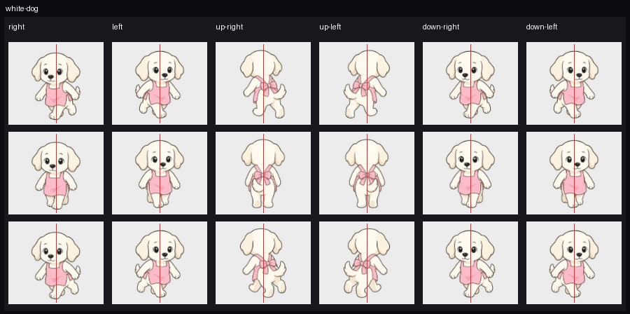

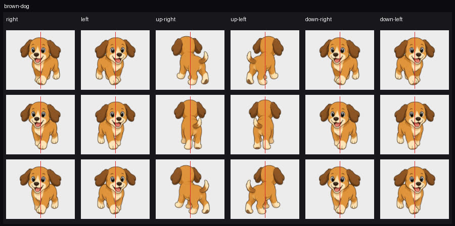

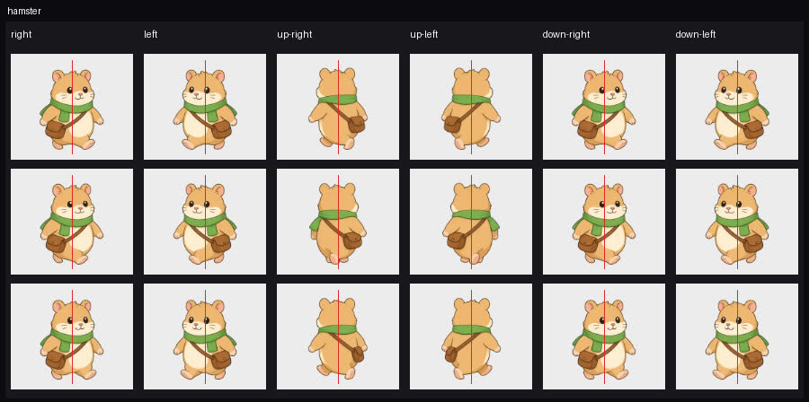

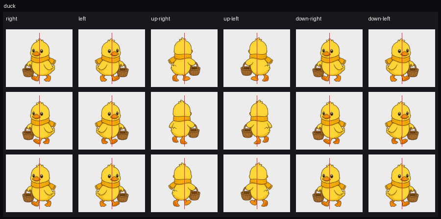

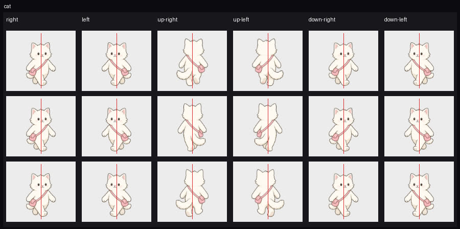

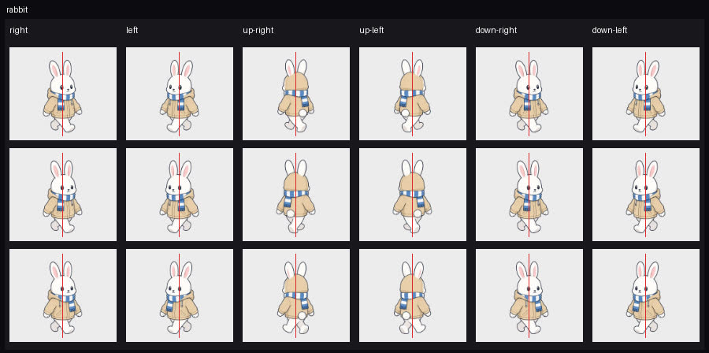

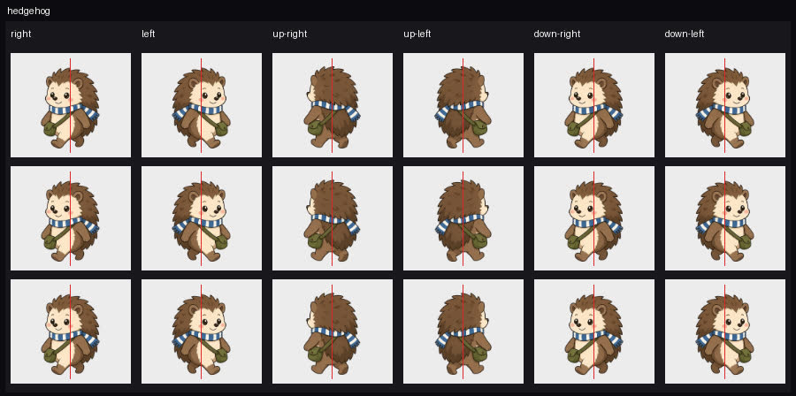

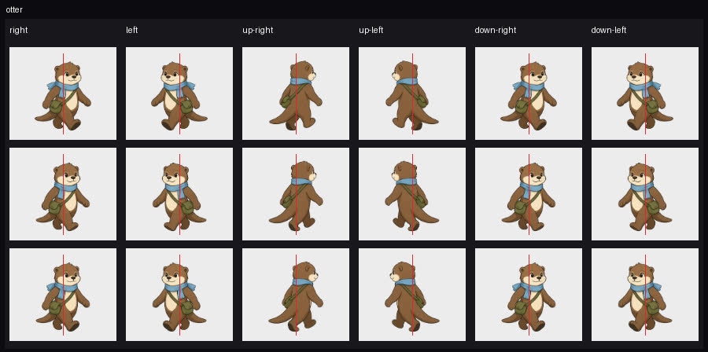

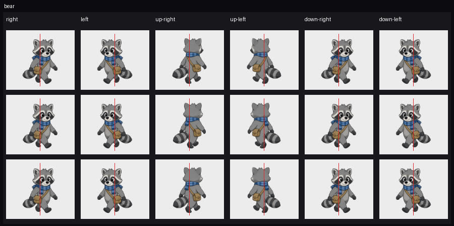

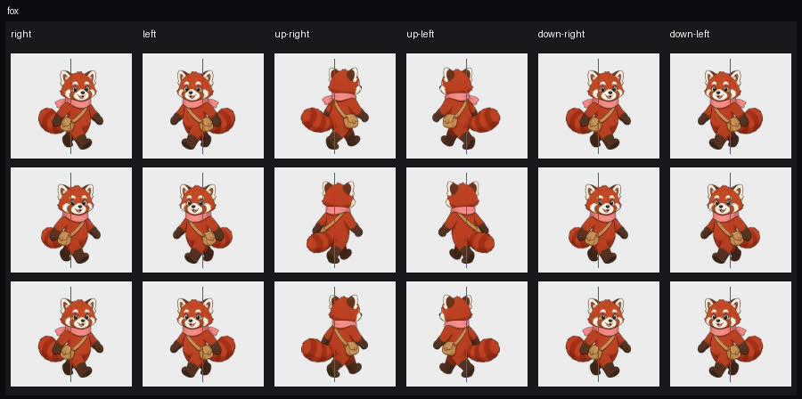

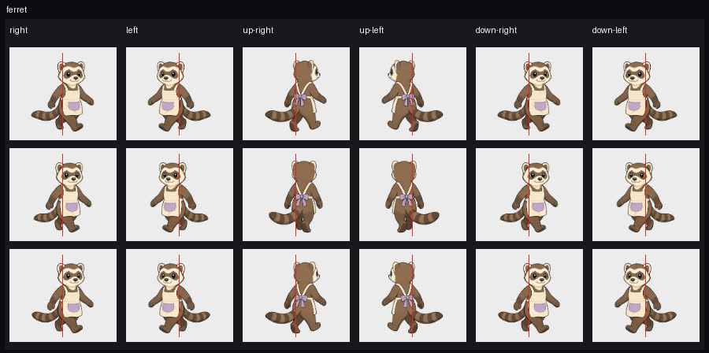

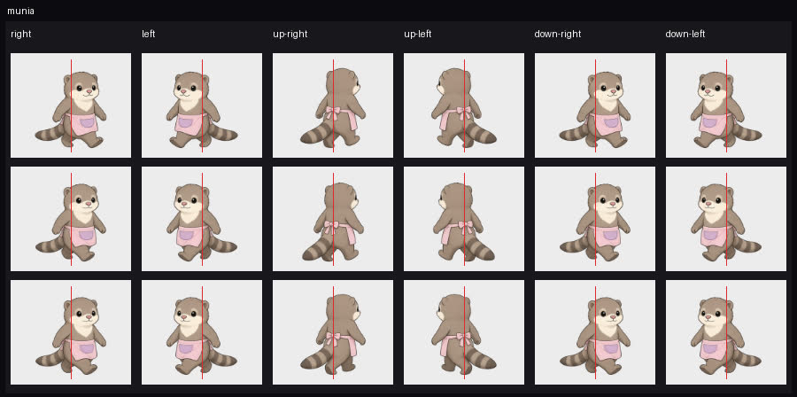

## 第一批回歸

開局約 2 秒，兩隻狗往上走（`dy` 明顯小於 0，而且 `|dy| >= |dx|`）用的是背面。白狗 t=57ms，`dx = 0.7`、`dy = -4.9`，`white-puppy-back-1.png`，`mirror` false。棕狗這段強的上坡步也是背面，沒有正面。圖檔種類和 PR #10 修完之後一樣。臉的方向是上面的第 2、第 3 點：背面原圖朝左，`mirror` false，水平分量往右時臉朝左。

`|dy|` 不到 1px 的小步會留在前一個朝向。這是 `FACING_COMMIT`，不是又改回正面。

員工會走到工作點並停在第 2 幀。文鳥停在 `munia-back-2.png`，`bob` false，約 (515, 781)。雪貂停在 `ferret-front-2.png`，`bob` false，約 (421, 781)。兩隻狗停下來之後換成 carry 和 sweep，和 PR #10 一樣。

## 閃爍

1440×900 和 390×844 各跑 60 秒，出生點沒有直接站上攤位。沒有在 150ms 內翻回上一個朝向。

短於 150ms 的都是轉彎，轉完就停在新方向。1440 有五次：棕狗開局 33ms 從正面換成背面；水獺一次 17ms 的鏡像；棕狗約 42 秒先 50ms 換鏡像，再 50ms 從背面換成正面，沒有回到原來的鏡像。390 是同一段棕狗轉彎，117ms 和兩次 50ms。左右看的 glance 仍是約 300ms，沒有算進去。

## 複查的品質門檻

| 門檻 | 結果 |
|---|---|
| lint | 通過 |
| typecheck | 通過 |
| unit | 通過，145 tests |
| build | 通過。`VITE_BASE=/line-dog-city/`，precache 181 筆、26138.65 KiB，`check-pwa` 過了 |
| e2e | 11 tests。第一次有 2 個失敗：growth 的截圖 EIO，以及 title 的圖還沒載完、狗的座標是 NaN。這兩項重跑通過 |
| 試合併 | `git merge-tree` 把 `0c62892` 併進 `origin/main`，沒有衝突 |

4 seeds、idle 和 active 各 2 小時，和 `47c2836` 的 8 列相同。hash 都是 `fdd2da1fec486e1b23629c6d6ee9453f5a567b0b70613148ff1ec27660e32354`。

同一份 schema 4（豆花／燒仙草，tick 80，錢 1,309，Lv.1，bustleXp 66，rngState 2455825194，格子和 sparrow 的信）用 localStorage 和設定裡的匯入，欄位都對得上。標題是「繼續營業」。

## 複查的 Co-authored-by

`0c62892` 的作者是 Cursor Agent `<cursoragent@cursor.com>`。commit 本文沒有 `Co-authored-by`，也沒有 noreply。PR 本文也沒有。

`fd425ad` 一樣沒有 trailer。`b3e7c6f` 的作者信箱仍是上面的 noreply，不是 trailer。

## 複查 08076c7

HEAD 核對過：`origin/cursor/walk-batch2-frames-793c` 是 `08076c7c4713b976b775d8f2397a18fe520bbd0a`。parent 是 `0c62892`。`origin/main` 仍是 `47c2836433be8940bc2bde8ddf6dee4f69f3b5ed`。這次 diff 是 12 個檔、+280/−23，沒有 png。旗標只改了四列：倉鼠背面 `false` → `true`，鴨子背面 `true` → `false`，白狗正面和背面都改成 `false`，棕狗背面 `true` → `false`。

## 結論：可合併

十二個角色、正面和背面、六個方向，畫面上的臉跟水平移動同一邊。1-2-3-2 裡面沒有頭轉到另一邊。上一輪白狗、棕狗背面、倉鼠背面、鴨子背面的四個錯邊，這次的旗標把鏡像補上了。

## 畫面上的朝向

1440×900，每個方向留下步伐裡出現過的圖。暗色內部（亮度 < 100、不靠透明邊）的重心相對外框中心，超過 ±0.045 才算有左右。390×844 用同一套門檻抽查，216 幀的正面／背面種類都對。n < 8 的單點不算方向。

往右、往左、往右下、往左下是正面。往右上、往左上（`|dy| >= |dx|` 且 `dy < 0`）是背面。

| 角色 | 往右時的鏡像 | 畫面上的臉 |
|---|---|---|
| 白狗正面 | true | front-1、front-3 朝右（+0.054、+0.052）。front-2 是 +0.038，算正中 |
| 白狗背面 | true | back-1、back-3 朝右（+0.149、+0.078）。back-2 沒有暗色內部，算正中 |
| 棕狗正面 | false | 三幀 +0.035 到 +0.042，正中，符號朝右 |
| 棕狗背面 | true | back-1、back-3 朝右（+0.156、+0.180）。back-2 是 +0.009 |
| 倉鼠背面 | false | 三幀都朝右（+0.069、+0.084、+0.053），含 back-2 |
| 鴨子背面 | true | 頭的質量在中線右邊（相對寬度 +0.034、+0.061、+0.039）。暗色像素少，1440 落在 ±0.045 裡；390 的 back-2 是 +0.052 |
| 貓、兔子、刺蝟、水獺、浣熊、小貓熊、雪貂、文鳥 | 跟各自旗標 | 有傾斜的幀都跟 `dx` 同一邊。小貓熊 back-1、back-2、back-3 往右上都朝右 |

390 的白狗 `back-2` 只有 1 個暗色像素，bias −0.258，是取樣雜訊。同一幀在 1440 是 n=0。倉鼠 back-2 在 390 是 +0.117、n=44，朝右。

開局約 2 秒，兩隻狗在 `|dy| >= |dx|` 的上坡步用背面。白狗 t=27ms，`dx = -1.6`、`dy = -2.2`，`white-puppy-back-2.png`，`mirror` false。背面原圖朝左，水平分量也朝左。棕狗 t=27ms 起，`dx` 約 0.3 到 0.4、`dy` 約 −2 到 −3，`brown-puppy-back-2.png` 和 `back-3`，`mirror` true。背面原圖朝左，鏡像後朝右。腳本把白狗往右上走時，`back-1` 和 `back-3` 是 `mirror` true，bias +0.149 和 +0.078。

員工走到工作點後停在檔案 2，`bob` false。文鳥是 `munia-back-2.png`，約 (512, 781)。雪貂是 `ferret-back-2.png`，約 (418, 781)。兩隻狗停下來是 carry 和 sweep。

60 秒、兩個視窗，沒有在 150ms 內翻回剛才的朝向。1440 有 155 次換面，其中 6 次間隔 < 150ms；390 是 146 次和 6 次。短的是雇用當下的一步，以及約 42 秒棕狗在彎角：正面換成背面，50ms 後只換鏡像，再 50ms 換成正面，然後停在新方向。

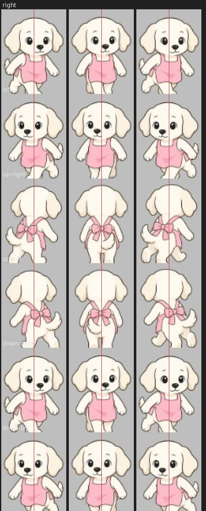

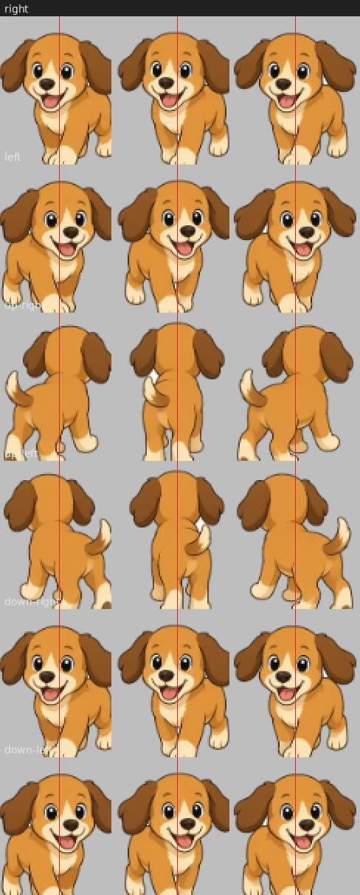

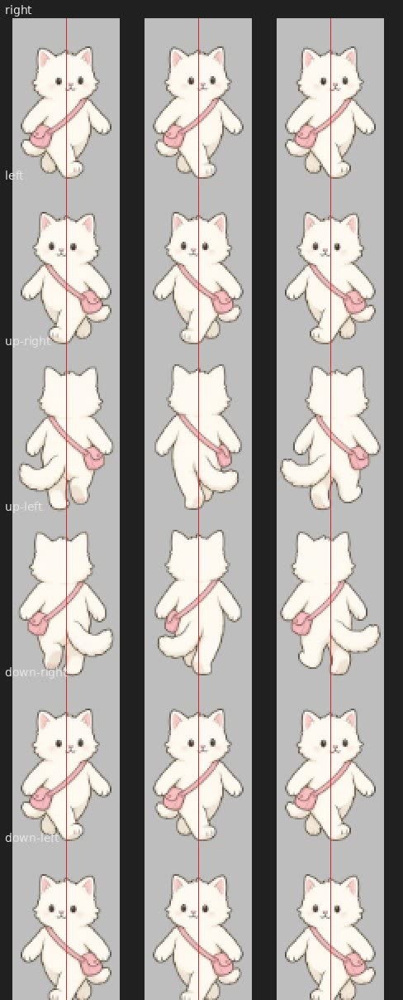

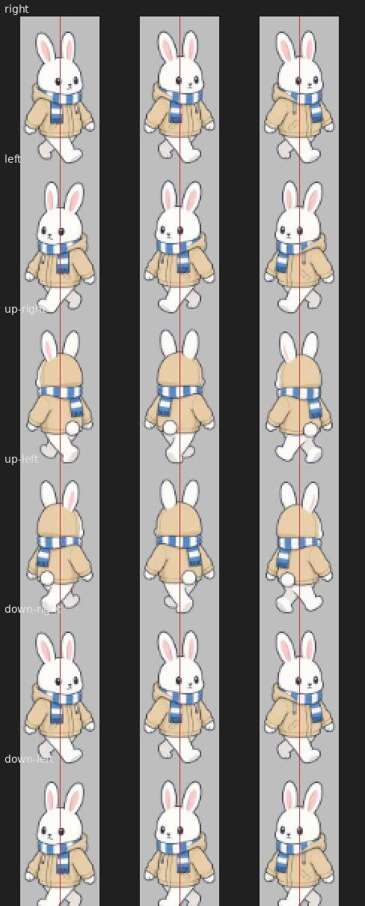

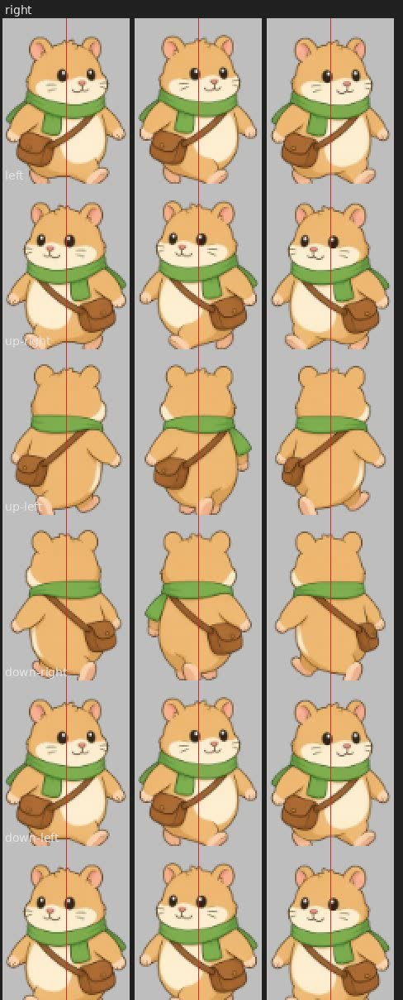

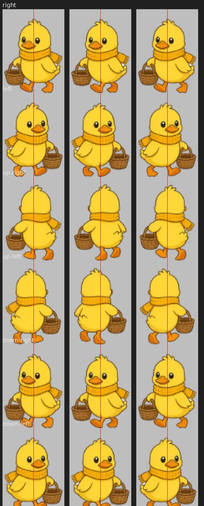

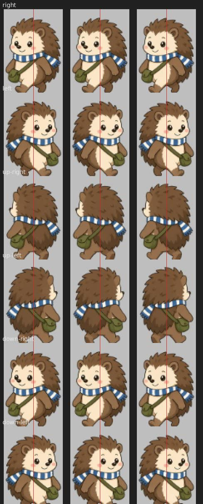

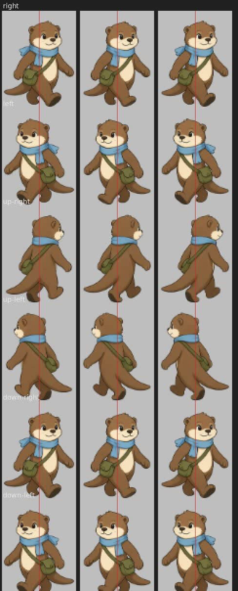

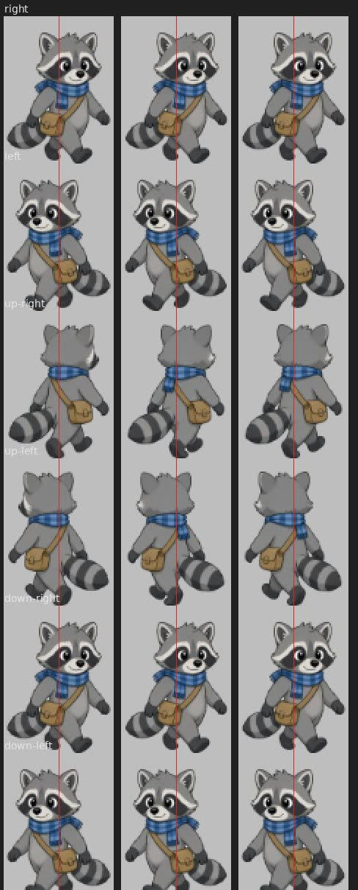

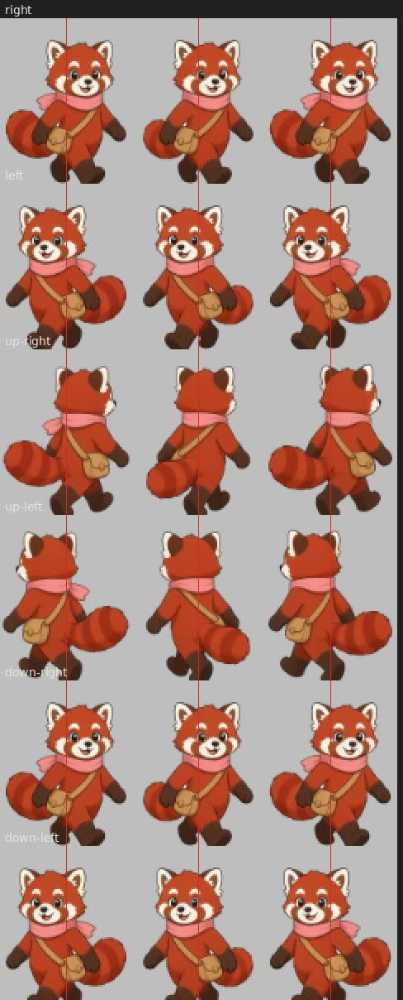

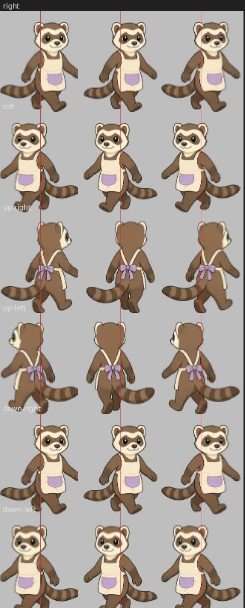

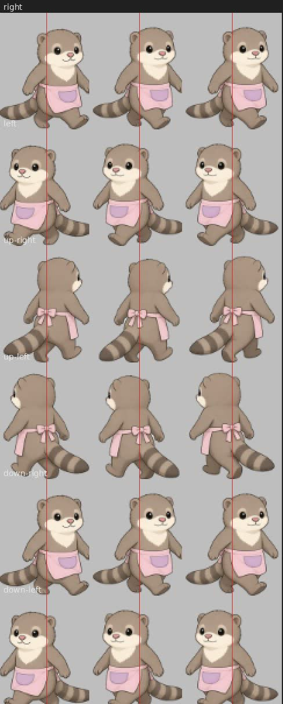

## 像素測試

`pixelFacing` 用頭的不透明重心對畫布中心（`MASS_MIN` 11）。正面再看兩眼之間的鼻子（`NOSE_MIN` 8）。接著是頭的左右跨距（`SPAN_MIN` 12）和上下段的傾斜（`LEAN_MIN` 5）。都不到就回 `neutral`，第二個測試會跳過。

把四列旗標改回 `0c62892` 再跑這個檔：第一個測試過（它只讀像素）。第二個測試失敗，第一個斷言就是 `hamster-back-1.png`，像素是 `right`，舊旗標要 `left`。用同一套分類對舊旗標比完 72 幀，對不上的是這 11 張，就是上一輪畫反的那些：`hamster-back-1`、`hamster-back-3`、`duck-back-1`、`duck-back-2`、`duck-back-3`、`white-puppy-front-1`、`white-puppy-front-3`、`white-puppy-back-1`、`white-puppy-back-3`、`brown-puppy-back-1`、`brown-puppy-back-3`。這 11 張都不是 `neutral`。

`neutral` 的 14 張：`cat-front-1`、`cat-front-2`、`cat-front-3`、`cat-back-2`、`rabbit-back-1`、`rabbit-back-2`、`rabbit-back-3`、`hamster-front-1`、`hamster-front-2`、`hamster-front-3`、`hamster-back-2`、`white-puppy-front-2`、`white-puppy-back-2`、`brown-puppy-back-2`。

貓的三張正面質量大約 −3，畫面 bias +0.036 到 +0.044。三張都是 `neutral`，所以只把貓的 `frontFacesRight` 寫反，這個測試仍會過。現在的圖接近正面，沒有藏著一張明顯朝錯的幀。`nose < 0 && lean >= 4` 的分支在這 72 張都沒有成立。

`hamster-back-2` 是離門檻最近、又被跳過的一張：質量 1.4、傾斜 −3.8、跨距 −3。往右上時 `mirror` false，暗色重心在 1440 是 +0.084、在 390 是 +0.117，朝右，和現在的旗標同一邊。同張背面的 back-1（跨距 15）和 back-3（跨距 14）不是 `neutral`，旗標寫反仍會失敗。

72 張裡，測試說的左右和畫面上的頭部位移沒有相反的。53 張標籤相同。18 張測試有左右、暗色門檻把畫面算成正中，頭的質量符號仍和測試同一邊：棕狗三張正面、`cat-back-1`、`cat-back-3`、鴨子六張、刺蝟三張背面、文鳥三張背面、`red-panda-front-2`。剩下的差是 `hamster-back-2`：測試是 `neutral`，畫面是輕微朝右。

## 這次的品質門檻

| 門檻 | 結果 |
|---|---|
| lint | 通過 |
| typecheck | 通過 |
| unit | 通過，26 files / 147 tests |
| build | 通過。`VITE_BASE=/line-dog-city/`，precache 181 筆、26138.65 KiB，`check-pwa` 過了 |
| e2e | 連跑兩次，各 11 passed（40.7s、43.1s） |
| 試合併 | `git merge-tree` 把 `08076c7` 併進 `origin/main`，樹是 `b651103ff7c3642891980a8557f758ecd946ca5f`，沒有衝突 |

4 seeds、idle 和 active 各 2 小時，和 `47c2836` 的 8 列相同。hash 都是 `fdd2da1fec486e1b23629c6d6ee9453f5a567b0b70613148ff1ec27660e32354`。

同一份 schema 4（豆花／燒仙草，tick 80，錢 1,309，Lv.1，bustleXp 66，rngState 2455825194，格子和 sparrow 的信）用 localStorage 和設定裡的匯入，欄位都對得上。標題是「繼續營業」，畫面上的錢是 1,309。

## 這次的 Co-authored-by

`08076c7` 的作者是 Cursor Agent `<cursoragent@cursor.com>`。commit 本文沒有 `Co-authored-by`，也沒有 noreply。PR 本文也沒有。
