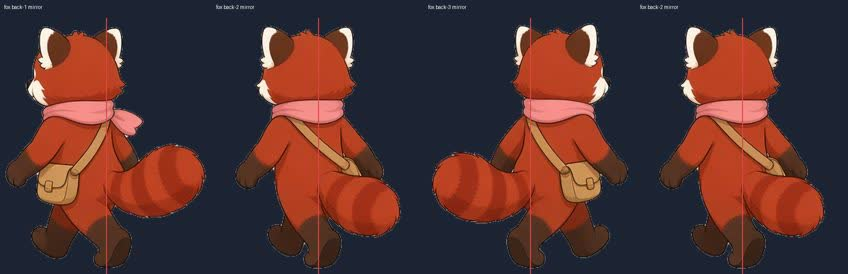
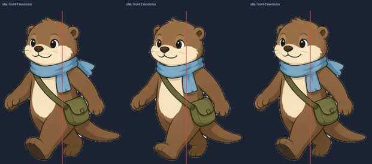
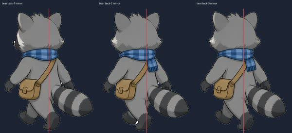
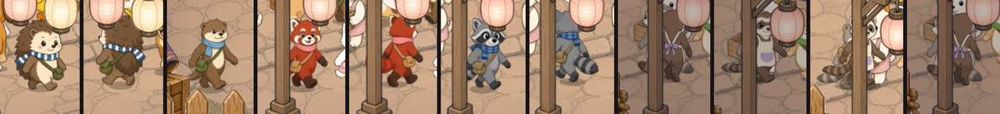

# QA：PR #11 第二批走路圖

HEAD 核對過：`origin/cursor/walk-batch2-frames-793c` 是 `fd425ad4a89b3413c027db7be0b33f61f102ca36`。parent 是 `b3e7c6f`（36 張走路圖）。base 是 `origin/main` `47c2836433be8940bc2bde8ddf6dee4f69f3b5ed`。

六個角色各 3 張正面、3 張背面，都是 512 高、腳在 y=500。`bear` 用 raccoon 圖，`fox` 用 red-panda 圖。檔案實際像素和 `WALK_ACTORS` 的寬度一致。

## 結論：需修改

尺寸、腳點、影子錨點、員工走到工作點、品質門檻、試合併、模擬、存檔、1 倍 CPU 的 60fps 都過。

要改的是 3/4 側面的朝向。第一批（貓）的規則是：沒有鏡像的正面朝右，往右走就不鏡像；沒有鏡像的背面朝左，往右走才鏡像。這一批多數圖畫反了。往右走時臉朝左。小貓熊的背面第 3 幀又和第 1、第 2 幀相反，同一個往上走的步伐裡頭會轉過去。

## 重現

對照是貓。`cat-front-1.png` 沒有鏡像時臉朝右。`cat-back-1.png` 沒有鏡像時臉朝左。`walkFacing` 往右（`dx >= 0`）的正面是 `mirror` false；往上且 `dx > 0` 的背面是 `mirror` true。

這次量測把 debug `spawn` 的「直接放到攤位」關掉，所以 `__puppy.spawn` 會走出最後 3 步。正式程式會先站到攤位，離開攤位時用的是同一套 mirror。視窗 1440×900，`?debug=1`，新局，點「開始營業」。

1. 水獺走出 `dx = 2.9`、`dy = -1.8`。圖是 `otter-front-1.png`，`mirror` false。正面原圖朝左，人往右走，臉也朝左。
2. 小貓熊走出 `dx = 0.2`、`dy = -1.9`。`red-panda-back-1.png`、`back-2`、`back-3` 都是 `mirror` true。back-1 和 back-2 鏡像後朝左，back-3 鏡像後朝右。`walkFps` 是 6，序列 1-2-3-2，back-3 大約每 667ms 出現 167ms。頭會在同一個背面步伐裡轉到另一邊。
3. 浣熊走出 `dx = 0.3`、`dy = -4.5`。`raccoon-back-*.png`，`mirror` true。背面原圖朝右，鏡像後朝左，人在往上、略往右。
4. 刺蝟走出 `dx = -2`、`dy = -2.4`。`hedgehog-back-*.png`，`mirror` false。背面原圖朝右，人往左上。刺蝟的傾斜比水獺小，正面幾乎朝鏡頭。
5. 文鳥走出 `dx = 0.4`、`dy = -2.7`。`munia-back-3.png`，`mirror` true。背面原圖朝右，鏡像後朝左。
6. 雪貂的背面原圖朝左，和貓的背面一致。正面原圖朝左。往左走時 `dx = -3.5`，正面 `mirror` true，臉被翻到右邊。

修法：把畫反的圖水平翻轉，讓沒有鏡像的正面朝右、沒有鏡像的背面朝左。小貓熊的 `red-panda-back-3.png` 要和 back-1、back-2 同一側。

下圖是遊戲會畫出來的樣子。紅線是畫布中心，也是影子的水平位置。狐的四格是同一個 `mirror` true，順序 1-2-3-2。

街上抓到的正面和背面。水獺這 4 秒沒有走到背面。

4 秒的接近路線裡，正面／背面的 enum 沒有在 150ms 內翻回去。刺蝟、狐、浣熊各 2 次換面（每秒 0.5），水獺 0 次。上面的頭轉向發生在背面圖自己的 1-2-3-2 裡，src 仍是 back，所以不會算進這個 flip 次數。

## 尺寸和腳點

同一處、1440×900。舊的單張和新的走路圖都用 `CUSTOMER_H`。畫布高度跟著 plaza `y` 的 depth，同一深度幾乎一樣。寬度變窄，因為新圖的畫布比較窄。不透明內容的高差是和舊圖比。

腳：36 張新圖最下面的不透明像素都在 y=500。站著時腳和影子相差 0。舊的單張沒有 `footOffset`，腳浮在影子上面約 2.0 到 3.1px。走路時身體最多抬 `5 * coverScale`，1440×900 約 4.2px，影子留在地上。

不透明外框的水平中心和影子中心相差在 ±0.2px 以內。寬尾巴沒有把錨點拉開。

| 角色 | 站著腳對影子 | 走路畫布高 vs 舊圖 | 走路畫布寬 vs 舊圖 | 正面第 2 幀不透明高 | 正面第 2 幀不透明寬 |
|---|---|---|---|---|---|
| 刺蝟 | 0（舊圖 -2.2px） | 93.8 / 93.9 | 67.8 / 79.4（-15%） | -1.5% | -15% |
| 水獺 | 0（舊圖 -2.0px） | 92.0 / 92.1 | 74.4 / 81.2（-8%） | -2.4% | -12% |
| 浣熊 | 0（舊圖 -2.0px） | 93.8 / 94.1 | 73.3 / 78.1（-6%） | -2.4% | -8% |
| 小貓熊 | 0（舊圖 -2.0px） | 93.8 / 93.7 | 77.7 / 82.7（-6%） | -4.3% | -18% |
| 雪貂 | 0（舊圖 -2.7px） | 同 `CUSTOMER_H` | 畫布寬 -2% | -0.8% | -9% |
| 文鳥 | 0（舊圖 -3.1px） | 同 `CUSTOMER_H` | 畫布寬 -3% | -1.5% | -2% |

1-2-3 三幀的畫布高相同。不透明寬會隨步伐收腳變窄，小貓熊正面第 1、第 3 幀的不透明寬約 -10%，第 2 幀約 -18%。

## 員工

`setMoney(8000)` 之後雇用文鳥和雪貂。兩隻都從入口走到工作點，然後 `bob` 變 false，停在中間幀（檔案 2）。文鳥最後是 `munia-back-2.png`，約 (563, 781)。雪貂最後是 `ferret-front-2.png`，約 (467, 781)。停著的取樣各約 350 幀，沒有繼續換步。

他們沒有狗的 carry / sweep 那種另一張工作圖。接上走路表之後，站著用的就是步伐的第 2 幀，原來的 `staff/ferret.png` 和 `staff/munia.png` 不再畫出來。

進石板路的那個彎，文鳥有一次 16ms 的鏡像切換，接著就停在新方向。和 PR #10 棕狗在彎角的一次切換同一類，不是一路來回翻。

## 品質門檻

| 門檻 | 結果 |
|---|---|
| lint | 通過 |
| typecheck | 通過 |
| unit | 通過，25 files / 144 tests |
| build | 通過。`VITE_BASE=/line-dog-city/`，`check-pwa` 過了 |
| e2e | 通過，11 tests |
| 試合併 | `git merge-tree` 把 `fd425ad` 併進 `origin/main`，沒有衝突 |

precache 從 main 的 145 筆、19066 KiB，變成 181 筆、26120 KiB。多的 36 筆、約 7053 KiB 就是這六個角色的走路圖。

## 模擬和存檔

4 seeds、idle 和 active 各 2 小時，和 `47c2836` 的 8 列逐欄相同。總 hash 都是 `fdd2da1fec486e1b23629c6d6ee9453f5a567b0b70613148ff1ec27660e32354`。seed 1 idle 結束是錢 53,738、rngState 4210385264、tick 7200、Lv.2、bustleXp 8,768。seed 1 active 結束是錢 8,777、rngState 604205214、tick 7200、Lv.3、bustleXp 20,265。

在 `47c2836` 打的 schema 4：主角棕狗，豆花／燒仙草，tick 80，錢 1,309，Lv.1，bustleXp 66，rngState 2455825194。格子是刨冰、充電站、燈籠、長椅。信是 sparrow。

localStorage（`savedAt` 設成載入當下）和設定裡的匯入，錢、tick、等級、XP、rngState、格子 uid、員工、信都相同。

## 效能

約 30 個角色，含刺蝟、水獺、小貓熊、浣熊。量 10 秒。對照是 PR #10。

| 視窗 | CPU | fps | 最長幀 | long task | PR #10 |
|---|---|---|---|---|---|
| 1440×900 | 1× | 60.1 | 17ms | 無 | 60.1fps，17ms，無 |
| 1440×900 | 4× | 35.3 | 117ms | 159、120、108、73、66、65、61、57、55、53ms | 35fps，117ms，107、60、52、51ms |
| 390×844 | 1× | 60.1 | 17ms | 無 | 60fps，17ms，無 |
| 390×844 | 4× | 59.3 | 33ms | 102、65、61、58、50ms | 59.6fps，67ms，76ms |

1 倍仍是 60fps。4 倍桌面仍是約 35fps，最長的 long task 比 PR #10 的 107ms 長，到 159ms。這不擋這次的朝向問題。

## Co-authored-by

`fd425ad` 的作者和 committer 是 Cursor Agent `<cursoragent@cursor.com>`。commit 本文和 PR 本文都沒有 `Co-authored-by`，也沒有 noreply。

`b3e7c6f` 的作者和 committer 是 `vup830707 <114939683+vup830707@users.noreply.github.com>`。這是這個 commit 的作者信箱，不是 `Co-authored-by` trailer。
