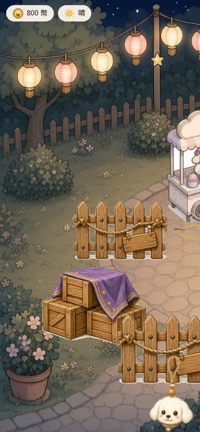
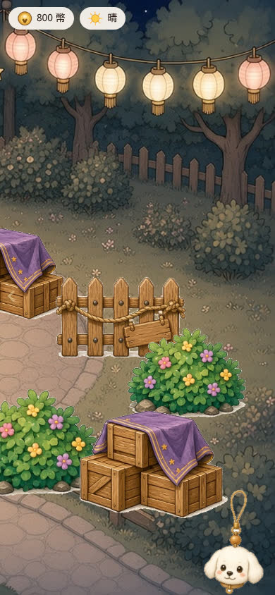
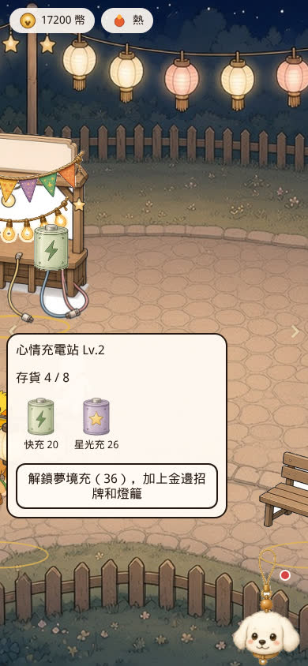
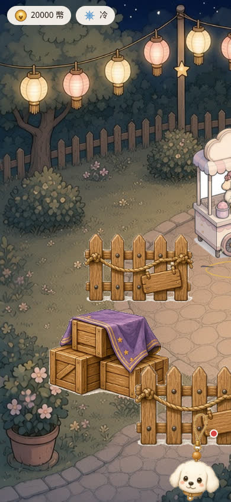
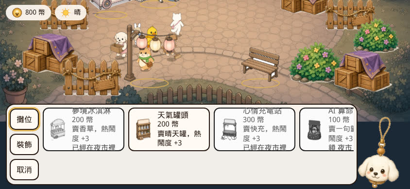
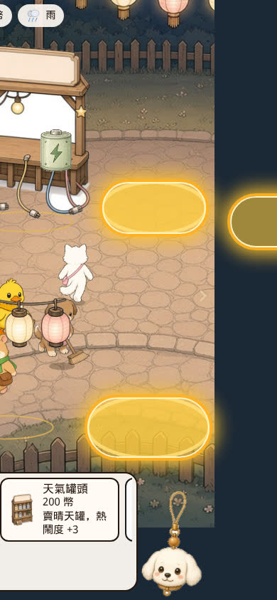

# PR #12 QA — 直式手機廣場鏡頭平移

- PR: https://github.com/vup830707/line-dog-city/pull/12
- 分支: `cursor/plaza-camera-pan-87e6`
- HEAD: `916c527dc0f73b31391b7b635a0612f974baa400`
- 父提交: `3391f5a`（功能）← `origin/main` `d66daa7413dcf6888cedd87a0e22cfc8749dc78d`
- 標題: fix: 直式手機可橫向拖動夜市廣場
- 判定: **需修改**
- 日期: 2026-10-11
- 沒有 merge、沒有 deploy、沒有推送到 `cursor/plaza-camera-pan-87e6`

Touch 使用 Playwright Chromium，`hasTouch: true`、`isMobile: true`，手勢走 CDP `Input.dispatchTouchEvent` 與 `page.touchscreen.tap`。Mouse 使用 `page.mouse`。Preview 是這顆 HEAD 的 `vite preview`（`http://127.0.0.1:4212/?debug=1`）。`deviceScaleFactor` 為 1。

## 需要修的問題

Touch 拖曳或 `touchcancel` 之後，下一次點擊會被吃掉。再點一次才會作用。Mouse 拖曳沒有這個問題。

`src/ui/StreetScreen.tsx` 的 `onPlazaPointerUp` 在 `drag.moved` 時把 `suppressClickRef` 設成 true，並交給 `onClickCapture` 吃掉下一次 click（`preventDefault` + `stopPropagation`）。`onPointerCancel` 走同一個函式。拖曳超過 `PAN_TAP_SLOP` 之後，`pointermove` 會 `preventDefault`。實測等 900ms，相容性 click 沒有把這個 flag 清掉，所以下一個真正的點擊被拿去清 flag，攤位、空格、手機吊飾都不會打開。

### 重現 1：touch 拖曳後第一下點不到

1. Viewport `390×844`，`hasTouch` + `isMobile`，開啟 `/?debug=1`，新遊戲，`window.__puppy.pause()`。
2. CDP touch：`touchStart (90, 430)`，約 180ms 內移到 `(210, 430)`，`touchEnd`。
3. 等 900ms。鏡頭已停住，這次 `data-pan-x` 是 `175.6`。
4. `touchscreen.tap` 點畫面內的 `slot-1`（這次中心約 `(26.7, 431)`）。`.slot-hit.selected` 仍是空的。
5. 同一個座標再點一次。`slot-1` 變成 selected。

同一頁用 mouse 從 `(100, 430)` 拖到 `(220, 430)` 之後，下一擊 mouse click 會立刻選到當時畫面內的 `slot-0`。Mouse 的 `mouseup` 會帶出 click，`onClickCapture` 在同一手勢裡把 flag 清掉。

### 重現 2：`touchcancel` 同樣吃掉下一擊

1. 同上的新遊戲。
2. `touchStart (100, 430)`，`touchMove (190, 430)`，立刻 `touchCancel`。
3. 等 900ms。鏡頭沿著最後的速度滑到夾緊點 `555.2` 後停下。沒有 `touchStart` 的 `touchMove` 會被 CDP 拒絕，鏡頭不再跟手。
4. 點當時畫面內的 `slot-0`（約 `(234.4, 485.8)`）。沒有選取。
5. 再點一次。`slot-0` 被選取。

拖曳結束當下，手指底下的格子不會被選到（mouse 停在 `slot-2`、touch 停在 `slot-2`，selected 都是空的）。被吃掉的是拖曳結束之後的下一擊。

390×844 的 touch 走訪裡，剛拖完再點的第一下沒有選到的格子是 0、3、4、5、7、8、10、11、12、13。已經在畫面裡、中間沒有新拖曳的 1、6、14、15，第一下就選到了。

## 手勢其餘結果

`PAN_TAP_SLOP` 是 8，條件是 `hypot < 8`。

| 輸入 | 位移 | 鏡頭 | 選取 |
| --- | --- | --- | --- |
| touch，slot-3 中心 | 7px | 停在 0 | `slot-3` |
| mouse，slot-3 中心 | 7px | 停在 0 | `slot-3` |
| touch | 9px | 剛好 +9 | 無 |
| mouse，每步 20ms | 9px | 剛好 +9 | 無 |
| mouse | 8px | 有移動 | 無（8px 已是拖曳） |

- 快甩：`pan-x` 從 9 在 70ms 到 218.1，1.2s 後停在 293.9，再等 200ms 仍是 293.9。之後沒有 `touchStart` 的 `touchMove` 不會再帶動鏡頭。
- 第二指：第一指拖動中再 `touchStart` 第二指，鏡頭沒有卡在 dragging。鬆開後沿速度滑到夾緊點 `555.2` 停下。
- 手機設定頁 `.phone-body`：`scrollTop` 0 → 178，`data-pan-x` 維持 555.2。
- 建造列 `.build-cards`：touch 橫拖 `scrollLeft` 0 → 145（`scrollWidth` 1224、`clientWidth` 186），廣場 `pan` 維持 0。
- 390×844 夾緊：慢拖可停在 `+555.2` 與 `-555.2`。`+555.2` 時左箭頭消失、右箭頭在；`-555.2` 時右箭頭消失、左箭頭在；置中時兩邊都在。
- `1280×720` mouse 與 touch 拖曳後 `pan` 仍是 0，`.pan-hint` 數量是 0。`1440×900` 仍有水平裁切，實測可到 `±80`。這和 cover 裁切規則一致：沒有裁切的軸不能拖，`1440×900` 左右仍被裁。`1920×1080` 與 `1280×720` 的零範圍有 unit test。
- 建造自動平移：置中時選「天氣罐頭」，`pan` 維持 0，發光格是 slot 3、4、11、15。先拖到 `555.2` 再選同一張卡，取樣從 555.2 經過 519.4、469.4、422.4、378.5、337.9、300.8、266.8、235.8、208、183.7、162.3、144.2、129.4、117.8、109.4、104.1，停在 102.1。中間有多個樣本，不是跳到終點。約 280ms。
- `844×390` 橫放：`maxX` 是 0，垂直可到 `±42.4`。左右箭頭數量是 0。直向提示只做水平，橫放看得到更多上下內容時沒有箭頭。

## 點擊盒與畫面

空格的金色地面圈，左右緣和按鈕左右緣在未遮擋時差 0 到 2px。同一顆按鈕在不同 `pan` 上這個差值不變，所以鏡頭和平移後的 hit box 是一起動的。

390×844、置中、`slot-3`：左緣差 `-1px`，右緣差 `+1px`。`slot-11`：`-1` / `+1.4`。360×780 置中同樣在 2px 以內。`844×390`、`780×360`、`1440×900` 置中，未遮擋空格（0、3、4、5、9、11、13）左右緣也在約 2px 以內。

點擊盒比地面圈高。圈的上緣比按鈕上緣低約 35px，下緣比按鈕下緣多約 8px。這是 `slotHitRect` 的腳邊墊（往上 `frame.height * 0.2`、往下 `8 * scale`），每個平移量都一樣。

只對上一邊、另一邊縮在畫面裡的，是精靈蓋住圈，或圈被 canvas 裁掉。例如 390、`pan` 555.2 的 `slot-8`：左緣對上（`-1px`），右緣短 18.6px。已建成的攤位選取時，圈畫在精靈下面，區域像素差不到 12px，沒有用這個方法量出第二組邊緣。

訪客 hit box 跟著鏡頭走。390 從置中拖到 `pan-x -555.2`，rabbit / hamster / cat / sparrow 的 `left` 分別移動 `-555.1`、`-555.2`、`-555.2`、`-555.1`。360 對 `-513.3`、1440 對 `-80`，誤差在 0.2px 以內。

攤位卡：390 點開心情充電站，盒子是 `x=8, y=422, 280×235`，沒有超出 `390×844`。升級後文字是「心情充電站 Lv.2」。另一組拖到中段時，夢境冰淇淋卡 `x=8, y=461, 280×259`，底邊 720，也在畫面內。

## 390×844 touch 走訪

新遊戲後用 touch 把 16 格逐一拖進畫面再點。14 格可以選到；其中多數要點第二次，就是上面的 flag。

- `slot-2` 那一次中心算在 `x=390`，剛好在 viewport 外，`elementFromPoint` 是空的。按鈕左半仍在畫面裡。稍後把充電站拖回畫面內，touch 點一下就打開卡片。
- `slot-9` 在 `pan` 555.2：按鈕 `267,691, 138×66`，手機吊飾 `290,694, 92×150`。66 個取樣點裡 13 個點到 `slot-9`，其餘是 `phone-charm`、`phone-badge` 或畫面外。左下角這格拖進畫面後，大部分點擊區在吊飾下面。

Lv1 已開放的空位：在 `slot-11` 蓋了天氣罐頭，在 `slot-15` 蓋了座位。兩次都是 mouse 把鏡頭移到位（mouse 的 click 已清掉 flag）之後，touch 第一下就放上去。`slot-11` 放罐頭時自動平移停在 `pan` 102.1。`slot-0`、`slot-7` 拖得到、點得到，Lv1 還不能蓋，這是等級門檻。

`setMoney(20000)` 之後：心情充電站升到 Lv.2；雇用文鳥；小白訓練到 Lv.2。餘額顯示 6700。圖鑑頁開得到（0/8）。信件頁開得到，新遊戲文案是「還沒有信件。」

手機可讀性：金額與天氣字級 14px。HUD `top` 是 `10px`。`viewport-fit=cover`，樣式表裡沒有 `safe-area-inset`。直式空格按鈕約 `117×57` 或 `138×66`。

橫放 `844×390`：空格按鈕高 32–37px。建造列高 168px，頂在 y=214。手機收合後，畫面內格子的中心點到的是格子本身；slot 2、3、4 的中心在預設鏡頭上方，要靠垂直平移才進畫面，而垂直方向沒有箭頭。吊飾在 `(744, 240)`，高 150px，貼著右下角。

## 模擬與存檔

4 個 seed、idle 與 active、各 2 小時，對 `main` `d66daa7`。8 列 deep-equal。列內容 hash：

`fdd2da1fec486e1b23629c6d6ee9453f5a567b0b70613148ff1ec27660e32354`

`main` 的 v4 存檔 `/tmp/pr11-v4.json`：`localStorage` 與設定頁匯入都載入。標題「繼續營業」，金額「1309 幣」，`localMatch` 與 `fileMatch` 都是 true（playerDog brown、豆花 / 燒仙草、tick 80、Lv.1、bustleXp 66）。

## 拖曳時的效能

連續拖曳約 3 秒，同時用 rAF 記約 4 秒。角色數是畫面上的 `.animal-hit`（約 26–30 隻訪客）。兩隻店狗和雇用員工畫在 canvas 上，沒有算進這個數字。PR #11 的數字是閒置動畫，不是拖曳。

| 畫面 | CPU | 這次拖曳 fps | 最長 frame | long task ≥50ms | PR #11 閒置 |
| --- | --- | --- | --- | --- | --- |
| 390×844 | 1× | 60 | 17ms | 無 | 60.1 fps，17ms，無 |
| 390×844 | 4× | 60 | 17ms | 106、62、57 | 59.3 fps，33ms，102、65、61、58、50 |
| 1440×900 | 1× | 60 | 17ms | 無 | 60.1 fps，17ms，無 |
| 1440×900 | 4× | 37.1 | 50ms | 161、71、69、54、52、51 | 35.3 fps，117ms，159、120、108、73、66、65、61、57、55、53 |

1× 拖曳仍是 60fps。1440 的 4× 仍是最重的一檔，和 PR #11 閒置同一量級，最長 frame 比那次閒置短。

## Gates

| 檢查 | 結果 |
| --- | --- |
| lint | 0 |
| typecheck | 0 |
| unit | 26 files，152 passed |
| build | precache 181 entries（26144.08 KiB），PWA ok，base `/` |
| e2e | 兩次都是 12 passed（38.5s、46.7s）。新增的 `e2e/pan.spec.ts` 用 mouse |
| trial merge `git merge-tree --write-tree origin/main 916c527` | exit 0，tree `ca24855c769bfda913d34cbc4fea24f719032de5` |
| Co-authored-by | `3391f5a`、`916c527` 與 PR 內文都沒有。作者是 Cursor Agent `<cursoragent@cursor.com>` |

## 判定

**需修改。** 鏡頭夾緊、7px 點擊、9px 拖曳、拖曳當下不選取、甩動與第二指不會把鏡頭卡死、手機與建造列可以自己捲、寬畫面在沒有裁切時不拖、建造模式的自動平移是 ease、未遮擋空格的左右緣在 2px 以內、模擬與 v4 存檔、gates 與兩次 e2e 都過。Touch 拖曳和 `touchcancel` 會留下 `suppressClickRef`，下一擊（含剛拖到的攤位和手機吊飾）沒有作用。`e2e/pan.spec.ts` 用 mouse，沒有蓋到這條。
