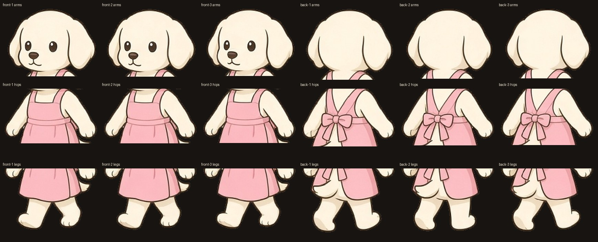
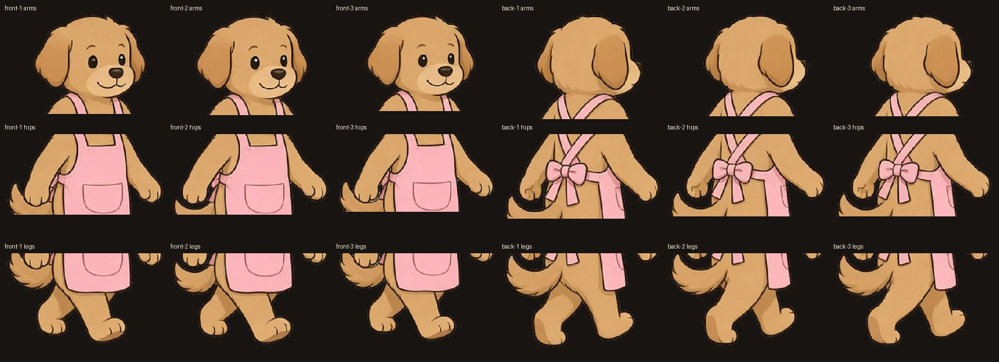
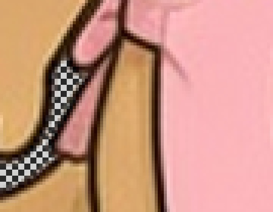
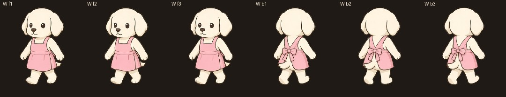
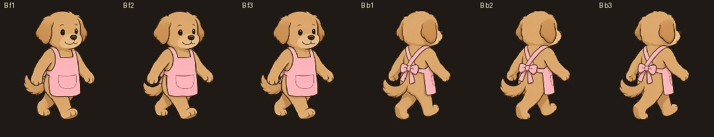
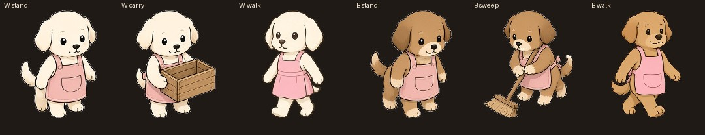
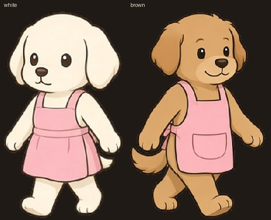
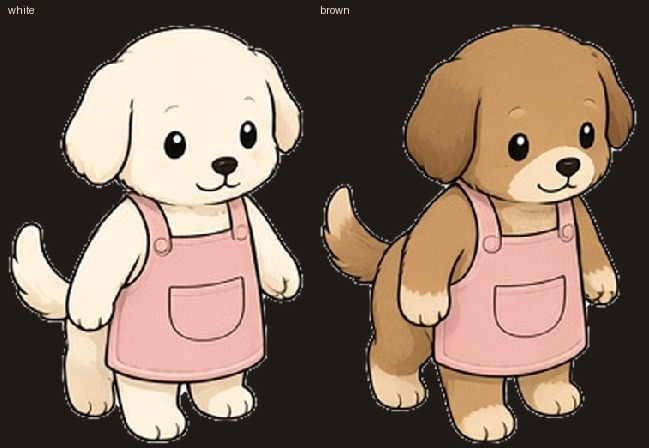
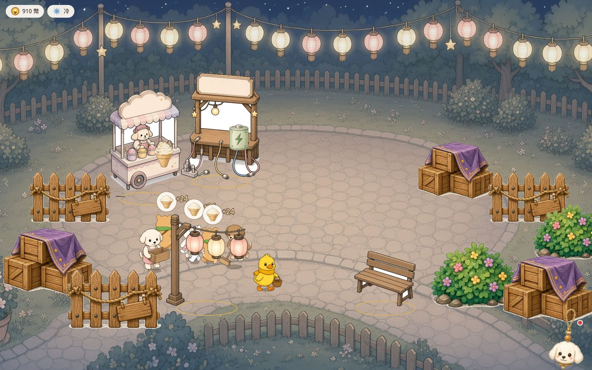
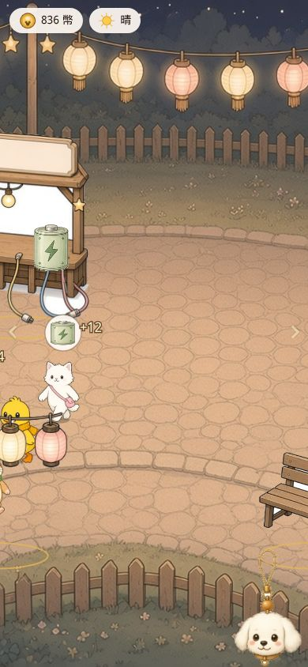

# PR #14 QA — 可可與小白的走路圖

- PR: https://github.com/vup830707/line-dog-city/pull/14
- 分支: `fix/brown-puppy-walk`
- HEAD: `581b9d2e87c3353e207c9fadb2386027f872fef0`
- 基底: `origin/main` `8f68c7ee1e120cff43a16727634d834be9935bfa`
- 標題: fix: 可可走路圖改成兩腳站立、穿圍裙，與站姿一致
- 判定: **可合併**
- 日期: 2026-10-11
- 沒有 merge、沒有 deploy、沒有推送到 `fix/brown-puppy-walk`

這一輪對的是 `581b9d2`，不是前一顆 `9d10f6a`。`581b9d2` 在 `9d10f6a` 之上重畫小白的 6 張走路圖。可可的 6 張維持 `9d10f6a` 那一組。

`WALK_ACTORS`：

| 角色 | 畫布 | 腳列 | frontFacesRight | backFacesRight |
| --- | --- | --- | --- | --- |
| 小白 `white-puppy` | 312×512 | 500 | false | true |
| 可可 `brown-puppy` | 370×512 | 500 | true | true |

小白原先是 374×512，正反旗標都是 false。6 張新圖的不透明腳列都在 y=500，和表一致。

## 判定

兩隻狗的走路圖都是直立、兩腳，和站姿是同一個角色。12 張都是 2 隻手臂、2 條腿、1 條尾巴。朝向跟水平移動一致，1-2-3-2 沒有跳、頭沒有轉。走路切到站姿、搬箱、掃地時，身高差在 2.6% 以內，腳底對影子的垂直差是原本就有的 `footOffset`（2.54px）。

可可正面第 2 幀，前臂疊到尾巴的地方，源圖有一塊 69px 的封閉透明縫。畫到畫面上大約 1px，沒有多出一肢，也不穿到軀幹另一側。不擋合併。座標寫在下面。

## 朝向

像素朝向用 `walkPixels.test.ts` 的 `pixelFacing`（相對畫布中線，不是外框中線）。門檻：頭部質量 11、鼻子 8、頭寬差 12、傾斜 5。neutral 的幀會被迴圈跳過，所以只有非 neutral 的幀鎖得住旗標。

| 幀 | mass | span | nose | 結果 | 把旗標反過來會失敗 |
| --- | --- | --- | --- | --- | --- |
| 小白 front-1 | 6.14 | 13 | -19.81 | left | 會 |
| 小白 front-2 | 4.25 | 10 | -1.63 | neutral | 不會（被跳過） |
| 小白 front-3 | 7.46 | 17 | -16.68 | left | 會 |
| 小白 back-1 | 7.43 | 15 | — | right | 會 |
| 小白 back-2 | 8.56 | 17 | — | right | 會 |
| 小白 back-3 | 7.65 | 15 | — | right | 會 |
| 可可 front-1 | 20.35 | 38 | 5.39 | right | 會 |
| 可可 front-2 | 11.65 | 20 | 4.65 | right | 會 |
| 可可 front-3 | 17.84 | 33 | 5.20 | right | 會 |
| 可可 back-1 | 10.05 | 22 | — | right | 會 |
| 可可 back-2 | 12.21 | 26 | — | right | 會 |
| 可可 back-3 | 11.85 | 26 | — | right | 會 |

小白的正面旗標由 front-1 和 front-3 鎖成朝左。front-2 是 neutral，和測試註解寫的一樣（註解從舊的 `white-puppy-back-2` 改成 `white-puppy-front-2`）。背面三幀都是 right，所以 `backFacesRight true` 不是只靠 1 和 3。可可正面三幀都是 right，front-2 的 mass 11.65 過了 11，沒有變成 neutral。

外框中線的頭質量不能拿來否定上面這張表。小白六幀的外框頭質量只有 +1.42 到 +3.84，會全部落在 ±8 的中間。測試看的是畫布中線加鼻子，front-1 / front-3 的鼻子是 -19.81 / -16.68。

鏡像之後，臉的水平方向跟 `dx` 一致。`walkMirror`：`dx === 0` 不翻；否則 `nativeRight !== (dx > 0)`。六個方向各走 8 步，mirror 沒有中途改掉。

| 方向 | 使用 | 小白 mirror | 畫面上 | 可可 mirror | 畫面上 |
| --- | --- | --- | --- | --- | --- |
| 右、右下 | front | true | 右 | false | 右 |
| 左、左下 | front | false | 左 | true | 左 |
| 右上 | back | false | 右 | false | 右 |
| 左上 | back | true | 左 | true | 左 |

1440×900 的繪製高度是 108.33px。小白 front-1 的鼻子 -19.81 源像素，畫面上是 -4.19px（朝左）；390×844 是 -3.93px。往右走會鏡像，符號反過來，鼻子朝右。可可 front-1 的 mass +20.35，1440 是 +4.31px、390 是 +4.04px，都朝右；往左走鏡像後朝左。

## 解剖

每張都數了腳踝列（身體高度 93%）的不透明分段、墨線切開的填色區塊，以及縮成 40 列的剪影。新的 12 張，腳踝都是 2 段。沒有第三隻腳，也沒有舊圖那種併成一條的四腳身體。

可可正面三幀，填色切開之後是：左右各一塊手臂（約在身體 0.51–0.55，不到腳）、左側一塊尾巴（約 0.70，底端在 y=390 左右，不到腳列）、以及接到 y=496–497 的腿。正面第 2、第 3 幀的左腿是另一塊接到腳的填色。剪影底部是兩條腿中間有縫。

小白的白毛是一整塊填色，手臂不會被墨線切開。肩寬約 260px、腰寬約 119px，多出來的是貼在身上的兩隻手臂。六幀腳踝都是兩段（寬約 60–84px）。舊的小白正面肩寬約 345px；舊 front-2 的腳踝只有 1 段。那就是原先「四腳身體再加兩隻手臂」的輪廓。新圖對得上站姿的兩腳剪影。

可可前臂貼尾巴的地方：

- front-2：封閉透明像素 73（主塊 69）。範圍 x=105–115、y=311–336，夾在左臂（y=189–344、x=56–169）和尾巴（y=307–397、x=40–126）重疊處。
- 畫到 1440 的 78×108（LANCZOS，和 `drawPlaza` 的平滑一樣）之後，這塊變成髖部大約 1px 寬的縫，往下開口，接上手臂和尾巴之間本來就該分開的空隙。不是穿出軀幹的洞。
- front-3 源圖 34px，縮放後剩 1–2 個半透明像素。front-1 的 2×2（y=112）在 1440 消失。back-2 的 1px 也消失。

12 張都沒有 stray 色塊、沒有 alpha=0 但 RGB 還留著的 bleed。白邊（半透明、亮度 ≥200、貼著不透明像素）小白 1–3、可可 0–6。放到暗底和亮底，2px 外圈都沒有亮環。

單幀放大在 `docs/qa/pr14/zoom/`，檔名 `zoom-<white|brown>-<front|back>-<1|2|3>-<arms|hips|legs>.jpg`。

## 小白 front-2 與走路循環

front-2 比前後兩幀在畫面上只差約 2 源像素，所以分類落在 neutral。腳底（y≥497 的腳掌）相對畫布中線：

| 幀 | 源像素 | 1440 畫面 |
| --- | --- | --- |
| front-1 | -48.5 | -10.26px |
| front-2 | -49.0 | -10.37px |
| front-3 | -47.0 | -9.94px |

1→2→3→2 的腳掌 x 最大差 2.0 源像素，畫面 0.43px。腳列 y 的步進差是 0。身體頂端差 2 源像素，畫面 0.42px。軀幹中心（相對影子錨點）是 +1.12、+0.77、+1.42px，相鄰差 0.65px。頭的畫面偏移是 +1.14、+0.76、+1.42px，沒有換邊。

背面三幀的著地腳掌停在 -11.7 到 -11.9px。back-2 另一隻腳落下在 +8.57px，是跨步，著地的那隻沒有換位置。

可可正面腳掌是 +9.42、+8.57、+8.57px。頭的畫面偏移 +4.49、+2.64、+3.97，都還朝右。front-2 比較正，約 1.8px，測試仍判 right。不是轉頭。

## 走路切換站姿、搬箱、掃地

繪製高度兩種視窗都是 `round(1080 * 0.12) * cover`。1440×900 是 108.33px，390×844 是 101.59px。走路圖有 `footOffset = 12/512`，腳列 y=500 落在影子上。站、搬、掃沒有設 `footOffset`，所以同一條 y=500 會浮在影子上方。這在 main 的舊走路圖也一樣，這次沒有改那些靜態圖。

1440×900：

| 姿勢 | 不透明高 | 對走路 | 腳對影子 |
| --- | --- | --- | --- |
| 小白走 front-2 | 101.35px | — | 0（0%） |
| 小白站 | 103.47px | 走比站矮 2.12px，2.05% | -2.54px（-2.34%） |
| 小白搬箱 | 103.68px | 走比搬矮 2.33px，2.25% | -2.54px（-2.34%） |
| 可可走 front-2 | 101.35px | — | 0 |
| 可可站 | 103.68px | 走比站矮 2.33px，2.25% | -2.54px（-2.34%） |
| 可可掃 | 104.10px | 走比掃矮 2.75px，2.64% | -2.33px（-2.15%，腳列 y=501） |

390×844 的比例相同。不透明高：小白走 95.04、站 97.03（矮 1.99px，2.05%）、搬 97.23（矮 2.19px，2.25%）。可可走 95.04、站 97.23（矮 2.19px，2.25%）、掃 97.62（矮 2.58px，2.64%）。腳對影子：走路 0；站和搬 -2.38px（-2.34%）；掃 -2.18px（-2.15%）。

軀幹中心相對影子，1440：小白走 +0.77px、站 +3.58px（差 2.81px）、搬 -3.52px（和走差 4.29px）。可可走 +0.81px、站 +3.71px（差 2.90px）、掃 +3.48px（差 2.67px）。身高、腳的垂直位置、影子都留在同一個角色上。搬箱和掃地的水平偏移是舊圖本身的重心，不是這次走路圖新加的跳動。

## 並排比例

同一條 512 畫布、同一個 `PUPPY_H`，源圖的不透明比例就是畫面上的比例。front-2：

| | 走路 可可/小白 | 站姿 可可/小白 |
| --- | --- | --- |
| 不透明高 | 479/479 = 1.000 | 490/489 = 1.002 |
| 頭寬 | 229/259 = 0.884 | 270/272 = 0.993 |
| 不透明寬 | 313/275 = 1.138 | 370/345 = 1.072 |

身高和站姿的配對一致，front-2 都是 479px。走路時可可的頭比較窄，因為走路圖是四分之三側面，站姿的頭幾乎等寬。寬度比站姿略寬（尾巴和圍裙在側面伸出去）。調色和圍裙還是站姿那個角色。

## mirror 預期

`plaza.test.ts` 往上走的那個案例：小白從 (600, 800) 到 (600.7, 795.1)，`dx = +0.7`、`dy = -4.9`。`|dy| >= |dx|` 且 `dy < 0`，所以用背面。新的 `backFacesRight true`，`true !== (dx > 0)` 是 false。舊旗標 false 時，同一個步伐會得到 true。

這一行從 `expect(white?.mirror).toBe(true)` 改成 `toBe(false)`。仍是一個確定的布林值。旗標若留在 false，這條測試會失敗。沒有改成「有值就好」或跳過。

同一個案例裡可可的 x 停在 740，`dx = 0`，`walkMirror` 直接回 false，和旗標無關。測試本來就只檢查她的 src 是背面，沒有斷言 `brown.mirror`。這次沒有拿掉一條原本存在的斷言。

`walk.test.ts` 的 `shownRight` 仍要求每隻角色往右走時畫面朝右、往左走時朝左，小白的新旗標包括在內。

## 開場 2 秒

seed 1，兩隻狗從 (620, 830) 走進工作點。往上的那幾段用背面。水平方向和 `dx` 一致。

- 0–200ms：兩隻都是背面。小白 x 621.5→623.1（略往右），mirror false，背面原生朝右，畫面朝右。可可同樣 mirror false。
- 300–500ms：小白改往左（x 623→561），正面、mirror false。正面原生朝左，畫面朝左。
- 600ms：小白再略往左上，背面 mirror true，畫面朝左。
- 700ms：小白停在 (561, 781)，換成 `white-puppy-carry.png`。
- 400–900ms：可可往右，正面 mirror false，畫面朝右。
- 1000–1200ms：可可在 x≈778 往上，背面 mirror false。
- 1300ms：可可停在掃地，`brown-puppy-sweep.png`。座標從 778 收到 804（26 廣場像素，1440 上約 22px）。這是 `separateCharacters` 把站定的身體推離道具，掃地圖這次沒有改。

搬箱那張不是 `actorPiece`，沒有小白的新旗標，鏡像會退回貓的表。這是原本的靜態圖路徑。

瀏覽器：1440×900 在點開始後 1.6 秒，小白站在攤位、手上是箱子，可可在左側掃地、粉紅圍裙、掃把。390×844 在 0.45 秒，兩隻從右側走入，小白在前。0.12 秒的截圖還停在開燈的標題，因為標題燈先播；上面的 layout 時間軸才是進場後的 0–2 秒。

## 閘門

工作樹 `/tmp/pr14`，detached 在 `581b9d2`。丟進樹裡的量測腳本在 lint 之前移走。

| 檢查 | 結果 |
| --- | --- |
| lint | 0 |
| typecheck | 0 |
| unit | 28 files，164 passed |
| build | precache 191 entries，28054.32 KiB，PWA ok，base `/` |
| main `8f68c7e` build | 191 entries，28315.74 KiB |
| e2e | 17 passed（1.0m），再跑 17 passed（54.7s） |
| trial merge `git merge-tree --write-tree origin/main 581b9d2` | 乾淨，tree `778b9c8484a2b02cfa2d910546e71becdbeb2db9` |
| sim | 4 seeds × 2 小時 × idle/active，hash `1cf93abb93de28caad9c0d59d4b96113c7c6a0232760cd96d58912690dc77b13`，和 main 相同 |

precache 少 261.42 KiB，筆數不變。走路圖變小，沒有多檔也沒有少檔。

## Commit 與 PR 內文

`9d10f6a` 和 `581b9d2` 的 commit message 都沒有 `Co-authored-by`，也沒有把 noreply 寫進 trailer。作者欄是 `vup830707 <114939683+vup830707@users.noreply.github.com>`，那是作者，不是 trailer。PR 內文也沒有 `Co-authored-by`。

PR 內文還停在只描述可可那一次重畫（「front-2 都是 479px」、370×512）。沒有寫小白改成 312×512，也沒有寫 `plaza.test.ts` 的 mirror。不影響這次的程式和圖。
