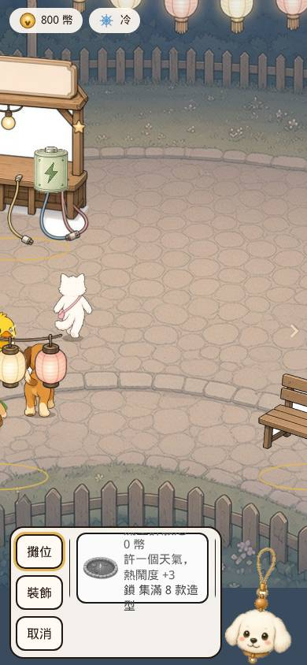
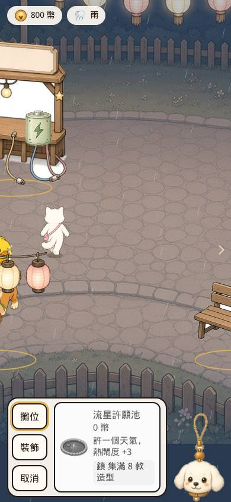
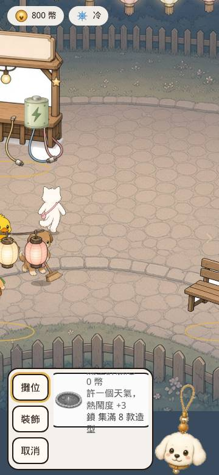
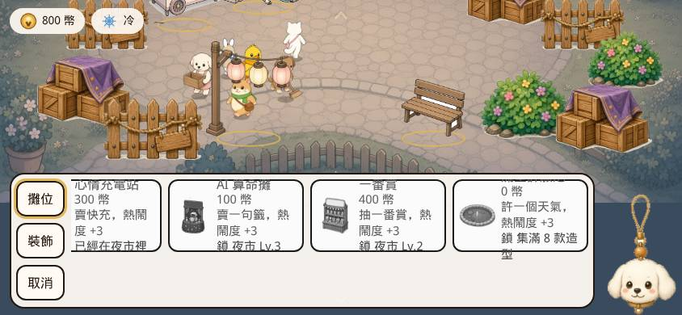
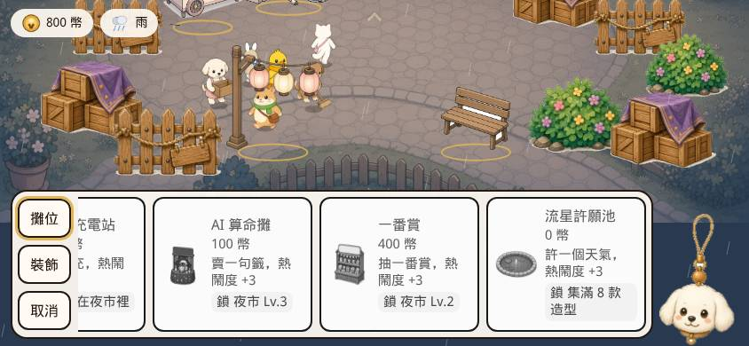

# PR #15 QA — 建造卡文字與廣場燈光淡出

- PR: https://github.com/vup830707/line-dog-city/pull/15
- 分支: `cursor/build-strip-light-fade-b193`
- HEAD: `53ec2df43ec0a39339270e26f8d84a0c24d028dc`
- 基底: `origin/main` `8f68c7ee1e120cff43a16727634d834be9935bfa`
- 標題: fix: keep build-card text inside the card and fade plaza light
- 判定: **需修改**
- 日期: 2026-10-11
- 沒有 merge、沒有 deploy、沒有推送到 `cursor/build-strip-light-fade-b193` 或 `fix/brown-puppy-walk`

兩個 commit：`2858ca837faec4b303d450ad7590f341ef2f4b68`、`53ec2df43ec0a39339270e26f8d84a0c24d028dc`。`git log --format=%B origin/main..HEAD` 與 PR 正文都沒有 `Co-authored-by`。作者欄位是 `Cursor Agent <cursoragent@cursor.com>`，不是 trailer。

## 判定

建造卡的文字已經收進卡片。四個視窗、兩個分頁、許願池的「0 幣」和「鎖 集滿 8 款造型」、長中文省略、15–16px、44px 點擊區、觸控和廣場拖曳分開、長椅扣 60 幣，都量過。

燈光在前景淡出約 4.5 秒，花燈與雨約 2.5 秒，單幀色階最多 2，沒有閃白。離線重載和手機選單不會跳色。模擬 hash 與 main 相同。`light.ts` 與 `drawPlaza.ts` 沒有碰到 RNG。lint、typecheck、unit 173、build、e2e 兩次、以及和 PR #14 的雙向 trial merge 都過。

要改的是隱藏分頁。淡出進行到約 400ms 時把分頁 frozen 3 秒，回來的第一幀天空紅色中位從 70 跳到 42，之後才一階一階走到 38。`stepLights` 用 rAF 的 `now`，凍結期間的時間一次算進 fade，所以顏色停在淡出中間，不是目前相位的顏色，也不是接著慢慢淡。重現步驟在下面。

減少動態仍跑完整的 4.5 秒淡出，閃爍是關的。PR 正文已經寫「reduced motion still fades, it just does not pulse」。量到的每幀最多 2 階，花燈亮度在淡完之後 4 秒維持同一值。這條不單獨擋合併。

## 要改的：隱藏分頁一幀跳色

`src/canvas/light.ts` 的 `fadeT` 用 `now - startedAt`。`StreetScreen` 把 rAF timestamp 傳進去。分頁凍結時 rAF 停，回來時 `now` 一次跳過隱藏的時間。

模型（直接呼叫 `stepLights`，`lightFadeSec` 4.5，入夜晴天先停住，再切深夜）：

| 時刻 | tint |
| --- | --- |
| 入夜 settled | `rgba(255, 196, 140, 0.18)` |
| 切到深夜後 400ms | `rgba(251, 194, 140, 0.18)` |
| 中間空 3000ms 的下一幀 | `rgba(98, 106, 157, 0.163)` |
| 再 16ms | `rgba(97, 105, 157, 0.163)` |

畫面（1440×900，`deviceScaleFactor` 1，天空一塊的中位 RGB，遊戲暫停）：

| 時刻 | R, G, B |
| --- | --- |
| 入夜 settled | 70, 72, 67 |
| 切到深夜後 400ms | 70, 71, 67 |
| frozen 3 秒後第 1 幀 | 42, 55, 66 |
| 之後每約 50ms | 41，41，41，40，40，40，39，39，39，39，38 |

第一幀 R 少 28，後面每幀約少 1。方向是對的（朝深夜），但是一幀跳到中間色。

這支 Chrome 的 `Page.setWebLifecycleState` 不接受 `hidden`（`Unidentified lifecycle state`）。`frozen` 會停 rAF，和真正把分頁藏到背景一樣。

離線與手機選單沒有這個跳：

- 手機選單打開前後，天空約 105,95,79，開著的六次取樣在 103–105，Escape 後 104,95,77。
- reload：第一幀 92,74,63，80 / 200 / 600 / 1500ms 都停在這組。`stepLights(null)` 一開始就是 settled，所以重載直接是目前顏色。
- `rewindClock(2h)` 再 reload：0 / 100 / 400 / 1200ms 都是 72,75,79。存檔 `schemaVersion` 5，phase `late`，weather `sunny`，tick 7223。

### 重現

1. 開 `?debug=1`，新遊戲，`window.__puppy.pause()`。
2. `tune({ phase: 'dusk', weather: 'sunny', clearEvent: true })`，等超過 4.5 秒。
3. `tune({ phase: 'late' })`。
4. 約 400ms 後，CDP `Page.setWebLifecycleState`，`state: "frozen"`，等 3 秒，再 `state: "active"`。
5. 天空紅色中位從 70 變成 42，下一幀才是 41。

修法：兩幀間隔若大於一幀，不要把整段間隔算進 fade。可以從隱藏前的顏色繼續淡，或直接落到目前相位的目標色。現在會落到淡出中間的那一點。

## 建造卡

main `8f68c7e` 的 `.build-card` 是 168×90、內容垂直置中。`53ec2df` 改成圖示加文字欄：寬 180、高 152，名稱 16px 單行省略，價錢／說明／狀態 15px，說明 `-webkit-line-clamp: 2`，狀態 chip `white-space: normal`。列高 168，卡片有 `min-height: 44px`。

四個視窗（390×844、360×780、844×390、1440×900）× 攤位 7 張 + 裝飾 6 張 = 52 張。每張量標題、價錢、說明、狀態的盒子是否在卡片內，以及 `scrollWidth` / `scrollHeight`。

| | main `8f68c7e` | `53ec2df` |
| --- | --- | --- |
| 卡片尺寸 | 168×90 | 180×152 |
| 文字盒子超出卡片 | 28（都是標題被 90px 卡片切掉） | 0 |
| 字級不在 15–16px | 0 | 0 |
| 價錢／說明／狀態 `scrollWidth > clientWidth` | 0 | 0 |
| 卡片或分頁按鈕小於 44px | 0 | 0 |

把 52 張各自捲進可視範圍再量一次：文字超出卡片或超出列的高，bad = 0。水平捲出畫面的卡片會讓「盒子比列寬」這種演算法誤報，那是捲軸，不是裁切。

390×844 攤位、許願池：

| 欄 | 文字 | 字級 | scroll / client |
| --- | --- | --- | --- |
| 名稱 | 流星許願池 | 16px | 104 / 104 |
| 價錢 | 0 幣 | 15px | 104 / 104 |
| 說明 | 許一個天氣，熱鬧度 +3 | 15px | 高 39 / 39 |
| 狀態 | 鎖 集滿 8 款造型 | 15px | 104 / 104，高 43 / 43 |

`0 幣` 是 `placeCost`。main 上價錢看得到，標題在 90px 卡片外面。現在名稱、價錢、兩行說明、換行的鎖都在卡片裡。

360×780 只在測試裡改 DOM（沒有改 repo）：名稱換成一段長中文，`white-space: nowrap`、`text-overflow: ellipsis`，`scrollWidth` 448、`clientWidth` 104，16px，盒子在卡片內。說明 `line-clamp: 2`，`scrollHeight` 273、`clientHeight` 39，15px，盒子在卡片內。卡片高仍是 152。

作者的 e2e 字級下限是 14px，視窗沒有 360×780。畫面上的 computed size 是 15 和 16。

### 觸控和扣款

CDP touch。滑建造列不改廣場 pan，拖廣場不改卡片 `scrollLeft`。

| 視窗 | 滑卡片 | 拖廣場 |
| --- | --- | --- |
| 390×844 | scroll 952→1122，pan 維持 0.0 | pan 0.0→−182.9，scroll 維持 1122 |
| 360×780 | scroll 1122→1152，pan −192.7→−193.7 | pan −193.7→−377.1，scroll 維持 1152 |
| 844×390 | scroll 400→212，pan-x 維持 0.0 | pan-y 0→42.4，scroll 維持 212，pan-x 維持 0.0 |

360 那 1px 是前一次廣場拖曳留下的 coast，390 的乾淨案例 pan 維持 0.0。844×390 橫向 pan 範圍是 0：cover 後廣場寬剛好等於視窗，所以拖的是直向。第一次向左滑時 scroll 已經在最大值 668，沒有再動；向右滑才從 400 到 212。

扣款：`setMoney(500)`，裝飾分頁，長椅顯示「60 幣」，4 個空位亮，點第一個。金錢「500 幣」→「440 幣」。

## 燈光淡出

取樣是 1440×900、暫停模擬、天空一塊的中位 RGB，大約每 100ms 一次。色差小是因為 tint alpha 只有 0.10–0.18，疊在深色天空上。看的是有沒有單幀跳。

| 轉換 | 通道 | 起 | 迄 | 最大單幀 | 逆向（≥3） | 時間 |
| --- | --- | --- | --- | --- | --- | --- |
| 入夜 settled | R | 73 | 75 | 1 | 0 | 0.4s |
| 入夜→中夜 | R | 77 | 82 | 1 | 0 | 5.2s |
| 入夜→中夜 | B | 86 | 82 | 2 | 0 | 5.2s |
| 中夜→深夜 | R | 82 | 72 | 1 | 0 | 5.2s |
| 中夜→深夜 | B | 82 | 79 | 1 | 0 | 5.2s |
| `showEvent('rain')` | R | 72 | 51 | 1 | 0 | 5.2s |
| `showEvent('rain')` | B | 79 | 70 | 2 | 0 | 5.2s |

下雨的 weather 屬性在第一個樣本就是 `rain`（模擬立刻改），像素接著走 smoothstep：開頭約 0.8 秒幾乎平，然後下降，大約 4.6 秒停住，沒有結尾彈一下。

花燈像素取花燈帶裡變化最大的 80 個點的亮度中位：

| | 起 | 約 1.25s | 約 2.5s | 3.2s | 最大單幀 | 逆向（≥4） |
| --- | --- | --- | --- | --- | --- | --- |
| 亮起 | 74 | 114 | 158 | 161 | 2 | 0 |
| 熄滅 | 162 | 118 | 73 | 73 | 2 | 0 |

約 2.5 秒後持平。中間有 1 階的來回（2210ms 的 155→154，熄滅時 73→74→73），低於 4 的門檻，和 `garlandTwinkle` 的 ±3% 同一量級。

`stepLights` 的 overlay alpha（`garlandFadeSec` 2.5）：雨 0 → 1.25s 的 0.5 → 2.5s 的 1。花燈亮起 0 → 1.25s 的 0.498 → 2.5s 的 0.946（乘了 twinkle）。熄滅時 id 維持「元宵」，2.5 秒後 alpha 0、id `null`。

減少動態：`puppy-reduce-motion=1`，`data-reduce-motion=1`。花燈淡完後 4 秒，亮度中位維持 657，最大單幀 0。相位淡出仍跑完，R 102→72，約 4.8 秒，最大單幀 2，沒有逆向。沒有閃爍。

### 效能

雨天、28 個 `.animal-hit`（`spawn` 28 次），量測窗一開始呼叫 `showEvent('rain')`，所以 PR #15 的 4 秒取樣蓋住淡出。同一台機器上對 main `8f68c7e`。方法與 PR #13 相同：rAF 間隔、long task ≥50ms、拖曳廣場。

| 視窗 | CPU | PR #15 fps / 最長幀 / long tasks | main fps / 最長幀 / long tasks |
| --- | --- | --- | --- |
| 390×844 | 1× | 60 / 17 / 無 | 60 / 17 / 無 |
| 390×844 | 4× | 58.1 / 33 / 132, 108, 64, 50 | 57.8 / 50 / 128, 103, 68 |
| 1440×900 | 1× | 60 / 17 / 無 | 60 / 17 / 無 |
| 1440×900 | 4× | 33.2 / 50 / 135, 113, 78, 68, 57, 55, 51 | 31.6 / 50 / 139, 134, 75, 71, 58, 54, 54 |

上一輪 PR #13（另一台量測）1440 4× 是 36.4 fps。這一輪 main 是 31.6，PR #15 是 33.2。淡出沒有比同一輪的 main 更慢。

## 模擬

4 seeds × 2 小時 × idle/active。PR #15 與 main `8f68c7e` 的 hash 都是 `1cf93abb93de28caad9c0d59d4b96113c7c6a0232760cd96d58912690dc77b13`。

`src/canvas/light.ts` 與 `src/canvas/drawPlaza.ts` 沒有 `createRng`、`Math.random`。`stepLights` 的註解寫 render-only，畫面前的呼叫只讀 street 的 weather、phase、festival。`showEvent` → `presentNightEvent` 會用 RNG，那是原本的事件注入，不是淡出。

新遊戲存檔 schema 5，2098 bytes。離線 2 小時的 v5 讀回見上面，phase `late`，tick 7223，顏色沒有從別的色閃進來。

## PR #14 與 PR #15 一起

`git merge-tree --write-tree origin/main 53ec2df` 乾淨，樹 `b3325bb4109d0824d38f59a62f7e4c926c86e248`。

兩個順序都在本機 merge 進 `origin/main`，沒有 conflict，`ort` strategy：

| 順序 | 結果樹 |
| --- | --- |
| 先 #15 `53ec2df` 再 #14 `581b9d2` | `53f0946c14f666edc87bff13cf526d7405fc0185` |
| 先 #14 `581b9d2` 再 #15 `53ec2df` | `53f0946c14f666edc87bff13cf526d7405fc0185` |

合併樹：unit 173 passed，build precache 191 entries、28057.59 KiB，PWA ok，base `/`。e2e 19 passed（1.5m）。這個 28057.59 比 PR #14 單獨的 28054.32 多 3.27 KiB，和 PR #15 相對 main 的差一樣。

合併用的 worktree 沒有推送。

## 閘門（`53ec2df`）

| 閘門 | 結果 |
| --- | --- |
| lint | 0 |
| typecheck | 0 |
| unit | 29 files，173 passed |
| build | precache 191 entries，28319.01 KiB，PWA ok，base `/` |
| main `8f68c7e` build（上一輪） | 191 entries，28315.74 KiB |
| e2e | 19 passed，1.4m；再跑一次 19 passed，1.4m |
| trial merge 進 main | 乾淨，樹 `b3325bb4109d0824d38f59a62f7e4c926c86e248` |

precache 多 3.27 KiB，筆數不變。

## 複查 89a6cad

- HEAD: `89a6cad6586213c135fba702f1569979463c8827`（上一輪的 `53ec2df` 之上）
- 判定: **需修改**
- 燈光本身已經照上一輪的重現修好。新的 e2e 在 `53ec2df` 上會通過，沒有鎖住那個洞。

`89a6cad` 把燈光時鐘每幀最多推進 100ms，`visibilitychange` 在 `document.visibilityState === 'hidden'` 時把這一幀的推進設成 0。三個 commit 的 `git log --format=%B` 和 PR #15、PR #14 正文都沒有 `Co-authored-by`。PR #14 正文現在寫了小白重畫（312×512、`frontFacesRight` false、`backFacesRight` true）以及 `plaza.test.ts` 背面鏡像預期改成 false。PR #14 HEAD 仍是 `581b9d2`。

### 隱藏分頁

這支 headless Chrome 的 `Page.setWebLifecycleState` `frozen` 不會停 rAF。3 秒裡兩邊都畫了 180 幀，幀間紅色最多差 1。凍結前 108、凍結中走到 81、解開後約 80，然後停在 76。這不是單幀跳，是淡出在凍結期間照常跑完。`53ec2df` 和 `89a6cad` 在這條 CDP 路徑上看起來一樣。

把 rAF 停住、下一幀塞 `last + 3000`（e2e 用的那個洞，也是真的背景分頁恢復時會交給 rAF 的時間）：

| | 注入那一幀 | 再等一幀 | 約 3.5s 後 |
| --- | --- | --- | --- |
| `53ec2df` | 108→80，差 −28 | 回到 107 | 76 |
| `89a6cad` | 108→107，差 −1 | 107 | 76，最大單幀 2 |

`+60000` 在 `89a6cad` 也是差 −1（108→107），約 3.5s 後停在同一個 76，沒有卡在半途，也沒有閃到終點。

同一支瀏覽器開新分頁、`bringToFront`、以及 `Emulation.setFocusEmulationEnabled`，`visibilityState` 都維持 `visible`，`visibilitychange` 沒有觸發。headed（`DISPLAY=:1`）也一樣。

接著直接讓 `document.visibilityState` 回傳 `hidden` 並派發 `visibilitychange`，走的是 `StreetScreen` 註冊的那個 listener：

| | 紅色 |
| --- | --- |
| 切到深夜後 400ms | 108 |
| 隱藏 2.5s | 維持 108，最大單幀 0 |
| 回到 visible 的第一個樣本 | 107 |
| 再 6s | 76，最大單幀 2 |
| 隱藏 60s 當下 | 仍是 108 |
| 回到 visible | 107，然後 7s 內走到 76，最大單幀 2 |

60 秒沒有把顏色留在半途不走，也沒有一幀跳到深夜。

### 100ms 上限

天空紅色走到離終點 1 以內的牆鐘時間：

| | 中位幀距 | 最長幀 | 走到終點 | 最大單幀 |
| --- | --- | --- | --- | --- |
| CPU 1× | 17ms | 17ms | 3950ms | 1 |
| CPU 4× | 17ms | 34ms | 3931ms | 1 |
| CPU 6× | 33ms | 67ms | 3929ms | 1 |
| 強迫每幀 200ms | 206ms | 209ms | 8447ms | 2 |

4× 和 6× 的幀距都低於 100ms，淡出時間和 1× 一樣，大約 3.9 秒（smoothstep 尾端不到 1 階，所以比 4.5 秒設定早一點停表）。強迫 200ms 一幀時，時鐘每幀只走 100ms，牆鐘變成 8.4 秒，大約兩倍，單幀仍是 2，最後會走完。

雨的色調：1× 3937ms、6× 4269ms，最大單幀 1 和 2。花燈在 6× 有亮起來，3421ms 停住，最大單幀 4。兩條都沒有卡住。

手機選單開在淡出中途：108、107、106、105、104，關掉後 101。沒有跳。

`rewindClock(2h)` 再 reload：0 / 80 / 250 / 800ms 都是 126,64,69（最後一筆 B 70）。存檔 schema 5，phase `dusk`，weather `rain`，tick 7200。顏色沒有閃。

減少動態 `data-reduce-motion=1`：相位淡出 108→76，最大單幀 2；花燈淡完後天空紅維持 148。和上一輪一樣，完整淡出、沒有閃爍。

### 新測試在 53ec2df

`src/canvas/light.test.ts` 換上 `89a6cad` 的版本再跑：12 個裡 6 個失敗。`clampFrameDt` 不是函式。3 秒洞和隱藏那兩則會炸 `rgba(NaN, NaN, NaN, NaN)`，因為 `advance()` 讀 `state.seenAt`，舊的 state 沒有這個欄位，顏色斷言 `< 8` 還沒跑到。

e2e `a frozen tab continues the tint fade instead of skipping it` 在 `53ec2df` 上 **通過**（1 passed，12.5s）。取樣和注入不在同一次 `evaluate`。注入那一幀的紅是 85→56（差 −29），e2e 下一次讀到的是 84（差 −1），低於門檻 12。舊時鐘用絕對 `now`，真實的下一幀時間比注入的 `+3000` 還早，顏色被拉回去，斷言就過了。`89a6cad` 注入那一幀本身就是 85→84。

要讓這則 e2e 在 `53ec2df` 失敗：在 `__releaseLight` 同一個 `evaluate` 裡讀天空，趁恢復的 rAF 畫下一幀之前。

### 回歸與閘門

建造卡再量一次：4 個視窗 × 2 個分頁，52 張，bad = 0，字級 15 和 16。許願池仍是「流星許願池 / 0 幣 / 鎖 集滿 8 款造型」。390 觸控：滑卡片 scroll 0→186、pan 維持 0.0；拖廣場 pan 0→−178.2、scroll 186→187。長椅 60 幣，500→440。

模擬 hash 與 main `8f68c7e` 相同：`1cf93abb93de28caad9c0d59d4b96113c7c6a0232760cd96d58912690dc77b13`。

雨天 28 個 `.animal-hit`，淡出進行中：

| 視窗 | CPU | fps / 最長幀 |
| --- | --- | --- |
| 390×844 | 1× | 60 / 17 |
| 390×844 | 4× | 57.7 / 33 |
| 1440×900 | 1× | 60 / 17 |
| 1440×900 | 4× | 31.7 / 67 |

上一輪 `53ec2df` 的 1440 4× 是 33.2，同一輪 main 是 31.6。

| 閘門 | 結果 |
| --- | --- |
| lint | 0 |
| typecheck | 0 |
| unit | 176 passed |
| build | precache 191 entries，28319.42 KiB，PWA ok，base `/` |
| e2e | 20 passed，1.4m；再跑一次 20 passed，1.7m |
| trial merge 進 main | 乾淨，`merge-tree` 樹 `1e37c0837e233980884480a8993028b42c4959ca` |
| 先 #15 再 #14 | 無 conflict，樹 `59c254e9ade2acaca4e45ed4a6cca255723738af` |
| 先 #14 再 #15 | 無 conflict，同一棵樹 |
| 合併樹 unit / e2e | 176 passed；20 passed（1.6m） |

合併 worktree 沒有推送。沒有 merge，沒有 deploy，沒有推 `cursor/build-strip-light-fade-b193` 或 `fix/brown-puppy-walk`。

## 終查 15a0372

- HEAD: `15a037281f9c66cbdf73022b71c33ace4238fffe`
- 判定: **可合併**
- `89a6cad..15a0372` 只改 `e2e/light-fade.spec.ts`（+25/−6）。遊戲程式沒有動，燈光時鐘沒有重測。

凍結測試在 `__releaseLight` 同一次 `evaluate` 裡讀天空。用 `53ec2df` 的 src 配這份 e2e，`--repeat-each=3`：三次都失敗，Δ 為 −29、−29、−28（85→56、85→56、85→57），斷言是 `< 12`。`15a0372` 三次都通過，Δ 都是 −1（85→84）。

| 閘門 | 結果 |
| --- | --- |
| lint / typecheck | 0 / 0 |
| unit | 176 passed |
| build | precache 191 entries，28319.42 KiB |
| e2e | 20 passed，1.5m；再跑一次 20 passed，1.6m |
| 模擬 hash | 與 main `8f68c7e` 相同，`1cf93abb93de28caad9c0d59d4b96113c7c6a0232760cd96d58912690dc77b13` |
| 先 #15 再 #14、先 #14 再 #15 | 無 conflict，樹都是 `f42d6b12d07cb5d08fea694b2569d16a41e062a0` |
| 合併樹 unit / e2e | 176 passed；20 passed（1.7m） |

PR #14 HEAD 仍是 `581b9d2`。這個分支的 commit 與 PR #14、PR #15 正文都沒有 `Co-authored-by`。沒有 merge，沒有 deploy，沒有推兩個功能分支。
