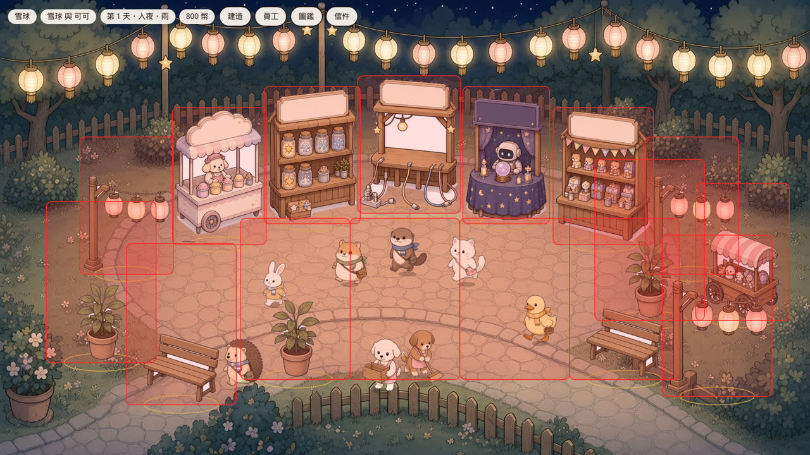
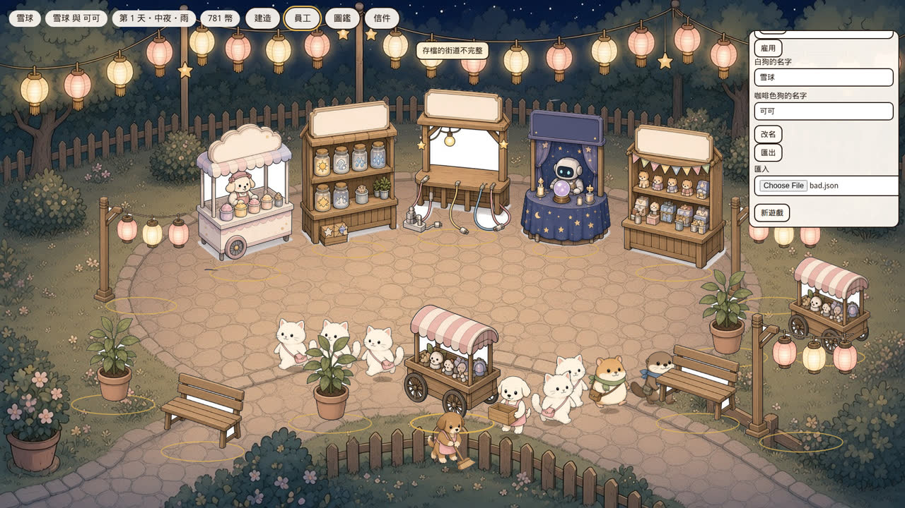
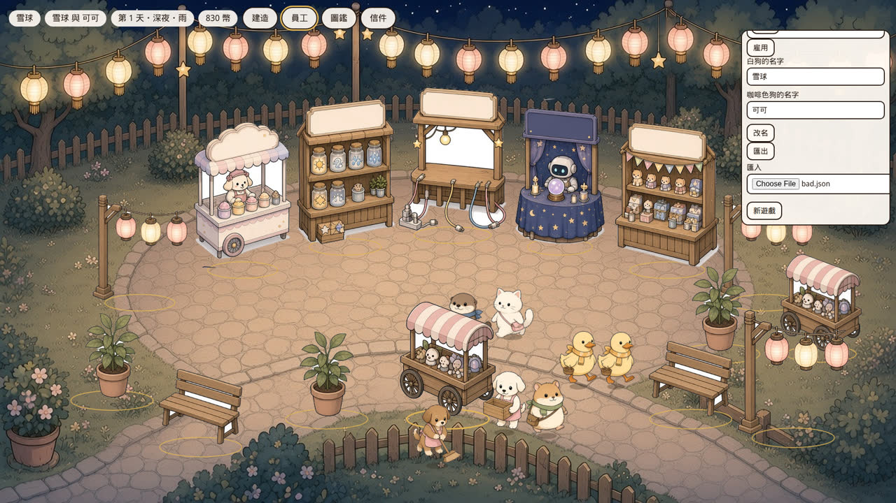
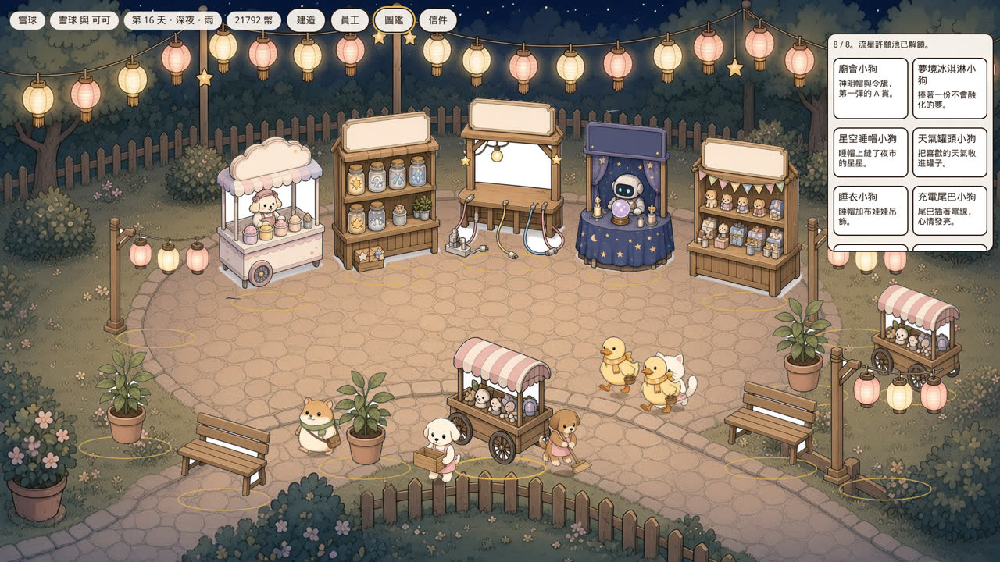
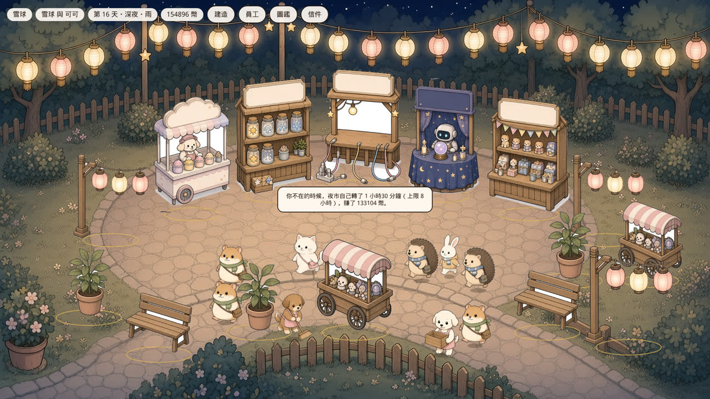

# QA：PR #6（企劃 v0.5 / PR A）再驗證

對象：draft PR #6 `cursor/pr-a-economy-visual-a699` @ `d68c8cd`（`fix: 暫停時保留倒轉的存檔時間`）。企劃是該分支的 `docs/plan.md` v0.5。模擬驅動的是這支分支的 `streetTick` / `closeBox` / `applyOffline`，不是另一套經濟公式。沒有改 PR #6 的遊戲邏輯，沒有 push 那條分支，沒有 merge，沒有 deploy，沒有改 GitHub Actions。

對照基準是 PR #5 對 `b8f6430`（v0.4）的同一套 32 seeds。v0.4 idle 穩態約 20,900 幣/小時。

## 品質門檻

在 `/tmp/pr6`（detached `d68c8cd`）執行。`qa-findings` 是 v0.4 的特徵測試，複製進來跑，沒有改遊戲程式。

| 門檻 | 指令 | 結果 |
|---|---|---|
| lint | `npm run lint` | 通過 |
| typecheck | `npm run typecheck` | 通過 |
| unit | `npm test` | 通過，18 files / 83 tests |
| qa-findings | `vitest run src/rules/qa-findings.test.ts` | 6 通過 / 7 失敗。失敗的 7 條裡，6 條是 v0.4 的 bug 已被改掉；剩下 1 條是 `Infinity` 離線（見下方殘留） |
| build | `npm run build` | 通過。PWA precache 50 entries、8723.59 KiB，base `/` |
| e2e | `npm run test:e2e` | 通過，4 tests |

`qa-findings` 仍失敗、因此算「修掉了」的斷言：免費箱收箱不再 +801（錢停在 800）、`street: {}` 不再載入、字串餘額不再和售價串接、NaN 經過時間不再得到 NaN ticks、缺貨客人不再直接離開（改去別攤）、刺蝟不再因為「攤位 ≤ 4」就寄信。`Number.MAX_VALUE` 與 `1e20` 仍封頂 8 小時；失敗點是 `POSITIVE_INFINITY` 現在回 0。

## 修復核對

| 項目 | 結果 | 數字 |
|---|---|---|
| 收箱退款印鈔 | **通過** | 免費箱連收 200 次，退款 0，餘額停在 800。模擬裡「一出現就收箱」8 seeds × 3 小時：開箱 270、抽數 0、一番賞金幣 0，金幣 21,513/小時，低於放著給客人抽的 idle 83,569/小時。付費箱立刻收：−2,670 + 退 30% = **淨 −1,869**。抽 8 次再收仍淨 −1,351 |
| 裝飾會增加客人 | **公式通過，開場仍頂滿** | 拔掉開場裝飾：客人 2,204 → 887/小時，visitFactor 1.5 → 0.6，金幣 83,387 → 27,019/小時。開場廣場 12 小時 idle / reasonable / blueprint 的 visitFactor 最小與最大都是 **1.5**。再加裝飾不會再增加客人，要等 PR D 的等級上限 |
| 攤位升級會增加收入 | **通過** | 同一開場把攤位設成 Lv3、不改來客：83,387 → **137,391 幣/小時（+65%）**，客人仍約 2,203/小時。`levelPriceMultiplier` 是 [1, 1.3, 1.7] |
| 補貨公平 | **通過，但 Lv1 補不贏** | 補貨 Lv3：收盤庫存 ice/can/charge/fortune = **4/4/4/4**。Idle（預設一隻 Lv1 補貨狗）：四攤收盤都是 **0**。兩座同樣空的攤，單一次 `applyStaff` 仍補索引較小的那座（平手規則），之後輪流。不再出現「只有最左邊有貨、其他永遠 0」 |
| 8 款造型可集滿 | **通過，而且太快** | Idle 32/32，中位數 **0.068 小時（約 4.1 分鐘）**，p10 0.053 / p90 0.073。Reasonable 32/32，中位數 0.69 小時。試玩快轉 15 分鐘後圖鑑是 8/8 |
| 刺蝟的信 | **程式通過，開場失敗** | 條件已改成深夜 + 算命攤 + 旁邊有長椅。自訂佈局（blueprint，長椅在算命隔壁）32/32，中位數 0.16 小時。出貨開場 0/32（idle 與 reasonable）。算命在 slot 4，左右是充電與一番賞；長椅在 slot 9 與 13。`decorNearby` 要距離 ≤ 1，而且沒有搬攤 |
| 通知會消失、不疊加 | **通過** | 畫面上同時只有 1 個 `.toast`，4.2 秒後是 0。收免費箱的字是「免費箱沒有退幣。」 |
| 按鈕 disabled | **通過** | 罐頭升級：disabled，「還差 300 幣」。有箱子時「立刻開新箱」disabled，「現在已經有一箱」。沒錢時「還差 1769 幣」。沒箱子時「收起這箱」disabled。星星在圖鑑未滿時 disabled |
| 新遊戲確認 | **通過** | 員工頁出現「現在的夜市會清掉，確定要重來嗎？」。按「先不要」後餘額仍是 781 |
| 匯入 `street: {}` 與 `savedAt` NaN | **通過** | `parseSave` 拒絕空街道，訊息「存檔的街道不完整」。試玩匯入同一份 JSON，toast 就是這句。可用街道配 NaN `savedAt` 會改成有限的 `Date.now()` |
| 離線文字 | **通過** | 90 分鐘：「你不在的時候，夜市自己轉了 1 小時30 分鐘（上限 8 小時），賺了 133104 幣。」8 小時：ticks `28800`，文字是「8 小時」，不是「28800 分鐘」。小時和分鐘之間少一個空格 |

曲線：`docs/qa/pr6/gold-curve.png`、`income-curve.png`、`stock-idle.png`、`collection-rate.png`。

## 新的金幣路徑

遊戲內操作沒有新的印鈔迴圈。

| 路徑 | 結果 |
|---|---|
| 免費箱反覆開／收 | 200 次，退款合計 0 |
| 付費箱買了立刻收 | 淨 −1,869 |
| 升級、訓練、擺裝飾、雇用 | 只扣錢（−600 / −300 / −120 / −500）。沒有賣掉退款，也沒有解雇 |
| 許願 | 金幣差 0 |
| 離線 | 時鐘倒轉 0。NaN 經過時間 0 ticks、沒有摘要。`MAX_VALUE` 封頂 28,800 ticks，8 小時離線與同樣 tick 數的線上金額、rng、tick 一致（4 seeds） |
| 雇用到沒錢 | 第二次雇用失敗，餘額維持 0 |

殘留兩條，都不是正常遊玩按出來的：

1. **手改存檔的付費箱。** `parseSave` 不檢查箱子內容。塞 `paid: true`、一張 `unitCost: 1_000_000` 的籤，收箱退 **300,060**。本地單人檔可以這樣改。
2. **`POSITIVE_INFINITY` 的離線經過時間回 0**，不再吃 8 小時上限。有限的超大值（`MAX_VALUE`、`1e20`）仍封頂。

72 小時單一種子：idle 6,022,212，斜率 **83,663 幣/小時**，線性 R² 0.9999995，log R² 0.914。沒有指數起飛，金額仍是 safe integer，tick 最小增量 0。

## 平衡

PR #6 自己的 probe（idle 約 83,600/小時）**成立**。這次 32 seeds × 12 小時：

| | Idle | Reasonable |
|---|---|---|
| 12 小時餘額中位數 | 1,004,449（p10 1,001,995 / p90 1,005,361） | 1,183,030 |
| 穩態毛收入 | **約 83,600/小時**（第 1 小時 83,369，其後 83,500–83,900） | **約 100,000/小時** |
| 12 小時開箱中位數 | **168（2 小時約 28 箱）** | 15 |
| 抽數中位數 | 13,388（約 1,116/小時） | 1,178 |
| 一番賞 draw price | 658,100 / 12 小時 ≈ **54,800/小時（約 66%）** | 98,623 / 12 小時 |
| 收盤庫存 | 0 / 0 / 0 / 0 | 12 / 12 / 12 / 12 |
| 造型 | 32/32，4.1 分鐘 | 32/32，0.69 小時 |

2 小時 28 箱，不是 probe 寫的 55。55 會是「每個客人都去抽」：來客約 2,204/小時 ÷ 80 抽 ≈ 27.5 箱/小時。實際約一半客人抽得到（1,116/小時），因為 Lv1 補貨每小時仍能補進大約 900 份小吃。

**驅動的是缺貨改道，不是裝飾，也不是升級倍率。** 預設只有一隻 Lv1 補貨狗，`restockEvery[0] = 4`，四攤平分，貨架清空。`targetFor` / `anotherStocked` 會把客人送去任何有貨的攤，一番賞有籤就算有貨，而且箱子免費、40 tick 補一箱、`ichibanIdleTicks = 40` 再強制拉一個人。Idle 因此變成抽卡機。Reasonable 會把補貨練上去，貨架維持 12，開箱降到 15/12 小時，但 Lv2/Lv3 售價把毛收入推到約 100,000/小時。

相對 v0.5：第 2 節的「1 分鐘內買得起裝飾、5 分鐘內第一次升級」是最慢允許的時間。開局 800 幣已經買得起 80 幣的花和 600 幣的冰淇淋升級，所以這兩條地板本來就過了。太快的是花費樹。Reasonable 的 Lv3 中位數：冰淇淋 0.17 小時、罐頭 0.14、充電 0.19、算命 **0.21 小時（約 12 分鐘）**。這支 PR 的升級、雇用加起來大約 15,200 幣，12 分鐘就買完。PR D 的夜市等級與商品還沒進來，後面只剩每小時 8 萬的線性金幣。造型在 idle 4 分鐘集滿，收集環也一起結束。成長是線性的，不是爆炸，但對現有價目來說太快。

### 建議數字（只模擬，沒有寫進 PR #6）

| 鍵 | 現值 | 建議 |
|---|---|---|
| `restockEvery` | `[4, 2, 1]` | **`[1, 1, 1]`** |
| `ichibanIdleTicks` | 40 | **180** |
| `ichibanRestockTicks` | 40 | **180** |
| `upgradeCost` | 原表 | **×3**（冰淇淋 1800/4500、罐頭 1500/3600、充電 2400/5400、算命 3000/6600、一番賞 1800/3600、許願 2400/4800） |
| `prices` | 不變 | 不變。小吃利潤在貨架有貨時是正常收入 |
| 箱子 `wholesale` | 2670 | 不變。立刻買進立刻收已經是淨虧 1869 |
| `ambienceCap` | 1.5 | 先留著。開場已經頂滿，降 cap 只是把整場來客打八折，不會讓「再加裝飾」開始有效 |

同一套 tick、8 seeds × 12 小時 idle，只改上面的補貨與一番賞間隔（升級費不影響 idle，因為 idle 不買東西）：

| | 出貨設定 | 建議設定 |
|---|---|---|
| 金幣/小時 | 83,470（2 小時對照）/ 83,600（32×12 小時） | **64,082** |
| 12 小時餘額中位數 | 1,004,449 | **769,782** |
| 開箱 | 28 / 2 小時 | **7 / 12 小時（約 1.2 / 2 小時）** |
| 造型 | 4.1 分鐘，32/32 | **1.35 小時，8/8** |
| 收盤庫存 | 0/0/0/0 | **4/4/4/4**（2 小時對照） |
| 來客 | 2,204/小時，係數 1.5 | 2,204/小時，係數 1.5 |

×3 升級費把這支 PR 的花費樹拉到約 45,600 幣。以建議設定的 64,082/小時，大約 **43 分鐘**花完。第一級冰淇淋 1,800，扣掉開局 800，大約再賺 1 分鐘，仍快過「5 分鐘內」那條地板。

若還想再慢一階：同一組再把 `ambienceCap` 設成 1，8 seeds × 2 小時是 **42,840 幣/小時**、來客 1,469、2 小時 1 箱。不建議現在做，原因寫在表裡。

單獨把補貨改成每 tick 1 件、其他不動：金幣降到 65,677/小時，2 小時只開 3 箱，貨架 4/4/4/4。這是主因。再把兩個一番賞間隔改成 180，金幣 63,989，2 小時 1 箱。降 cap 與一番賞售價是次要的。

## 試玩報告

Chromium headless，1920×1080，`vite preview` 上的 production build（`/line-dog-city/?debug=1`）。操作是真的點按鈕；15 分鐘用 `__puppy.runTicks(900)` 快轉（1 tick = 1 秒）。截圖在 `/opt/cursor/artifacts/qa-pr6-play/`，報告裡嵌的是縮小版。

### 卡關點

- **一番賞用滑鼠點不到。** 16 個 `.slot-hit` 的框高 324px（遠排）或 381px（近排），彼此重疊。slot 5（一番賞，x=1312, y=256, 237×324）的中心被 slot 15（x=1411, y=379, 259×381）蓋住。Playwright 的正常 click 一直被 slot 15 攔截。要用 DOM `click()` 才開得了面板。
- 刺蝟的信在這張開場拿不到，也沒有搬位或拆除。
- 建造卡片用點的不會蓋下去。`build-flower` click 之後 slot 11 的 class 仍是 `slot-hit`；拖到 slot 11 才扣 120 幣。點選建造是 v0.5 的 PR C，這支 PR 還沒做。

### 破圖

- 攤位卡用 280×240 的預留高度去找位置，實際卡片大約 133px。冰淇淋卡算出來貼在 **y = 8**（`data-flipped=0`），壓住左上的金幣 pill，也蓋到攤位上緣。一番賞卡同樣貼著頂部，三顆按鈕還在白框裡，沒有溢出框外。
- 離線摘要改到畫面中央，toast 在上方置中。兩者不再跟攤位卡搶 (12, 88)。
- 沒有看到攤位底部整條白邊。`src/assets/fringe.test.ts` 通過。頁面沒有橫向或直向捲軸（scroll 等於 1920×1080）。

### 移動

客人沿著廣場石板的橢圓走，走到攤前會停。1 秒一格（`walkSpeed` 1），三張連拍都還在路上，沒有飛出廣場或踩進天空。兩隻小狗走的是固定弧線來回（`layoutScene` 裡 `travel = 0.36 + swing * 0.28`），不會走到自己正在補的那攤。走路只有面向，沒有 v0.5 第 8 節的 2–3 張 walk frame；那項不在 PR A。

### 無聊點

快轉 15 分鐘：餘額 781 → **21,792**（大約 84,000/小時，和模擬一致），圖鑑 **8/8**，信箱只有開場那封夜麻雀。貨架與升級在試玩前段就碰到「還差 N 幣」，但收入補得很快。小狗巡邏、客人走路、金幣上跳，沒有新的目標。建造只能拖，點了沒反應。

### 建議先修的 5 件

1. **縮小格子點擊框，讓它貼著攤位腳底，不要互蓋。** 現在一番賞點不到。
2. **把免費一番賞從缺貨溢流裡拿掉。** 建議 `restockEvery = [1, 1, 1]`、`ichibanIdleTicks = 180`、`ichibanRestockTicks = 180`。重跑是 64,082 幣/小時、12 小時 7 箱、造型中位數 1.35 小時。升級費 ×3，讓這支 PR 的樹大約能花 40 分鐘。
3. **開場把一張長椅放到算命攤旁邊，或讓刺蝟的信認「廣場上有長椅」而不是「隔壁那一格」。** 現在 0/32。
4. **攤位卡用實際高度定位。** 240px 的預留把卡片釘在 y=8，蓋住金幣。
5. **開場熱鬧度不要一開始就頂到 1.5。** 公式已經會對裝飾有反應（拔掉裝飾客人少 60%），但贈送的全套廣場讓「再佈置」沒有來客差。這是 PR D 的等級上限；在那之前至少別再送已經頂滿的星星。

## 連結

- 本報告：`docs/qa/2026-10-11-pr6-report.md`（PR #5 的分支）
- 曲線與 CSV：`docs/qa/pr6/`
- 上一輪 v0.4：`docs/qa/2026-10-10-report.md`
- 被驗證的 PR：https://github.com/vup830707/line-dog-city/pull/6
