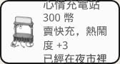
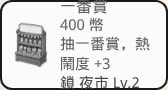

# QA：PR #9 夜市成長循環

HEAD 核對過：`origin/cursor/growth-loop-b73d` 是 `5f5c38ae92139bcd4ee5e48076353de6fbd7e470`。parent 鏈是 `5f5c38a` → `41addf6` → `803de41` → `09c88ad` → `main` `01be17530b71dfc86bd0c8add25df9520f0f978e`。`cf820c0` 之上的手機選單已經在這條鏈上。

## 結論：可合併

沒有阻擋項。試合併進 `origin/main` 沒有衝突。品質門檻通過。32-seed 的等級時間和 Gemu 的數字對得上。一番賞在遷移後的存檔裡抽得到、補得到、收得起來，新局在 Lv.4 之前蓋不了。

後續（不擋合併）放在文末。最大的手感問題是閒置收入 72 小時都貼在約 22,200／時，因為開場熱鬧度 22 低於來客地板。

## 合併與 commit

`git merge-base --is-ancestor` 確認 `01be175` 在 parent chain 上。`git merge-tree` 沒有衝突標記。另開 worktree 對 `origin/main` 做 `git merge --no-commit --no-ff`，自動合併成功。沒有留下 commit，也沒有推 `cursor/growth-loop-b73d`。

四個 commit 的作者和 committer 都是 Cursor Agent `<cursoragent@cursor.com>`。commit 本文和 PR 本文都沒有 `Co-authored-by`，也沒有 `noreply`。

## 品質門檻

在 `5f5c38a` 的 worktree 跑。qa-findings 用完就刪。

| 門檻 | 結果 |
|---|---|
| lint | 通過 |
| typecheck | 通過 |
| unit | 通過，24 files / 126 tests |
| build | 通過。e2e 的 webServer 以 `VITE_BASE=/line-dog-city/` 建置，`check-pwa` 過了 |
| e2e | 通過，11 tests。含成長畫面、手機、標題 |
| qa-findings | 13 條裡 6 通過、7 失敗。失敗仍是 v0.4 特徵，加上開場攤位現在是 2 個而不是舊的 5 個。`POSITIVE_INFINITY` 的離線 tick 仍是 0 |

## 存檔遷移

在 `01be175` 的規則裡打了一份中盤檔，再以同一個 JSON 進 PR #9。production build 也各走了一次：main 上 localStorage 載入後標題是「繼續營業」、一番賞面板是「這箱還有 80 抽」；PR #9 用 localStorage 和設定裡的匯入各載一次。

這份檔：年糕／麻糬、圖鑑 8/8、麻雀和刺蝟的信、刨冰／罐頭／算命／充電／一番賞都是 Lv.3、一番賞有付費箱 80 抽、許願池在 slot 11、長椅在 slot 3 和 slot 12、告示牌在 slot 9、花車在 slot 7 和 slot 14。錢 38,483，tick 8000。schema 是 3。

| 欄位 | 遷移後 |
|---|---|
| 名字、主角白狗、員工工作 | 年糕補貨、麻糬掃地，等級仍是 1 |
| 錢、tick | 38,483、8000，沒有改 |
| 格子 | 16 格的 uid、種類、類型、等級都沒動。充電站仍在 slot 8，沒有被開場佈局搬到 slot 2。罐頭仍在 slot 2 |
| 圖鑑造型 | 8 / 8，許願池解鎖文案還在 |
| 信 | 兩封都在。標題依新的物種名顯示「夜鴨子」，內文仍是夜麻雀那句 |
| 一番賞箱子 | 付費、80 抽、wholesale 被夾回 2,670 |
| 商品圖鑑 | 全是「還沒看過」。v3 沒有 `seenProducts`，遷移不依已有等級回填 |
| 動物圖鑑 | 開場四種加上信裡的夜鴨子、刺蝟。水獺、小貓熊、雲朵熊仍是？？？ |
| schema | 記憶體和匯入結果是 4。停在標題前、還沒寫檔時，localStorage 仍是 3；再載入會再遷移一次，錢和格子不會疊加 |
| 夜市等級 | **Lv.5，bustleXp 96,000**。見下面 |

預設 v3 開場（slot 0–8，含一番賞，沒有後面那些裝飾）遷移後是 **Lv.4、bustleXp 25,000**。推斷規則：攤位種類和「這個格子要幾級才開」取較高者，再把 XP 抬到該級門檻。slot 9 和 slot 14 在 v4 要 Lv.5，所以這份中盤檔直接滿級。物件沒有被搬，但成長曲線被跳過。單元測試本來就期望「街上有一番賞 → Lv.4」。

v0.4／schema 2：`parseSave` 拒絕，`loadGame` 是 null。畫面上匯入時出現「這是舊版的策略存檔，沒辦法匯入。現在這局夜市還在，沒有被換掉。」錢留在 38,483，沒有被 99,999 換掉。

截圖：`docs/qa/pr9/main-kai-1280.jpg`、`migrate-ichiban-1920.jpg`、`migrate-codex-1920.jpg`、`migrate-market-1920.jpg`、`import-1280.jpg`。

## 一番賞和 Lv.4

新局開場沒有一番賞。空著且已開放的 slot 4 蓋一番賞，被拒：「夜市 Lv.4 才蓋得了一番賞」。建造卡寫「鎖 夜市 Lv.4」。圖鑑 0/8，許願池另鎖「集滿 8 款造型」。

遷移後的 Lv.3 一番賞：`runTicks(2500)` 抽了 13 次，票 80 → 67，錢 +52,797。收箱退 465（剩餘票的 30%，不是整箱 2,670）。再跑 200 tick，免費補上一箱（`paid: false`）。箱子還開著時再買，原因是「現在已經有一箱」。面板上收箱、立刻開新箱都在，沒有缺按鈕。等級被抬到能覆蓋這個攤的級別，所以不是「人在 Lv.1、攤卻鎖死」。新玩家仍要自己升到 Lv.4。

## 平衡

獨立模擬，32 seeds，使用 PR 的 `streetTick`。三種政策：idle 不買；reasonable 每 120 tick 買最便宜的一項；active 每 30 tick 買最便宜的一項（對齊 Gemu 的 play）。時數四捨五入到 0.01 小時。Gemu 的腳本四捨五入到 0.1 小時，所以 0.22 小時會被他們寫成 12 分、0.43 小時寫成 24 分。

| 等級 | active | reasonable | idle | Gemu（active／idle） |
|---|---|---|---|---|
| Lv.2 | 0.22 時（約 13 分） | 0.24 時 | 0.43 時（約 26 分） | 12 分／24 分 |
| Lv.3 | 1.02 時 | 1.04 時 | 2.28 時 | 1.0 時／2.3 時 |
| Lv.4 | 2.51 時 | 2.54 時 | 6.32 時 | 2.5 時／6.3 時 |
| Lv.5 | 8.16 時 | 8.19 時 | 24.24 時 | 8.2 時／24.2 時 |

圖鑑集滿：active 2.71 時（32/32），reasonable 2.79 時（32/32）。idle 跑完 72 小時仍是 0/32，因為開場沒有一番賞，不買就抽不到造型。

買不起的最長空窗：active 中位數 **2.85 分**（Gemu 2.8 分）。reasonable 是 0，因為每兩分鐘才買一次，錢始終夠最便宜的那項。

第一小時每 10 分鐘的購買次數（中位數）：

| 政策 | 0–10 | 10–20 | 20–30 | 30–40 | 40–50 | 50–60 |
|---|---|---|---|---|---|---|
| active | 8 | 5 | 0 | 0 | 0 | 0 |
| reasonable | 5 | 5 | 3 | 0 | 0 | 0 |

開場能買的東西大約 20 分鐘內買完。Lv.3 約在第 1 小時才到，所以第一小時的後半沒有新單。

金幣（中位數，含開場 800）：

| 時 | idle | reasonable | active |
|---|---|---|---|
| 1 | 23,067 | 38,441 | 41,385 |
| 3 | 67,546 | 191,606 | 198,957 |
| 6 | 134,253 | 409,961 | 416,733 |
| 12 | 267,879 | 1,232,614 | 1,239,703 |
| 24 | 534,878 | 2,728,837 | 2,736,362 |
| 72 | 1,602,461 | 8,715,410 | 8,720,659 |

idle 每小時毛收入 12 小時都在 **22,181–22,319**，24→48 時和 48→72 時仍是約 22,250／時。Lv.5 在 24.24 時到達之後斜率沒有變。開場熱鬧度是 22（刨冰 3 + 充電 3 + 燈籠 10 + 長椅 6）。`ambienceTarget` 40、地板 0.6，22/40 = 0.55，被地板托在 0.6。等級把 `visitCap` 從 1.2 放到 1.9，但來客係數根本碰不到那個上限。

會買東西的兩條曲線會成長：第一小時約 4 萬，第三小時約 8 萬，第六小時以後約 10.9 萬，Lv.5 前後到約 12.5 萬／時。活躍和穩健差不多，因為瓶頸是熱鬧度累積，不是點購買的頻率。

## 閒置建議（只重跑建議，沒有改 PR）

建議：來客用的熱鬧度加上 `(marketLevel - 1) * 8`，**不要**加進 `bustleXp`，否則升級會一起變快。等級時間維持現在這組。

依這個係數，地板 0.6 會被逐級抬高：Lv.2 約 0.75、Lv.3 約 0.95、Lv.4 約 1.15、Lv.5 約 1.35。32-seed 的閒置重跑（錢依來客比例加，XP 不加）測到的每小時收入：

| 階段 | 現況 | 建議 |
|---|---|---|
| Lv.1 | 22,200 | 約 25,400（Lv.2 在 0.43 時，第一小時混到一點） |
| Lv.2 | 22,200 | 約 27,800 |
| Lv.3 | 22,200 | 約 33,100–35,200 |
| Lv.4 | 22,200 | 約 42,700 |
| Lv.5 | 22,200 | 公式約 50,000（22,200 × 1.35 / 0.6）。重跑的 30 小時在 24.24 時才到 Lv.5，小時樣本停在 Lv.4 |

24 小時餘額從 534,878 變成 959,830。滿級之後仍是平台，只是平台比較高，不會再變成另一條無限斜線。

## 漏洞

沒有找到正常遊玩能把錢或等級滾大的迴圈。

- 升級只加一級、扣該級費用，沒有退款。商品是疊加上架（Lv.3 刨冰同時有香草、草莓、巧克力、聖代），售價走商品表，不是等級再乘一次。
- 付費箱立刻收起會退剩餘成本的 30%。抽過 13 次後退 465，低於進貨 2,670。免費補箱 `paid` 是 false，收起不退錢。
- 同一份 v3 再標成 schema 3 匯入一次：等級、XP、錢都不變。
- 箱子被改成 wholesale 9,999,999、票面 1,000,000 時，遷移把單價夾回目錄（15 和 200），wholesale 夾回 2,670。單元測試蓋過。
- 打造的 v3 若自帶 `bustleXp: 500000`、街上只有刨冰：遷移當下仍是 Lv.1，但 XP 被留下。20 tick 後（一個時段）變成 Lv.5。一般存檔沒有這個欄位。攤位 `level: 99` 也不會被夾。
- 升級沒有發錢。離線的無限大時鐘會被修成有限值，tick 數是 0。許願一天一次的檢查還在。

## 試玩報告

新玩家，1920×1080 和 1280×720，`runTicks(900)` 約 15 分鐘遊戲時間。開場是 slot 1 刨冰、slot 2 充電站、slot 10 燈籠、slot 12 長椅。沒有破圖，`naturalWidth === 0` 的圖是 0。1280 的六個 app 按鈕約 61×73。

15 分鐘結束仍是 **夜市 Lv.1**，累積熱鬧度 **968 / 1700**，第 15 天・深夜，節日元宵。錢面在 React 畫上去之前讀到 800，接著把刨冰升到 Lv.2，扣 1,100 後剩下 5,295，所以升級前大約是 6,395，這 15 分鐘約進帳 5,600，合每小時 22,000 上下。升級後商品變成香草、草莓、巧克力，下一級預告聖代。圖鑑仍是 0/8。

卡關點：第一級要閒置約 26 分鐘。15 分鐘只看到條在漲，看不到升級橫幅。下一級文案寫「心情充電站」，但充電站開場就在 slot 2，建造卡同時寫「鎖 夜市 Lv.2」和「已經在夜市裡」。算命、一番賞、烤串、許願池都鎖着。圖鑑要等一番賞，活躍也要約 2.7 小時。

破圖：沒有。

無聊點：不買東西的時候收入是一條直線，等級上來也不加薪。第一小時買完開場能蓋的東西之後，大約 40 分鐘沒有新單可下。

升級手感：點攤位升一級、商品欄立刻多兩項，這一下是清楚的。等級橫幅在這 15 分鐘裡還沒出現，所以「夜市升級」本身還沒有獎賞感。活躍玩家約 13 分鐘會到 Lv.2，比這次純閒置的試玩早。

前五個修改：

1. 來客熱鬧度每級 +8，不要加進 XP。閒置才會從 22,200 漲到大約 27,800、35,200、42,700、50,000。
2. 已經在街上的充電站不要再寫「鎖 夜市 Lv.2」。Lv.2 的預告改成招牌和新格子。
3. 遷移保留格子，但不要把 `bustleXp` 灌到該級門檻。佔用 slot 9、14 的舊檔現在會直接 Lv.5 滿級。
4. 遷移時把攤位 Lv.1 已經在賣的商品記進商品圖鑑。
5. 打造用的 `bustleXp` 和 `level: 99` 在 v3 匯入時丟掉或夾回合法範圍。

截圖：`docs/qa/pr9/opening-1920.jpg`、`opening-1280.jpg`、`build-lock-1920.jpg`、`play-15m-1920.jpg`、`play-15m-1280.jpg`、`upgrade-1920.jpg`、`phone-1280.jpg`。

## 再檢：a133975

HEAD 核對過：`origin/cursor/growth-loop-b73d` 是 `a133975a8beaa6d3c056a39549f35fa3f900ba42`。parent 是上一輪的 `5f5c38a`。`git merge-tree` 沒有衝突標記。另開 worktree 對 `origin/main` `01be175` 做 `git merge --no-commit --no-ff`，自動合併成功，沒有留下 commit，也沒有推這條分支。

### 結論：可合併

Gemu 說已套上的四件事都對得上，數字也對得上。免費一番賞沒有把閒置收入拉回陡增。沒有新的阻擋項。

上一輪留下、這次沒改的仍是後續：佔用 slot 9、slot 14 的舊檔遷移後還是 Lv.5、bustleXp 96,000。打造用的 `seenProducts`、`bustleXp`、`level` 仍不會被夾掉。

### 品質門檻

在 `a133975` 的 worktree 跑。模擬用的計數探針在建置和 e2e 之前已還原，工作樹沒有留下改動。

| 門檻 | 結果 |
|---|---|
| lint | 通過 |
| typecheck | 通過 |
| unit | 通過，24 files / 129 tests |
| build | 通過。`VITE_BASE=/line-dog-city/`，`check-pwa` 過了，precache 109 |
| e2e | 通過，11 tests |

### 平衡

獨立模擬，32 seeds，`streetTick`。idle 不買，跑 72 小時。reasonable 每 120 tick、active 每 30 tick，都買最便宜的一項（含訓練；雇用要多留 400）。另跑一條每 30 tick、雇用不留緩衝的對照，前兩小時的購買次數和 active 相同。時數四捨五入到 0.1 小時。

閒置每級的每小時淨收入（中位數）。上一輪整段都貼在約 22,200。

| 等級 | 這一輪 idle／時 | 上一輪 |
|---|---|---|
| Lv.1 | 22,330 | 約 22,200 |
| Lv.2 | 27,239 | 約 22,200 |
| Lv.3 | 34,373 | 約 22,200 |
| Lv.4 | 41,598 | 約 22,200 |
| Lv.5 | 48,765 | 約 22,200 |

Lv.1 和 Lv.5 就是 Gemu 的 22.3k 到 48.8k。48→72 時的斜率是 48,779，停在 Lv.5 的平台，沒有再往上翹。72 小時閒置餘額中位數 3,301,886（上一輪 1,602,461）。

等級時間：

| 等級 | active | reasonable | idle |
|---|---|---|---|
| Lv.2 | 0.2 時 | 0.2 時 | 0.4 時 |
| Lv.3 | 1.0 時 | 1.0 時 | 2.1 時 |
| Lv.4 | 2.4 時 | 2.4 時 | 5.6 時 |
| Lv.5 | 8.1 時 | 8.1 時 | 21.4 時 |

上一輪 active／idle 是 0.22／0.43、1.02／2.28、2.51／6.32、8.16／24.24。Lv.2 的 XP 從 1,700 改成 1,500，所以略早。

圖鑑集滿：active 2.5 時（32/32），reasonable 2.5 時（32/32），idle 4.0 時（32/32）。對上 Gemu 的 active 2.5 時、idle 4.0 時。上一輪 idle 跑完 72 小時仍是 0/32，因為那時不買就沒有一番賞。

前 2 小時、每 10 分鐘的購買次數（active 中位數）：**8, 2, 1, 1, 1, 1, 4, 1, 2, 1, 2, 1**。和 Gemu 的序列一致。

一番賞佔毛收入（售價淨額加重複獎，扣掉購買支出前）：idle 2.3%（約 77,540 / 3,301,086），active 21.3%（約 300,022 / 1,410,157）。32 個 seed 結束時都只有一座一番賞。active 第 12 小時餘額 1,212,877，該小時約 135,000，上一輪活躍後期約 125,000／時。早開的免費箱把圖鑑補完，沒有把收入曲線重新拉成陡增。

### 存檔

同一份 `01be175` 中盤檔（schema 3，年糕／麻糬，錢 38,483，tick 8000）。`parseSave`、localStorage 載入、設定裡的匯入，三條結果一致。localStorage 和匯入都先把 `savedAt` 設成現在，避免離線補 tick。標題是「繼續營業」。寫回後 schema 是 4。

16 格的 uid、種類、類型、等級都沒有差。信仍是 sparrow、hedgehog；畫面上是「夜鴨子」和「刺蝟」，內文沒換。造型 8 / 8，許願池已解鎖。錢仍是 38,483。一番賞仍是一座，箱子仍是付費。

商品圖鑑回填 16 項，和攤位等級對得上：刨冰 Lv.3 四項、罐頭 Lv.3 四項、算命 Lv.3 三項、充電 Lv.3 三項、一番賞的一抽、許願池 Lv.1 的小願。星願、流星大願和三款烤串是「？？？」。沒有把沒擺過的攤位標成看過。

遷移後仍是 **Lv.5，bustleXp 96,000**。slot 9 和 slot 14 還是用「格子要幾級才開」把等級抬滿。同一份已遷移的存檔再標成 schema 3 匯入一次，錢、XP、商品數都不增加。

### 漏洞

沒有找到正常遊玩能重複領免費攤或用收箱印錢的路。

- 升到 Lv.2 時免費放一座一番賞（這次在 slot 0，不是 slot 4），錢沒有扣 400。之後再跑 4,000 tick 仍是一座。把 XP 灌到 500,000 升上 Lv.5，再跑幾個時段，還是一座。
- 已有攤位的存檔，不論標成 schema 4 或改回 schema 3 再匯入，都不會多一座。
- 免費箱 `paid: false`，收起退 0。收起後約一個補貨週期會再開一箱，仍是免費，這是原有的補貨，不是退款迴圈。整箱付費、一張都沒抽就收起，退 801，是 2,670 的 30%。
- 來客加分是 `(level - 1) * 9`：Lv.1 為 0，Lv.5 為 36。開場熱鬧度 22，來客用 58。`accrueBustle` 這一拍只加 22，沒有把 9 算進 bustleXp，也不會逐 tick 疊加。
- 回填只收「這個攤、這個等級賣得了」的商品。刨冰改成 Lv.1 再遷移，商品只剩香草。一般中盤檔沒有多標。
- 打造的洞還在，不擋合併：v3 的 `seenProducts` 會和回填取聯集，手寫 `skewer-meteor` 或目錄裡沒有的 id 會留著。把一番賞格子從 JSON 拿掉再以 schema 3 匯入，下一個時段會再免費放回一座，不退錢、也不會同時有兩座。

### 畫面

新局建造條，1280×720，reduced motion。

充電站卡沒有鎖，文案是「心情充電站 300 幣 賣快充，熱鬧度 +3 已經在夜市裡」。

一番賞卡文案是「一番賞 400 幣 抽一番賞，熱鬧度 +3 鎖 夜市 Lv.2」。

### commit

`a133975` 的作者和 committer 都是 Cursor Agent `<cursoragent@cursor.com>`。這個 commit、`origin/main..HEAD` 的五個 commit、以及 PR 本文都沒有 `Co-authored-by`，也沒有 `noreply`。PR 仍是 draft。
