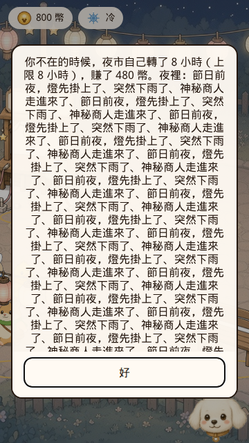
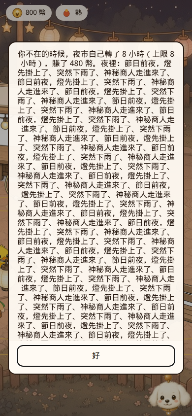
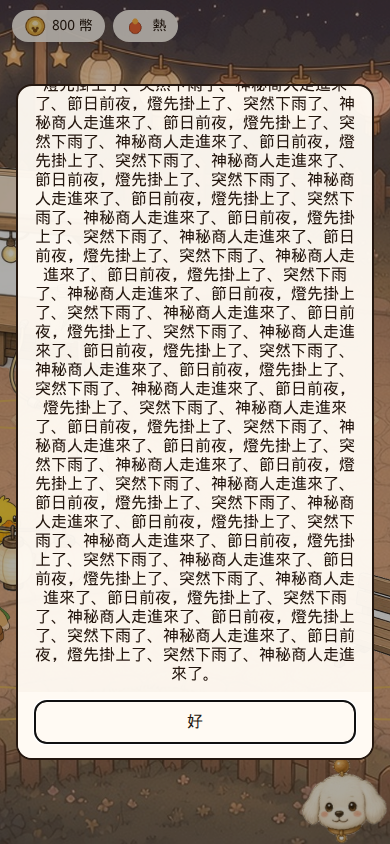
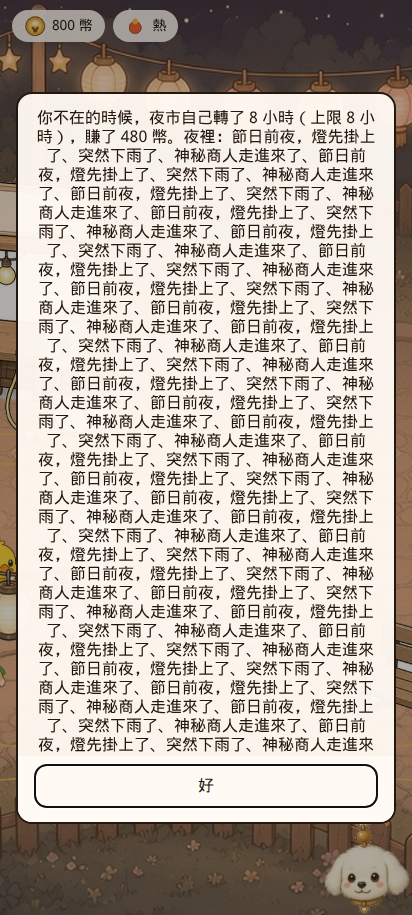
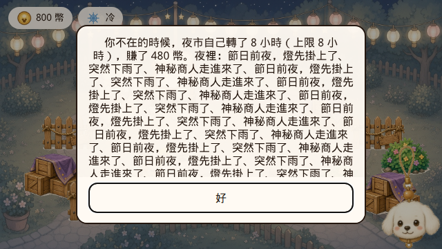
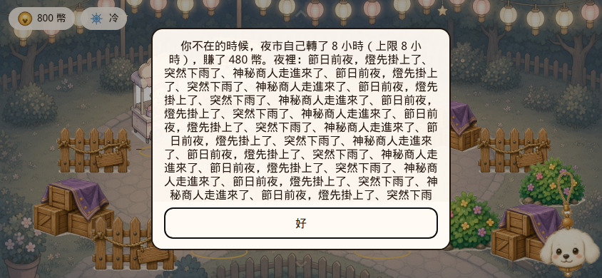
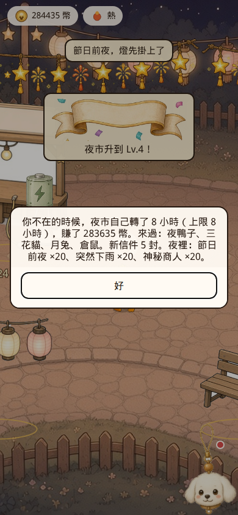
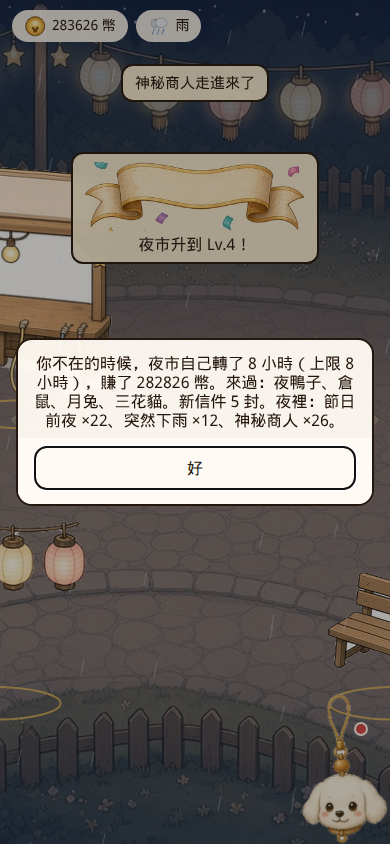

# PR #16 QA — 離線摘要計數與可關閉視窗

- PR: https://github.com/vup830707/line-dog-city/pull/16
- 分支: `cursor/offline-summary-modal-f574`
- HEAD: `1039a1cd24323db0875a012d50298aed7573c24c`（與預期 `1039a1c` 相同）
- 基底: `origin/main` `1d30f7192e1b0b98526221b48121279283a68f82`
- 標題: fix: 離線摘要按事件計數，回來視窗不再把人關住
- 判定: **可合併**
- 日期: 2026-10-21
- 沒有改產品程式、沒有 merge、沒有 force push、沒有加 workflow、沒有推 `cursor/offline-summary-modal-f574`

一個 commit。`git log --format=%B origin/main..HEAD` 與 PR 正文都沒有 `Co-authored-by`，也沒有 `noreply`。作者欄位是 `Cursor Agent <cursoragent@cursor.com>`，不是 trailer。

Diff 五個檔案，+278/−19：`e2e/offline-summary.spec.ts`、`src/rules/offline.test.ts`、`src/rules/offline.ts`、`src/styles.css`、`src/ui/StreetScreen.tsx`。

## 判定

8 小時離線後那張把約 60 筆夜晚事件逐條接起來的卡片，在五個 viewport 都收在畫面裡。「好」不用捲整頁就看得到、點得到，內文自己捲。點卡片裡面不會關；點背景、「好」、Esc 都會關，而且寫進 `localStorage`。關掉之後重載不會再打開。把時鐘倒回 8 小時再重載，視窗會再出現，文字是計數，不是舊的長串。

舊格式存檔（schema 5、滿的 `eventLog`、legacy `seq: 0`、不認得的 kind、`savedAt` 約 8 小時前）載入沒有 page error。畫面上的 ×N 和載入後紀錄裡 `seq > 78` 的筆數一致。

lint、typecheck、unit 177、build、e2e 21 都過。新的 e2e 在 main `1d30f71` 上失敗，卡片 `y = -363.5`。模擬的街道狀態 hash 和 main 相同；`offlineNote` 文字不同，這就是這次的修改。

下面那條「8 小時實際發生 148 筆、摘要只計最後 60 筆」是原本 `eventLog.slice(-60)` 就有的上限，舊版也只會列出還留在紀錄裡的標題。不擋這次合併，寫在待確認。

## 畫面

長摘要是種進去的 60 次「節日前夜，燈先掛上了、突然下雨了、神秘商人走進來了」，`savedAt` 設成現在，所以 boot 的 `ticks === 0`，畫面沿用這段舊文字，用來量溢出。Playwright Chromium，`deviceScaleFactor` 1。`html` 的 `scrollY` 都是 0，`scrollHeight === clientHeight`。內文 `.offline-body` 的 `scrollTop` 都能從 0 捲到大於 0，「好」的 y 不變。`elementFromPoint` 打在按鈕中心，命中 `offline-close`。按鈕至少 44×44。

| viewport | 卡片 y / 高 / 底 | 80vh | 「好」y / 高 | 內文 scrollHeight / clientHeight | 在畫面內 | 可點 |
| --- | --- | --- | --- | --- | --- | --- |
| 360×640 | 64 / 512 / 576 | 512 | 516 / 44 | 1770 / 442 | 是 | 是 |
| 390×844 | 84.4 / 675.2 / 759.6 | 675.2 | 699.6 / 44 | 1561 / 605 | 是 | 是 |
| 412×915 | 91.5 / 732 / 823.5 | 732 | 763.5 / 44 | 1485 / 662 | 是 | 是 |
| 640×360 | 36 / 288 / 324 | 288 | 264 / 44 | 1295 / 218 | 是 | 是 |
| 844×390 | 39 / 312 / 351 | 312 | 291 / 44 | 1295 / 242 | 是 | 是 |

`.offline-footer` 的 computed `position` 是 `sticky`。它是捲動區的兄弟節點，不是捲動區裡的子節點，所以按鈕留在卡片底部是 flex 排版的結果；內文捲動時 y 沒有變。













## 關閉

390×844，同一段長摘要。

| 動作 | 視窗 | `street.offlineNote` |
| --- | --- | --- |
| 點卡片內文 `<p>` | 還在 | 仍是長摘要 |
| 點 (8, 8)，`elementFromPoint` 是 `offline-backdrop`，卡片 y 大於 8 | 關掉 | `null` |
| Esc | 關掉 | `null` |
| 「好」 | 關掉 | `null` |
| 「好」之後重載，再按繼續營業 | `offline-note` 數量 0 | `null` |
| `rewindClock(8h)` 之後重載 | 再出現 | 新的計數句，沒有舊的長串 |

新的 8 小時摘要是：`夜裡：節日前夜 ×20、突然下雨 ×20、神秘商人 ×20。` 前面還有「8 小時」「283635 幣」「來過：夜鴨子、三花貓、月兔、倉鼠」「新信件 5 封」。




`dismissOffline` 把 `offlineNote` 設成 `null` 再交給 `onChange`。`App.commit` 會 `storeGame`，並再寫一次 `savedAt: Date.now()`。重載時 `applyOffline` 的 ticks 是 0，`loadInitial` 保留存檔，所以視窗不會回來。

## 舊存檔和計數

存檔由 `createNewGame({ seed: 7, now: 1 })` 做出來，改成 schema 5，再放進紀錄。原始 65 筆：

- 5 筆非法：`null`、字串、`kind: "comet"`、雨缺 `title`、商人缺 `body`
- 60 筆合法：節日前夜 16、雨 32、商人 12。其中 18 筆 `seq: 0`（節日前夜 4、雨 8、商人 6）
- `eventSeq` 先寫 40
- `offlineNote` 先放舊的 60 次長串
- 瀏覽器載入前把 `savedAt` 設成 `Date.now() - 8h`

`parseSave` 丟掉 5 筆非法，留下 60 筆。legacy 的 `seq: 0` 被編成 61–78，`eventSeq` 變成 `max(40, 78) = 78`。沒有 throw，title 是「繼續營業」，console / pageerror 是空的。

8 小時是 28800 ticks。載入後存檔裡的摘要和 node 的 `parseSave` + `applyOffline` 完全同一句：

`你不在的時候，夜市自己轉了 8 小時（上限 8 小時），賺了 282826 幣。來過：夜鴨子、倉鼠、月兔、三花貓。新信件 5 封。夜裡：節日前夜 ×22、突然下雨 ×12、神秘商人 ×26。`

畫面上的文字就是這句加上「好」。沒有「節日前夜，燈先掛上了、突然下雨了」那種逐條串接。

對照的是載入後 `eventLog` 裡 `seq > 78` 的筆記，不是載入前那 60 筆歷史。歷史 60 筆的 seq 都 ≤ 78，這次回來沒有重數。新筆記 148 筆（`eventSeq` 78 → 226）。`slice(-60)` 之後留下 60 筆，種類是節日前夜 22、雨 12、商人 26，和 ×N 一致。

若在 `slice` 之前把每一筆新筆記的 kind 都記下來，8 小時實際是 148 筆：節日前夜 51、雨 47、商人 50。摘要沒有這組數字。舊版 `applyOffline` 也是 `next.eventLog.filter(item => item.seq > seqBefore)`，只是把 `title` 接成一行，所以同樣只會看到最後 60 筆。這次改的是同一組筆記的寫法。

schema 4 走 `parseSave` 不會丟例外，但 `withGrowth` 只在 schema 5 保留事件紀錄，schema 4 的 `eventLog` 會被清成 0。同一條街道跑 8 小時，尾端 60 筆和上面那句相同，因為 RNG 沒有讀紀錄。



## 用字

`offlineSummary` 直接餵事件，不經過存檔：

| 輸入 | 夜裡那一句 |
| --- | --- |
| 節日前夜 ×3 | `夜裡：節日前夜 ×3。` |
| 雨 ×2 | `夜裡：突然下雨 ×2。` |
| 商人 ×4 | `夜裡：神秘商人 ×4。` |
| 商人、雨、節日前夜、商人 | `夜裡：節日前夜 ×1、突然下雨 ×1、神秘商人 ×2。` |
| 節日前夜、`comet`、雨、`comet` | `夜裡：節日前夜 ×1、突然下雨 ×1。` |
| 只有 `comet` | 沒有「夜裡」 |
| 空的 | 沒有「夜裡」 |

順序固定是節日前夜、突然下雨、神秘商人。數量 0 的種類不寫。不認得的 kind 略過，沒有「其他」或原樣 kind 名稱。`parseSave` 的 `EVENT_KINDS` 也會先把不認得的 kind 丟掉，所以正常載入不會把 `comet` 送進 `nightLine`。

## 模擬

4 個 seed，各 2 小時（7200 ticks）。idle 是 `runTicks`。active 每 30 tick 把買得起、最便宜的建造項放到第一個空格。hash 含 money、rngState、tick、marketLevel、bustleXp、eventSeq、phase、day、紀錄長度，不含 `offlineNote`。

PR #16 和 main `1d30f71` 都是 `8873289bcb247f2fc368a862a2d2147faa45e25fbee40baa61e7d6a0ef4ae79c`。

seed 1 idle：錢 53,785、rngState 4202808964、tick 7200、Lv.2、bustleXp 8,936、eventSeq 34。兩邊相同。2 小時離線的錢、ticks、eventSeq 也相同。含 `offlineNote` 的 hash 不同：main 仍是「突然下雨了、節日前夜，燈先掛上了…」逐條接起來，PR 是 `夜裡：節日前夜 ×8、突然下雨 ×12、神秘商人 ×7。`

`src/rules/street.ts` 不在這次 diff 裡。

## 新 e2e 在 main 上

把 `e2e/offline-summary.spec.ts` 複製到 main `1d30f71` 跑這一個測試（跑完刪掉，沒有 commit）。失敗：

```
Error: expect(received).toBeGreaterThanOrEqual(expected)
Expected: >= 0
Received:    -363.5
  at e2e/offline-summary.spec.ts:45
```

1 failed。和 PR 正文寫的 `y = -363.5` 相同。main 的摘要仍是一顆沒有 max-height、沒有「好」、沒有 backdrop 的 `<p data-testid="offline-note">`。

同一支測試在 `1039a1c` 的完整 e2e 裡通過（21 裡的 `offline-summary.spec.ts`，7.2s）。

這支 e2e 只蓋 390×844，而且種的是已經寫好的長 `offlineNote`（`savedAt` 是現在，不會重算）。另外四個 viewport、卡片內點擊、以及真正的 `applyOffline` 計數，是上面的 Playwright 和 node 跑的，不在這支 e2e 裡。

## 閘門（`1039a1c`）

| 門檻 | 結果 |
| --- | --- |
| lint | 通過 |
| typecheck | 通過 |
| unit | 29 files，177 passed |
| build | e2e 的 webServer 跑 `VITE_BASE=/line-dog-city/ npm run build`，測試能開，PWA check 過了。precache 191 筆。`dist/assets` 的 JS 比 main 多 1124 bytes（354277 vs 353153） |
| e2e | 21 passed（1.4m） |
| 模擬 | 狀態 hash 與 main `1d30f71` 相同；摘要文字不同，見上 |

## 待 Kai 確認

8 小時離線實際產生 148 筆夜晚事件，摘要只計紀錄裡留下的 60 筆。若希望 ×N 是「不在的這段時間全部發生過的次數」，要在 `slice(-60)` 之前自己累加，不能等紀錄裁完再數。目前和舊版看到的是同一組筆記。

不認得的事件種類會被丟掉，句子裡沒有位置。若要留「其他 ×N」，現在沒有。
